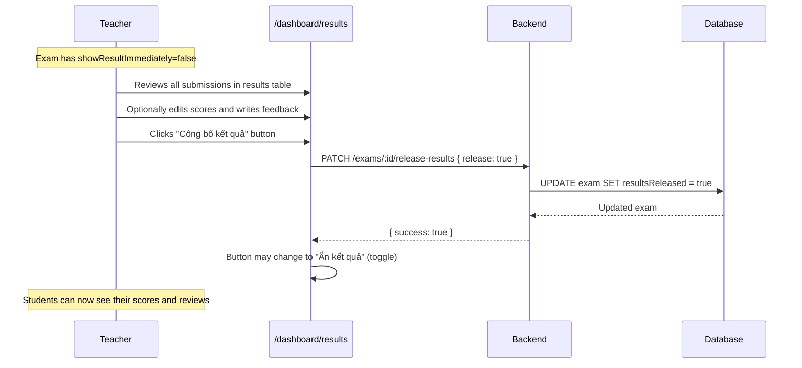
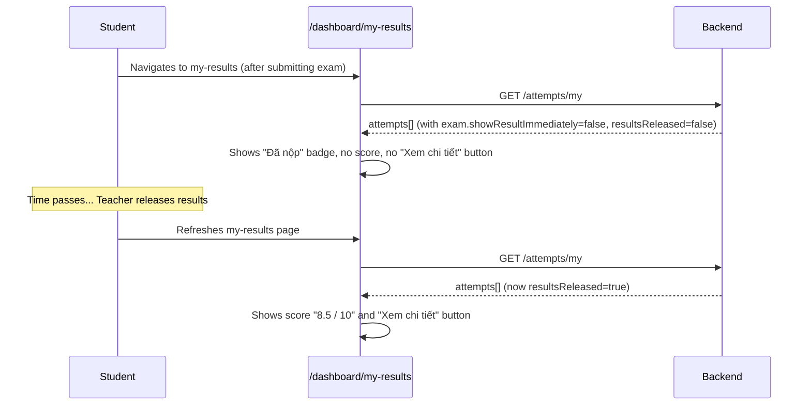
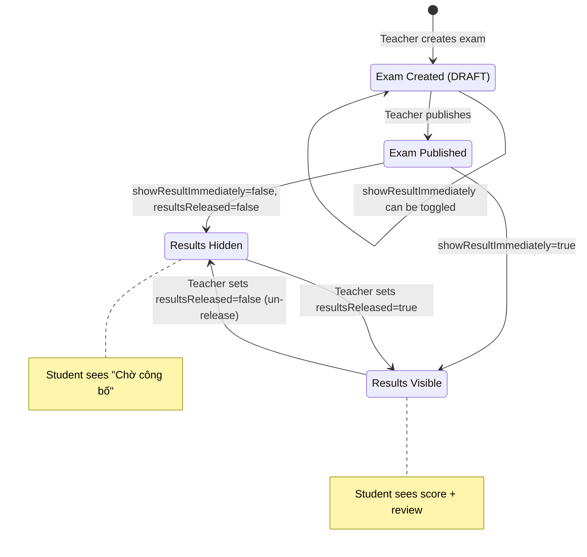

# G5. Result Visibility & Release Control

## 5.1 Feature Overview

| Field | Value |
|---|---|
| Feature ID | G5 |
| Feature Name | Result Visibility & Release Control |
| Module | G. Grading & Results |
| Priority | P1 |
| Complexity | S |
| Status | Existing — both flags implemented in schema and API. Frontend respects visibility rules. Teacher release button implemented. |
| Target Roles | Teacher (controls visibility), Student (subject to visibility) |
| Business Objective | Give teachers control over when students can see their exam scores and detailed answers, enabling pedagogical strategies like deferred feedback and class-wide result publication. |
| User Problem | Teachers may want to review all submissions, adjust scores, or prepare feedback before students see their grades. Immediate result display can also enable cheating if students share answers with classmates who haven't taken the exam yet. |
| Dependencies | G1 (Auto-Grading), G3 (Exam Results), D2 (Exam Configuration) |

## 5.2 Actors and Permissions

### Teacher

| Action | Rule |
|---|---|
| Set `showResultImmediately` at exam creation | Allowed — part of exam configuration |
| Change `showResultImmediately` after publish | **Forbidden** — PUBLISHED exams are immutable |
| Toggle `resultsReleased` | Allowed — PATCH /exams/:id/release-results |
| View all results regardless of visibility setting | Always allowed |

### Student

| Action | Rule |
|---|---|
| View own score | Allowed when `showResultImmediately OR resultsReleased` |
| View answer review | Allowed when `showResultImmediately OR resultsReleased` |
| View teacher feedback | Allowed when `showResultImmediately OR resultsReleased` |
| Request result release | **Not supported** — no mechanism for students to request |

### Backend Authorization

- Visibility is enforced at the API level on:
  - `GET /attempts/my`: Score is included in the response but frontend decides display. **Architectural note**: The score IS present in the API response — visibility is a UI-level concern for the list endpoint.
  - `GET /attempts/:id/review`: Backend enforces visibility. If neither flag is true, student receives 403.

## 5.3 Preconditions and Business Rules

### Two Independent Flags

| Flag | Set At | Mutable After Publish | Default | Scope |
|---|---|---|---|---|
| `showResultImmediately` | Exam creation/edit (DRAFT only) | No | `true` | Per-exam. Applies to all students taking this exam. |
| `resultsReleased` | Any time by teacher | Yes | `false` | Per-exam. Toggleable on/off by teacher. |

### Visibility Logic

```
canSeeResults = exam.showResultImmediately OR exam.resultsReleased
```

| showResultImmediately | resultsReleased | Student Can See Results |
|---|---|---|
| true | false | **Yes** — immediately after submit |
| true | true | **Yes** |
| false | false | **No** — "Chờ giáo viên công bố" |
| false | true | **Yes** — teacher released |

### Business Rules

| Rule | Description |
|---|---|
| Immediate mode | If `showResultImmediately = true`, students see score and review right after submitting. This is the default behavior. |
| Deferred mode | If `showResultImmediately = false`, students see only status "Đã nộp" until teacher sets `resultsReleased = true`. |
| Release is global | `resultsReleased` applies to ALL attempts for this exam, not individual students. |
| Release is reversible | Teacher can set `resultsReleased` back to `false` (un-release). Students lose access to review on their next page load. Previously viewed scores cannot be "unseen." |
| Visibility does not affect grading | Grading runs regardless of visibility. Scores are always computed and stored. Visibility only controls what students can see. |
| Teacher always sees everything | Visibility flags do not restrict teacher access. |

## 5.4 Main User Flow — Happy Path

### Teacher Releases Results



### Student Experiences Deferred Results



## 5.5 Alternative Flows

### AF-1: Teacher Uses Immediate Mode (Default)

1. Teacher creates exam with default `showResultImmediately = true`.
2. Students see scores immediately after submitting.
3. Teacher never needs to "release" results.
4. `resultsReleased` stays `false` (irrelevant in this mode).

### AF-2: Teacher Un-Releases Results

1. Teacher released results (`resultsReleased = true`).
2. Teacher realizes a grading error and wants to hide results while fixing.
3. Teacher calls PATCH with `{ release: false }`.
4. Students on their next page load see "Chờ giáo viên công bố" again.
5. Students who already viewed scores have the information but can no longer access the review.

### AF-3: Teacher Changes showResultImmediately Before Publish

1. Teacher creates exam with `showResultImmediately = true` (default).
2. Teacher decides to defer results — changes to `false` while exam is DRAFT.
3. Teacher publishes. Setting is locked.
4. After students submit, results are hidden until teacher releases.

### AF-4: Teacher Publishes Results with Notification (Proposed)

1. Teacher clicks "Công bố kết quả."
2. System creates a notification for each student with a submitted attempt: "Kết quả bài {examTitle} đã được công bố."
3. Students see notification bell badge.
4. **Status**: Notification creation is not wired to the release endpoint. See Open Questions.

## 5.6 Edge Cases and Failure Scenarios

| Scenario ID | Scenario | Trigger | Expected Behavior | User Feedback | Data Integrity | Recovery | Severity |
|---|---|---|---|---|---|---|---|
| G5-EC-01 | Student submits and immediately checks results (deferred mode) | showResultImmediately=false, resultsReleased=false | Post-submit screen shows "Bài đã nộp. Chờ giáo viên công bố kết quả." No score. | Clear message | Score is stored but hidden | Wait for release | Medium |
| G5-EC-02 | Student accesses review API directly | Student crafts GET /attempts/:id/review request directly | Backend returns 403 "Results not available" | 403 response | No data leaked | N/A | High |
| G5-EC-03 | Score present in /attempts/my response | Student inspects network response | Score field IS in the response (implementation detail). Frontend chooses not to display it. | **Potential data leak**: a tech-savvy student could read the raw API response. | Score visible at API level | See Open Questions — backend should omit score when not visible. | High |
| G5-EC-04 | Teacher releases then immediately un-releases | Quick toggle | resultsReleased flips. Students who loaded between toggle states saw results briefly. | Momentary visibility | Flag state is consistent | Acceptable race condition | Low |
| G5-EC-05 | Release with no submissions | No students have submitted | Release succeeds (flag set to true). No visible effect. | No error | Flag updated | N/A | Low |
| G5-EC-06 | New submission after release | Student submits AFTER resultsReleased=true | Student sees results immediately (both flags allow). | Normal behavior | Consistent | N/A | Low |
| G5-EC-07 | Student polling for results | Student refreshes my-results repeatedly waiting for release | Each refresh shows the current state. No caching issue. | Consistent display | N/A | N/A | Low |
| G5-EC-08 | Multiple exams with different visibility | Student has attempts on Exam A (immediate) and Exam B (deferred) | Exam A shows score, Exam B shows "Chờ giáo viên" | Per-exam visibility | Correct per-exam logic | N/A | Low |

## 5.7 UI/UX Specification

### Exam Configuration (DRAFT State)

**Location**: CreateExamDialog / Edit Exam form.

**Field**: Checkbox or toggle: "Hiện kết quả ngay sau khi nộp bài" (Show results immediately after submission).
- Default: checked (true).
- When unchecked: Add helper text "Học sinh sẽ chỉ thấy kết quả khi bạn công bố."

### Release Button (Teacher Results Page)

**Location**: `/dashboard/results`, top-right, next to exam selector.

**Button**: "Công bố kết quả" (outline variant).
- Only shown when an exam is selected.
- After releasing, button could toggle to "Ẩn kết quả" — **currently not implemented**, button always shows "Công bố kết quả" and clicking it again is a no-op (sets true again).

**Proposed improvement**: Toggle button that shows current state:
- Not released: "Công bố kết quả" (outline).
- Released: "Đã công bố ✓" (default variant, or "Ẩn kết quả" as secondary action).

### Student Results Card (My Results Page)

**When results ARE visible**:
```
┌────────────────────────────────────────┐
│ Kiểm tra giữa kỳ Toán 12    [Đã nộp] │
│ 📊 8.5 / 10    🕐 10/11/2026 14:30   │
│                        [Xem chi tiết]  │
│ Nhận xét: Làm tốt lắm!               │
└────────────────────────────────────────┘
```

**When results are NOT visible**:
```
┌────────────────────────────────────────┐
│ Kiểm tra giữa kỳ Toán 12    [Đã nộp] │
│ 🕐 10/11/2026 14:30                   │
│ (No score, no "Xem chi tiết" button)  │
└────────────────────────────────────────┘
```

### Post-Submit Screen (Take Exam Page)

**When showResultImmediately = true**:
```
✅ Đã nộp bài!
Điểm: 8.5 / 10
Xem kết quả chi tiết trong mục Kết quả.
[Quay lại danh sách]
```

**When showResultImmediately = false**:
```
✅ Đã nộp bài!
Giáo viên sẽ công bố kết quả sau.
[Quay lại danh sách]
```

## 5.8 Data Requirements

### Existing Schema (Sufficient)

**Exam**:
```
showResultImmediately  Boolean  @default(true)
resultsReleased        Boolean  @default(false)
```

Both fields exist and are functional. No schema changes needed.

### No Per-Student Visibility

Visibility is per-exam, not per-student. All students with attempts see (or don't see) results simultaneously. Per-student visibility (e.g., release results only for students who scored above a threshold) is out of scope.

## 5.9 API Requirements

### PATCH /exams/:id/release-results

| Field | Value |
|---|---|
| Method | PATCH |
| Endpoint | `/api/exams/:id/release-results` |
| Purpose | Toggle result visibility for all students taking this exam |
| Required Role | TEACHER |
| Authorization | `exam.ownerId === currentUser.id` |
| Request Body | `{ "release": true }` or `{ "release": false }` |
| Validation | `release`: required, boolean |
| Success Response (200) | `{ "success": true, "data": { "id": "...", "resultsReleased": true } }` |
| Error: Not owner (403) | Standard 403 |
| Error: Exam not found (404) | Standard 404 |
| Idempotency | Yes — setting `release: true` when already `true` is a no-op |

### GET /attempts/my (Visibility-Aware)

The response includes exam visibility flags. Frontend logic:
```typescript
const canSeeResults = attempt.exam.showResultImmediately || attempt.exam.resultsReleased;
```

**Concern**: The score field is always included in the response data, even when visibility is false. A student inspecting the network response can read it. See Open Questions.

### GET /attempts/:id/review (Visibility-Enforced)

Backend enforces visibility for students:
```
if (currentUser.role === 'STUDENT') {
  if (!exam.showResultImmediately && !exam.resultsReleased) {
    throw ForbiddenException("Results not available");
  }
}
```

This is the only endpoint that enforces visibility at the backend level.

## 5.10 State Management



**Key states**:
- **Always visible**: `showResultImmediately = true` — results visible from the moment of submission.
- **Hidden until release**: `showResultImmediately = false, resultsReleased = false`.
- **Released**: `resultsReleased = true` — teacher explicitly made results available.

## 5.11 Acceptance Criteria

### Positive

```
Given an exam with showResultImmediately = true,
When a student submits the attempt,
Then the post-submit screen shows the score.
```

```
Given an exam with showResultImmediately = false and resultsReleased = false,
When a student views their results,
Then the score is hidden and "Xem chi tiết" button is absent.
```

```
Given an exam with showResultImmediately = false,
When the teacher sets resultsReleased = true,
Then all students with attempts can now see their scores and access the review.
```

```
Given an exam with resultsReleased = true,
When the teacher sets release = false,
Then students on their next page load cannot see scores or reviews.
```

```
Given a teacher views the results table,
When the exam has showResultImmediately = false and resultsReleased = false,
Then the teacher still sees all scores and can access reviews.
```

### Negative

```
Given an exam with showResultImmediately = false and resultsReleased = false,
When a student calls GET /attempts/:id/review directly,
Then the backend returns 403.
```

```
Given a PUBLISHED exam,
When the teacher tries to change showResultImmediately,
Then the backend rejects the modification (PUBLISHED exams are immutable).
```

## 5.12 QA Test Scenarios

| Test Case ID | Scenario | Preconditions | Test Steps | Test Data | Expected Result | Priority |
|---|---|---|---|---|---|---|
| G5-TC-01 | Immediate results shown | showResultImmediately=true | Student submits and views results | — | Score visible on post-submit and my-results | P0 |
| G5-TC-02 | Deferred results hidden | showResultImmediately=false, resultsReleased=false | Student submits and views results | — | No score, no review access | P0 |
| G5-TC-03 | Teacher releases results | showResultImmediately=false | Teacher PATCHes release=true, student refreshes | release: true | Score now visible to student | P1 |
| G5-TC-04 | Teacher un-releases | resultsReleased=true | Teacher PATCHes release=false, student refreshes | release: false | Score hidden again | P1 |
| G5-TC-05 | Teacher always sees results | showResultImmediately=false, resultsReleased=false | Teacher opens results page | — | All scores visible to teacher | P0 |
| G5-TC-06 | Review blocked for student | showResultImmediately=false, resultsReleased=false | Student calls GET /attempts/:id/review | — | 403 Forbidden | P0 |
| G5-TC-07 | Review allowed after release | resultsReleased=true | Student calls GET /attempts/:id/review | — | 200 with full review | P1 |
| G5-TC-08 | Post-submit screen deferred | showResultImmediately=false | Student submits exam | — | "Giáo viên sẽ công bố kết quả sau." | P1 |
| G5-TC-09 | showResultImmediately immutable | PUBLISHED exam | Teacher tries to PATCH showResultImmediately | — | 400 or field ignored | P1 |
| G5-TC-10 | Multiple exams different visibility | Exam A: immediate, Exam B: deferred | Student views my-results | — | Exam A shows score, Exam B hidden | P1 |
| G5-TC-11 | Score in API response (deferred) | showResultImmediately=false | Student inspects GET /attempts/my response | — | See Open Question G5-OQ-01 | P1 |
| G5-TC-12 | Release with no attempts | No students submitted | Teacher PATCHes release=true | — | Success, no visible effect | P2 |

## 5.13 Open Questions and Assumptions

| # | Question | Why It Matters | Options | Recommended Default | Impact |
|---|---|---|---|---|---|
| 1 | Should the backend omit the `score` field from GET /attempts/my when results are not visible? | Currently, score is in the API response. A tech-savvy student can see it via browser dev tools, even when the UI hides it. | (a) Always include score (current — frontend hides it). (b) Backend omits score when `!canSeeResults`. (c) Return score as null when hidden. | (b) or (c) — backend should not expose hidden scores. This is a security/integrity concern for exam fairness. | High |
| 2 | Should result release trigger notifications? | Students may not know to check their results. | (a) No notification (current). (b) Notify all students with attempts: "Kết quả bài {exam} đã được công bố." | (b) — integrate with NotificationsService. | Medium |
| 3 | Should the release button be a toggle in the UI? | Currently, "Công bố kết quả" is a one-way action. Un-releasing requires API knowledge. | (a) One-way release (current). (b) Toggle: "Công bố" / "Ẩn kết quả". | (b) — toggle gives teachers full control. | Low |
| 4 | Should per-student release be supported? | Some teachers may want to release results for individual students (e.g., early finishers). | (a) Per-exam only (current). (b) Per-student release flag on ExamAttempt. | (a) — per-exam is simpler and covers the common case. | Low |
| 5 | Should there be a scheduled release? | Teacher may want results to appear at a specific future time. | (a) Manual release only (current). (b) Add `resultsReleaseAt DateTime?` to Exam. | (a) for MVP. Scheduled release requires a background job. | Low for MVP |

### Assumptions

- **A1**: `showResultImmediately` is immutable after publish. This is enforced by the general rule that PUBLISHED exams cannot be modified.
- **A2**: `resultsReleased` is a simple boolean toggle. There is no scheduled release, gradual release, or per-student release.
- **A3**: Un-releasing results is allowed and removes access on the next page load. There is no guarantee that students haven't already seen the scores.
- **A4**: Visibility flags do not affect the grading process. Scores are always computed and stored.
