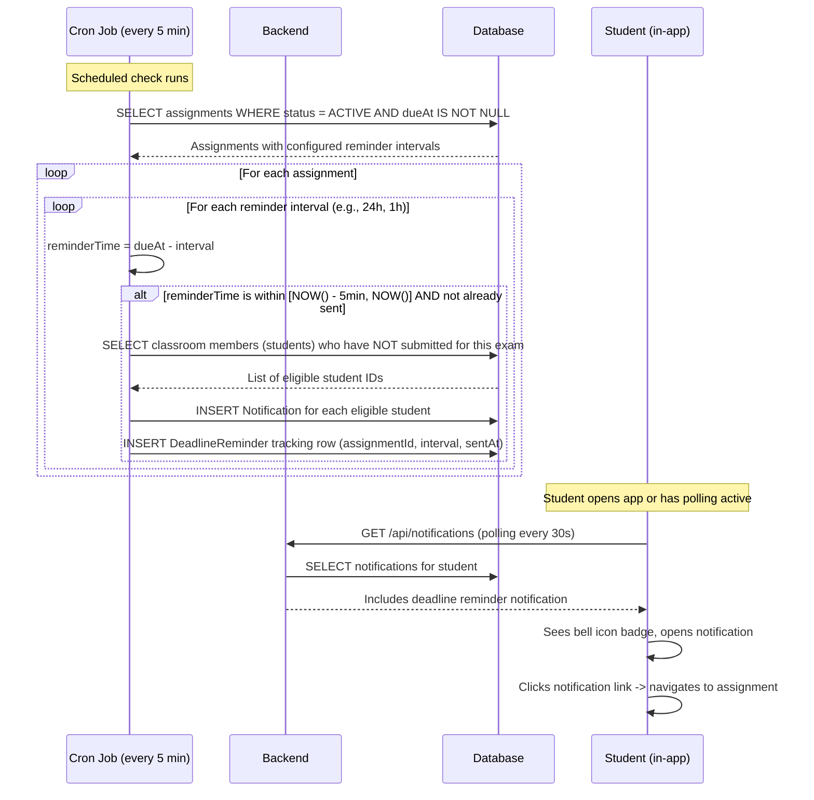
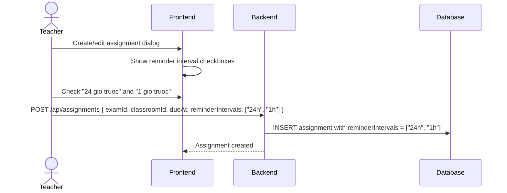
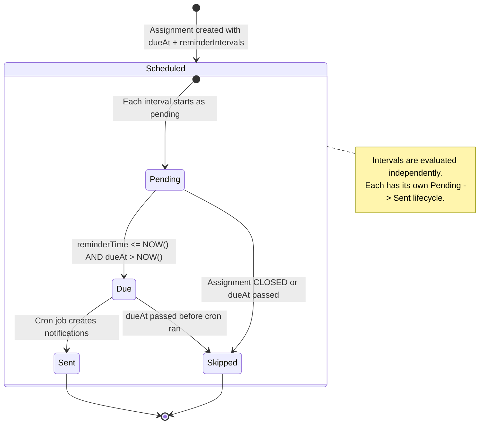

# J5. Deadline Reminders

## 5.1 Feature Overview

| Field | Value |
|---|---|
| **Feature ID** | J5 |
| **Feature Name** | Deadline Reminders |
| **Module** | J. Notifications |
| **Priority** | P2 |
| **Complexity** | M |
| **Status** | Not implemented — `Assignment.dueAt` field exists in the schema but is neither enforced nor used for reminders. No background scheduler exists (AD-06). No reminder notification type exists in the `NotificationType` enum. |
| **Target Roles** | Student (receives reminders), Teacher (configures reminder intervals per assignment) |
| **Business Objective** | Proactively notify students about upcoming assignment deadlines so they do not miss submission windows. Reduce late or missed submissions caused by students not checking the platform regularly. |
| **User Problem** | A student who does not log in regularly has no way of knowing a deadline is approaching. The current system only shows assignment due dates inside the app. Students discover they missed a deadline only after it passes. |
| **Dependencies** | J1 (In-App Notification System), F1 (Create Assignment — `Assignment.dueAt`), F4 (Deadline Management), J4 (Email Notifications — optional, for email delivery of reminders) |

## 5.2 Actors and Permissions

### Student

- **Receives**: Deadline reminder notifications for assignments in classrooms they belong to.
- **Cannot**: Configure reminder intervals, dismiss future reminders for a specific assignment, or receive reminders for assignments in classrooms they have left.

### Teacher

- **Configures**: Reminder intervals when creating or editing an assignment. The teacher chooses which intervals to enable (e.g., 24h before, 1h before).
- **Does not receive**: Deadline reminders (they set the deadlines).
- **Cannot**: Send manual reminder notifications to students (this is system-automated).

### System (Reminder Engine)

- **Evaluates**: Which reminders are due and creates in-app notifications for eligible students.
- **Reads**: `Assignment.dueAt`, `Assignment.status`, `DeadlineReminder` rows (or equivalent tracking), `ClassroomMember` for student membership.
- **Writes**: `Notification` rows, reminder tracking state.

### Backend Authorization

- Reminder configuration is part of assignment management — requires `TEACHER` role and classroom ownership.
- Reminder delivery is system-internal — no public "trigger reminder" endpoint.

## 5.3 Preconditions and Business Rules

### Preconditions

1. The assignment must have a non-null `dueAt` value. Assignments without a deadline do not generate reminders.
2. The assignment must have `status = ACTIVE`. `CLOSED` assignments do not generate reminders.
3. The reminder engine must be running (see J5-BR-12 for the architectural decision on how this runs).

### Business Rules

| Rule ID | Rule | Enforced |
|---|---|---|
| J5-BR-01 | Reminders are sent only for assignments where `dueAt` is in the future and `status = ACTIVE`. If `dueAt` has passed or the assignment is `CLOSED`, no reminders are generated. | Backend |
| J5-BR-02 | The default reminder intervals are: **24 hours** and **1 hour** before `dueAt`. These intervals are configurable per assignment by the teacher at creation or edit time. Available interval options: `48h`, `24h`, `12h`, `6h`, `1h`. | Backend + Frontend |
| J5-BR-03 | A reminder is sent at most once per student per assignment per interval. The system tracks which (assignment, interval) pairs have been sent via a `DeadlineReminder` tracking table or equivalent mechanism. Duplicate reminders are never created. | Backend |
| J5-BR-04 | Reminders are created as in-app `Notification` rows with type `DEADLINE_REMINDER`. This requires adding `DEADLINE_REMINDER` to the `NotificationType` enum. | Backend (schema migration) |
| J5-BR-05 | The reminder notification includes: the assignment's exam title, the classroom name, and the time remaining until the deadline (e.g., `"Con 1 gio"`). The `link` field points to the student's assignment page. | Backend |
| J5-BR-06 | Reminders are sent only to students who are current members of the assignment's classroom AND who have not yet submitted a completed attempt for that exam. Students who have already submitted are not reminded. | Backend |
| J5-BR-07 | If a student joins a classroom after a reminder interval has passed, they do not receive a retroactive reminder for that interval. They will receive reminders for future intervals only. | Backend |
| J5-BR-08 | If the teacher closes an assignment (`status = CLOSED`) before a scheduled reminder fires, the reminder is skipped. No notification is created. | Backend |
| J5-BR-09 | If the teacher changes `dueAt` on an existing assignment, previously sent reminders are not recalled or deleted. Future reminders are evaluated against the new `dueAt`. The tracking state is reset for intervals that are now in the future again. | Backend |
| J5-BR-10 | If J4 (Email Notifications) is implemented, deadline reminders also trigger an email for students with `emailNotificationsEnabled = true`, following the same rules as J4-BR-01 through J4-BR-04. | Backend |
| J5-BR-11 | Reminder intervals are stored on the Assignment as a JSON array. If no intervals are specified, the system defaults to `["24h", "1h"]`. If the teacher explicitly sets an empty array, no reminders are sent for that assignment. | Backend + Frontend |
| J5-BR-12 | **Architectural constraint**: Lumi Lite currently has no background scheduler (AD-06). The reminder evaluation mechanism must be chosen from the options in Open Questions. The recommended approach is a lightweight in-process NestJS cron job using `@nestjs/schedule`. | Backend |
| J5-BR-13 | The reminder check runs at a fixed interval (recommended: every 5 minutes). On each run, it queries assignments where `dueAt` minus any configured interval falls within the window `[NOW() - checkInterval, NOW()]` and where no reminder has been sent for that (assignment, interval) pair. | Backend |
| J5-BR-14 | A reminder that was missed (the check window passed without the cron running — e.g., server restart) is still sent on the next cron run, provided `dueAt` has not yet passed. If `dueAt` has passed, the reminder is skipped (it is no longer useful). | Backend |

## 5.4 Main User Flow — Happy Path

### Flow: Deadline Reminder Fires Automatically



### Steps

1. The cron job (or chosen mechanism) runs every 5 minutes.
2. It queries all `ACTIVE` assignments with a non-null `dueAt` that is still in the future.
3. For each assignment, it evaluates each configured reminder interval.
4. For each interval, it calculates `reminderTime = dueAt - interval`.
5. If `reminderTime` falls within the check window (has passed but `dueAt` has not), and no tracking row exists for (assignment, interval):
   a. Query classroom members (students only) who have NOT submitted a completed attempt for the assignment's exam.
   b. Create an in-app notification for each eligible student.
   c. Insert a tracking row to prevent duplicate sends.
6. Students see the reminder via the existing notification polling mechanism (30-second interval) or on their next page load.

### Flow: Teacher Configures Reminder Intervals



## 5.5 Alternative Flows

### AF-01: Assignment Has No dueAt

1. Teacher creates an assignment without setting a deadline.
2. `dueAt` is `null`.
3. The cron job skips this assignment entirely. No reminders are generated.

### AF-02: Teacher Sets Empty Reminder Intervals

1. Teacher creates an assignment with `dueAt` set but unchecks all reminder intervals.
2. `reminderIntervals` is stored as `[]`.
3. The cron job sees no intervals to evaluate. No reminders are generated.

### AF-03: Student Has Already Submitted

1. The cron job evaluates a 1-hour reminder for an assignment.
2. Student A has already submitted an attempt for the associated exam.
3. Student A is excluded from the reminder notification batch.
4. Other students who have not submitted receive the reminder.

### AF-04: Assignment Closed Before Reminder Fires

1. Teacher closes the assignment (status = CLOSED) 2 hours before the deadline.
2. The 1-hour reminder interval has not yet fired.
3. On the next cron run, the assignment's status is CLOSED — it is skipped.
4. No 1-hour reminder is sent.

### AF-05: Deadline Extended (dueAt Changed)

1. Teacher changes `dueAt` from Dec 15 14:00 to Dec 16 14:00.
2. The 24-hour reminder was already sent (for the original deadline).
3. The system resets tracking for intervals that are now in the future relative to the new `dueAt`. In this case: the new 24-hour reminder time (Dec 15 14:00) may coincide with the old deadline, so the 24-hour reminder for the new deadline needs to be sent at the new time.
4. Implementation: delete tracking rows for this assignment where the interval's `reminderTime` based on the new `dueAt` is in the future. The cron job will re-evaluate and send new reminders.

### AF-06: Server Restart / Missed Cron Window

1. The server was down for 30 minutes. The cron job missed several runs.
2. On restart, the cron job runs immediately (NestJS `@Cron` catches up on startup).
3. It evaluates all assignments: any reminder whose `reminderTime` has passed but whose `dueAt` is still in the future AND has no tracking row is sent now.
4. Any reminder whose `dueAt` has also passed is skipped.

### AF-07: Student Joins Classroom Late

1. Assignment was created with a 24h and 1h reminder. The 24h reminder has already been sent.
2. A new student joins the classroom.
3. On the next cron run, the student is a new classroom member. The 24h reminder's tracking row already exists (for the assignment), so the cron job does not re-evaluate it for new members.
4. The 1h reminder has not yet fired. When it does, the new student is included (they are now a classroom member and have not submitted).

## 5.6 Edge Cases and Failure Scenarios

| Scenario ID | Scenario | Trigger | Expected Behavior | User Feedback | Data Integrity | Recovery | Severity |
|---|---|---|---|---|---|---|---|
| J5-EC-01 | dueAt is in the past when assignment is created | Teacher sets a past dueAt (validation gap) | No reminders generated — all intervals are in the past | None (assignment should have been rejected by validation) | No impact | Fix at assignment validation level (F4) | Low |
| J5-EC-02 | dueAt is less than the smallest interval away | Assignment created with dueAt 30 minutes from now, intervals are [24h, 1h] | Both intervals are already past — no reminders sent | Student sees no reminder but sees the assignment in their list | No impact | None — expected behavior | Low |
| J5-EC-03 | Cron job throws an error mid-batch | Database connection failure during notification creation | Reminders sent before the error are committed (each assignment's batch is its own transaction). Failed assignments are retried on the next cron run. | Some students may receive the reminder late (next cron cycle) | No duplicate sends — tracking row is inserted atomically with notifications | Automatic retry on next cron run | Medium |
| J5-EC-04 | Two cron runs overlap | Cron interval shorter than execution time (unlikely at ~100 users) | Use a mutex/flag to prevent concurrent runs. If the previous run is still executing, the new run is skipped. | No user-visible impact | No duplicates | Built-in concurrency guard | Low |
| J5-EC-05 | Assignment has 100 students, all eligible | Large classroom, 24h reminder fires | 100 notification rows inserted in a single batch (Prisma `createMany`). No performance issue at this scale. | All 100 students receive the notification | Atomic batch insert | None | Low |
| J5-EC-06 | Student leaves classroom after reminder is sent | Student received a 24h reminder, then is removed from the classroom | The notification row already exists. Student still sees the notification in their history. The 1h reminder will not be sent (student is no longer a member). | Student sees the old notification but cannot access the assignment | Notification row is orphaned (cosmetically) but harmless | None — no need to recall | Low |
| J5-EC-07 | Teacher changes dueAt to the past | Teacher accidentally sets dueAt to a past time | All intervals are now in the past — no new reminders. Previously sent reminders remain. | Teacher should see assignment as effectively expired | No impact on reminders | Teacher fixes dueAt | Low |
| J5-EC-08 | Multiple assignments for the same classroom due at the same time | Two different exams assigned with the same dueAt | Each assignment is evaluated independently. Students receive separate reminders for each. | Student receives 2 reminders (one per assignment) — expected and correct | No cross-contamination | None | Low |
| J5-EC-09 | NotificationType enum not updated (migration forgotten) | Developer deploys code without running migration to add DEADLINE_REMINDER | Prisma client throws on insert — cron job fails | No reminders sent | No corrupt data | Run migration | High (deployment risk) |

## 5.7 UI/UX Specification

### Assignment Creation / Edit Dialog — Reminder Configuration

**Location**: The assignment creation dialog (or form) when `dueAt` is set.

**Behavior**: The reminder configuration section appears only when the teacher has set a `dueAt` value. If `dueAt` is cleared, the section hides.

**Section Label**: `"Nhac nho han nop"` (Deadline Reminders)

**Controls**: Checkboxes for each available interval. Default checked intervals: `24h` and `1h`.

| Checkbox Label | Interval Value | Default |
|---|---|---|
| `"48 gio truoc"` | `48h` | Unchecked |
| `"24 gio truoc"` | `24h` | Checked |
| `"12 gio truoc"` | `12h` | Unchecked |
| `"6 gio truoc"` | `6h` | Unchecked |
| `"1 gio truoc"` | `1h` | Checked |

**Helper text**: `"Hoc sinh se nhan thong bao nhac nho truoc han nop bai. Chi nhac hoc sinh chua nop bai."`

**Constraint**: If `dueAt` minus the selected interval is in the past at the time of saving, show a warning (not an error): `"Moc nhac nho '24 gio truoc' da qua. Hoc sinh se khong nhan duoc nhac nho nay."` The assignment is still saved.

### Notification Display (Student Side)

Deadline reminder notifications appear in the existing notification panel and page (`/dashboard/notifications`).

**Notification content**:
- **Title**: `"Sap het han nop bai: {exam.title}"` (e.g., `"Sap het han nop bai: Kiem tra Toan chuong 3"`)
- **Body**: `"Bai tap trong lop {classroom.name} se het han trong {timeRemaining}. Han nop: {dueAt formatted}."` (e.g., `"Bai tap trong lop Toan 10A se het han trong 1 gio. Han nop: 15/12/2026 14:00."`)
- **Link**: `/dashboard/assignments` (student's assignment list)
- **Icon**: Clock icon (same as other time-sensitive notifications)

**Time remaining formatting**:
| Interval | Display |
|---|---|
| `48h` | `"2 ngay"` |
| `24h` | `"1 ngay"` |
| `12h` | `"12 gio"` |
| `6h` | `"6 gio"` |
| `1h` | `"1 gio"` |

### No Student-Side Configuration

Students cannot configure or disable deadline reminders per assignment. The only control is the global email notification toggle (J4), which affects email delivery but not in-app notifications.

## 5.8 Data Requirements

### Schema Changes

**1. Add `DEADLINE_REMINDER` to `NotificationType` enum:**

```prisma
enum NotificationType {
  NEW_ASSIGNMENT
  SUBMISSION_RECEIVED
  GRADING_COMPLETE
  RESULTS_RELEASED
  ANNOUNCEMENT
  DEADLINE_REMINDER    // NEW
}
```

**Migration**: `ALTER TYPE "NotificationType" ADD VALUE 'DEADLINE_REMINDER';`

**2. Add `reminderIntervals` field to `Assignment`:**

```prisma
model Assignment {
  // ... existing fields ...
  reminderIntervals Json? @default("[\"24h\", \"1h\"]") @map("reminder_intervals")
}
```

**Migration**: `ALTER TABLE assignments ADD COLUMN reminder_intervals JSONB DEFAULT '["24h", "1h"]';`

The field stores a JSON array of interval strings. Valid values: `"48h"`, `"24h"`, `"12h"`, `"6h"`, `"1h"`. Null is treated as the default `["24h", "1h"]`. An empty array `[]` means no reminders.

**3. Add `DeadlineReminder` tracking table:**

```prisma
model DeadlineReminder {
  id            String   @id @default(uuid()) @db.Uuid
  assignmentId  String   @map("assignment_id") @db.Uuid
  interval      String   // e.g., "24h", "1h"
  sentAt        DateTime @map("sent_at")
  recipientCount Int     @map("recipient_count")

  assignment Assignment @relation(fields: [assignmentId], references: [id], onDelete: Cascade)

  @@unique([assignmentId, interval])
  @@map("deadline_reminders")
}
```

**Purpose**: Tracks which (assignment, interval) combinations have been sent. The `@@unique` constraint ensures at-most-once delivery per interval.

**Migration**: `CREATE TABLE deadline_reminders (...)` with the unique constraint.

### Add Relation to Assignment

```prisma
model Assignment {
  // ... existing relations ...
  deadlineReminders DeadlineReminder[]
}
```

### Data Volume

- Reminder tracking rows: 1 per (assignment, interval). With ~50 assignments and 2 intervals each: ~100 rows. Negligible.
- Notification rows: same volume as NEW_ASSIGNMENT notifications — ~50 assignments x ~30 students average = ~1500 notification rows per semester. Consistent with J1 volume estimates.

### Indexing

- `deadline_reminders(assignment_id, interval)` — unique constraint provides the index.
- Existing `notifications(user_id, read)` index handles notification queries.

## 5.9 API Requirements

### POST /api/assignments (Existing — Extend DTO)

| Field | Value |
|---|---|
| **Method** | POST |
| **Path** | `/api/assignments` |
| **Change** | Add optional `reminderIntervals` field to `CreateAssignmentDto` |
| **Validation** | `reminderIntervals` must be an array of strings. Each element must be one of `"48h"`, `"24h"`, `"12h"`, `"6h"`, `"1h"`. No duplicates allowed. Array length max 5. |
| **Default** | If omitted, defaults to `["24h", "1h"]`. If explicitly set to `[]`, no reminders. |
| **Error (400)** | `{ code: "VALIDATION_ERROR", message: "Khoang thoi gian nhac nho khong hop le. Cac gia tri hop le: 48h, 24h, 12h, 6h, 1h." }` |

### PATCH /api/assignments/:id (New or Extended Endpoint)

| Field | Value |
|---|---|
| **Method** | PATCH |
| **Path** | `/api/assignments/:id` |
| **Change** | Add optional `reminderIntervals` and `dueAt` to the update DTO |
| **Behavior** | When `dueAt` or `reminderIntervals` changes, delete `DeadlineReminder` tracking rows for intervals whose `reminderTime` (new `dueAt` minus interval) is in the future — so those reminders fire again at the new time. |
| **Role** | `TEACHER` — must own the classroom |
| **Error (403)** | `{ code: "FORBIDDEN", message: "Ban khong co quyen chinh sua bai tap nay" }` |

### No New Public Endpoints for Reminder Execution

The reminder cron job is internal. No public endpoint triggers it. If an external cron approach is chosen (OQ #1), a single internal endpoint would be added, protected by an API key or internal-only guard — not exposed to users.

### Internal: DeadlineReminderService

| Field | Value |
|---|---|
| **Module** | `NotificationsModule` (or a new `RemindersModule`) |
| **Injected** | `PrismaService`, `NotificationsService` |
| **Method** | `checkAndSendReminders(): Promise<void>` — called by the cron job |
| **Logic** | 1. Query ACTIVE assignments with non-null dueAt in the future. 2. For each, evaluate configured intervals. 3. For each interval: calculate reminderTime, check if it's past, check DeadlineReminder table for existing tracking row. 4. If due and not sent: query eligible students (members who haven't submitted), create notifications in batch, insert tracking row. |
| **Concurrency** | Uses a simple in-memory flag to prevent overlapping runs. |

## 5.10 State Management

### Reminder Lifecycle



### States per (assignment, interval) pair

| State | Condition | Stored As |
|---|---|---|
| **Pending** | `reminderTime` is in the future | No `DeadlineReminder` row exists |
| **Due** | `reminderTime` has passed, `dueAt` is in the future, no tracking row | Transient — detected by cron |
| **Sent** | Notifications created and tracking row inserted | `DeadlineReminder` row exists |
| **Skipped** | `dueAt` has passed, or assignment is CLOSED, and no tracking row | No row, but no action taken |

### Effect of dueAt Changes

When `dueAt` is updated:
1. Calculate new `reminderTime` for each interval.
2. Delete `DeadlineReminder` rows where the new `reminderTime` is in the future (these intervals need to be re-evaluated).
3. Keep `DeadlineReminder` rows where the new `reminderTime` is in the past (these were already sent for the original deadline — the notification already exists).

## 5.11 Acceptance Criteria

### Happy Path

```gherkin
Given an ACTIVE assignment with dueAt = "2026-12-15 14:00" and reminderIntervals = ["24h", "1h"],
  and a classroom with 3 students who have not submitted,
When NOW() passes "2026-12-14 14:00" (24h before dueAt),
Then on the next cron run, 3 Notification rows are created with type = DEADLINE_REMINDER,
  and the notification title is "Sap het han nop bai: {exam.title}",
  and the body includes "1 ngay",
  and a DeadlineReminder tracking row is created for (assignmentId, "24h").
```

```gherkin
Given the same assignment,
When NOW() passes "2026-12-15 13:00" (1h before dueAt),
Then on the next cron run, 3 more Notification rows are created for the 1h interval,
  and the body includes "1 gio",
  and a separate DeadlineReminder tracking row is created for (assignmentId, "1h").
```

```gherkin
Given a teacher creates an assignment with reminderIntervals = ["24h", "1h"],
When the assignment is saved,
Then the assignment's reminderIntervals field is ["24h", "1h"].
```

### Student Already Submitted

```gherkin
Given an assignment with dueAt in 1 hour,
  and Student A has already submitted an attempt for the exam,
  and Student B has not submitted,
When the 1h reminder fires,
Then only Student B receives a notification,
  and Student A does not receive a notification.
```

### Assignment Closed

```gherkin
Given an assignment with dueAt in 1 hour and a pending 1h reminder,
When the teacher closes the assignment (status = CLOSED),
Then the next cron run does not send the 1h reminder.
```

### No dueAt

```gherkin
Given an assignment with dueAt = null,
When the cron job runs,
Then no reminders are generated for this assignment.
```

### Empty Reminder Intervals

```gherkin
Given an assignment with reminderIntervals = [],
When the cron job runs,
Then no reminders are generated for this assignment.
```

### Duplicate Prevention

```gherkin
Given a 24h reminder has already been sent for an assignment,
When the cron job runs again within the same interval window,
Then no duplicate notifications are created (DeadlineReminder tracking row exists).
```

### Deadline Extended

```gherkin
Given a 24h reminder was sent for an assignment with dueAt = "2026-12-15 14:00",
When the teacher changes dueAt to "2026-12-16 14:00",
Then the DeadlineReminder tracking row for "24h" is deleted (new reminderTime is in the future),
  and on the next appropriate cron run, a new 24h reminder is sent for the new deadline.
```

### Negative / Permission Cases

```gherkin
Given a STUDENT role user,
When they attempt to set reminderIntervals on an assignment,
Then the request is rejected with 403.
```

```gherkin
Given a teacher who does not own the classroom,
When they attempt to create an assignment with reminder intervals,
Then the request is rejected with 403.
```

```gherkin
Given reminderIntervals = ["30m"],
When the teacher saves the assignment,
Then the request is rejected with 400 and message "Khoang thoi gian nhac nho khong hop le. Cac gia tri hop le: 48h, 24h, 12h, 6h, 1h."
```

## 5.12 QA Test Scenarios

| Test Case ID | Scenario | Preconditions | Test Steps | Test Data | Expected Result | Priority |
|---|---|---|---|---|---|---|
| J5-TC-01 | 24h reminder fires correctly | ACTIVE assignment, dueAt 24h from now minus 1 min, 3 students | Wait for cron (or invoke manually) | 3 students, none submitted | 3 DEADLINE_REMINDER notifications created, tracking row inserted | P0 |
| J5-TC-02 | 1h reminder fires correctly | Same assignment, now 1h before dueAt | Wait for cron | 3 students, none submitted | 3 more notifications, separate tracking row | P0 |
| J5-TC-03 | No duplicate on re-run | 24h reminder already sent | Run cron again | Tracking row exists | 0 new notifications | P0 |
| J5-TC-04 | Student already submitted is excluded | 2 students: A submitted, B not | 1h reminder fires | A has SUBMITTED attempt | Only B receives notification | P0 |
| J5-TC-05 | Assignment CLOSED before reminder | ACTIVE assignment, teacher closes it | Cron runs after close | status = CLOSED | No reminders sent | P0 |
| J5-TC-06 | No dueAt — no reminders | Assignment with dueAt = null | Cron runs | No dueAt | Assignment skipped entirely | P1 |
| J5-TC-07 | Empty intervals — no reminders | reminderIntervals = [] | Cron runs | Empty array | No reminders sent | P1 |
| J5-TC-08 | Default intervals applied | Assignment created without reminderIntervals | Check stored assignment | Not provided | reminderIntervals = ["24h", "1h"] | P1 |
| J5-TC-09 | Invalid interval rejected | Teacher sends reminderIntervals = ["30m"] | POST /assignments | "30m" value | 400 Validation Error | P0 |
| J5-TC-10 | Deadline extended resets tracking | 24h reminder sent, teacher extends dueAt by 24h | Check DeadlineReminder table | Old tracking row for "24h" | Tracking row deleted; new 24h reminder fires at new time | P1 |
| J5-TC-11 | Notification content correct | 24h reminder fires | Read the created notification | Exam "Kiem tra Toan", classroom "Toan 10A" | Title: "Sap het han nop bai: Kiem tra Toan", body includes "1 ngay" and "Toan 10A" | P1 |
| J5-TC-12 | Student who left classroom | Student was member, received 24h reminder, then removed | 1h reminder fires | Student no longer in ClassroomMember | Student not included in 1h reminder batch | P1 |
| J5-TC-13 | Multiple assignments same classroom | 2 assignments with overlapping reminder windows | Cron runs | Both due at the same time | Students receive separate reminders for each | P1 |
| J5-TC-14 | Cron concurrency guard | Two cron invocations overlap (simulate) | Trigger cron twice quickly | In-memory flag | Second run is skipped, no duplicates | P2 |
| J5-TC-15 | Server restart catch-up | Server was down when 24h reminder was due; now back, dueAt still future | Cron runs on startup | Missed window, dueAt in 12h | Missed 24h reminder is sent now | P1 |
| J5-TC-16 | Server restart after dueAt passed | Server was down; both reminder and dueAt have passed | Cron runs on startup | dueAt in the past | No reminders sent (too late) | P1 |
| J5-TC-17 | Teacher configures all 5 intervals | reminderIntervals = ["48h","24h","12h","6h","1h"] | Create assignment with dueAt 3 days out | All intervals | All 5 reminders fire at their respective times | P2 |
| J5-TC-18 | Ownership check on assignment | Teacher A creates assignment in Teacher B's classroom | POST /assignments | Wrong teacher | 403 Forbidden | P0 |

## 5.13 Open Questions and Assumptions

| # | Question | Why It Matters | Options | Recommended Default | Impact | Blocks Implementation? |
|---|---|---|---|---|---|---|
| 1 | **How should the reminder engine run?** This is the most significant architectural decision. Lumi Lite has no background scheduler (AD-06 — lazy expiry only). Deadline reminders require proactive evaluation. | Without a mechanism to run code before a student requests it, reminders cannot fire. This breaks the "no scheduler" principle. | (a) **Lightweight NestJS cron** via `@nestjs/schedule` — runs in-process, zero infrastructure, uses `node-cron`. (b) **External cron** (system crontab or Docker health-check trick) calling a protected API endpoint every N minutes. (c) **Client-side check on page load** — when a student opens the app, frontend checks for upcoming deadlines and creates a local notification. Only works if the student opens the app. (d) **Hybrid**: client-side for in-app banner + server cron for in-app notification creation. | **(a) Lightweight NestJS cron via `@nestjs/schedule`**. Justification: it is zero-infrastructure, runs reliably in-process, handles ~100 users trivially, and keeps the notification in the existing Notification table. The scheduler adds no external dependency (no Redis, no BullMQ). The `@nestjs/schedule` package is already a NestJS first-party module. This is a minimal exception to AD-06, which was specifically about avoiding schedulers for attempt expiry — deadline reminders are a fundamentally different concern that cannot be solved lazily. | **High — blocks implementation.** The entire feature depends on this decision. | **Yes** |
| 2 | Should the cron check interval be configurable, or hardcoded? | Flexibility vs simplicity. | (a) Hardcoded to 5 minutes. (b) Configurable via environment variable. | (a) Hardcoded to 5 minutes. Configuring this adds no user-facing value. The interval affects only the precision of when a reminder arrives relative to the exact interval time (worst case: 5 minutes late). | Low | No |
| 3 | Should the reminder notification link go to the specific assignment or the assignments list? | Students may have multiple assignments. A specific link is more actionable but depends on having a per-assignment page. | (a) `/dashboard/assignments` (list — exists). (b) `/dashboard/assignments/:id` (detail — may not exist). | (a) `/dashboard/assignments` — the student's assignment list page exists and shows due dates. A per-assignment detail page may not exist yet. | Low | No |
| 4 | Should students be able to dismiss/snooze future reminders for a specific assignment? | Reduces notification noise for students who are aware of the deadline but plan to submit later. Adds significant complexity. | (a) No per-assignment snooze. (b) A "mute" option on the notification that suppresses future reminders for that assignment. | (a) No per-assignment snooze. At ~100 users and max 2-3 reminders per assignment, notification volume is low. Snooze is a post-MVP enhancement. | Low | No |
| 5 | Should the `@nestjs/schedule` package be added as a dependency even though it technically breaks the "no scheduler" principle in AD-06? | AD-06 was written in the context of attempt expiry, where lazy evaluation is sufficient. Deadline reminders are fundamentally proactive. Adding `@nestjs/schedule` sets a precedent for future scheduled tasks. | (a) Yes — add it for this feature, document the exception in TECHNICAL_DECISIONS.md. (b) No — use a different approach (client-side, external cron). | (a) Yes. The alternative approaches are either unreliable (client-side) or operationally complex (external cron). Document this as a controlled exception to AD-06 in TECHNICAL_DECISIONS.md, scoped to notifications only. | Medium — architectural precedent. | Depends on OQ #1 |
| 6 | If J4 (Email Notifications) is not yet implemented, should reminders be in-app only? | Email is the most reliable way to reach a student who is not logged in. In-app only is limited to students who open the app. | (a) In-app only until J4 is done. (b) Implement a minimal email path for reminders only. | (a) In-app only. Email delivery will automatically follow when J4 is implemented — reminders use the same NotificationsService path. | Medium — affects how many students are actually reached. | No |
| 7 | How should the system handle the case where the cron job query returns a large number of assignments to process? | At ~100 users, this is unlikely to be a problem. But if many teachers create assignments simultaneously with similar deadlines, one cron cycle could process dozens of assignments. | (a) Process all in a single run. (b) Batch with a limit per run. | (a) Process all. At ~100 users, even 50 assignments with 30 students each = 1500 notifications in one batch, which Prisma handles in under 1 second. | Low | No |

### Assumptions

| ID | Assumption | Risk if Wrong |
|---|---|---|
| A-J5-01 | `@nestjs/schedule` is an acceptable addition to the project despite AD-06. The distinction is: AD-06 avoids schedulers for attempt lifecycle (lazy expiry works), while deadline reminders are fundamentally proactive. This is a controlled exception, not a contradiction. | If the PO or architect rejects this, the feature cannot be implemented as specified. Alternatives (client-side only, external cron) have significant reliability or operational trade-offs. |
| A-J5-02 | A 5-minute cron interval provides sufficient precision. A student receiving a "24 hours before" reminder at 23h55m before the deadline is acceptable. | If sub-minute precision is needed, the cron interval must be reduced (increases CPU usage slightly) or a more sophisticated scheduling system is needed. Not expected at ~100 users. |
| A-J5-03 | Students who have submitted an attempt are the right exclusion criterion. "Submitted" means `ExamAttempt.status = SUBMITTED` for the assignment's exam. An `IN_PROGRESS` attempt does not count as submitted — the student still needs to finish. | If the definition of "submitted" changes (e.g., include IN_PROGRESS as "started"), the query filter needs updating. |
| A-J5-04 | The `DeadlineReminder` tracking table is the simplest at-most-once mechanism. An alternative is adding a `remindersSent Json?` field to Assignment, but a separate table is cleaner for querying and deletion. | If the tracking table is rejected for schema simplicity, the Json field approach works but is harder to query and does not benefit from unique constraints. |
| A-J5-05 | The notification `link` field pointing to `/dashboard/assignments` is sufficient. A deep link to a specific assignment detail page would be better UX but depends on F3 (Submission Tracking) page existing. | If the link leads to a page that doesn't show the relevant assignment prominently, the reminder is less useful. |

---

### Handoff

**Artifacts**: `docs/features/notifications/deadline-reminders.md`

**Open questions blocking implementation**:
- OQ #1: How should the reminder engine run? Recommended: `@nestjs/schedule` in-process cron. This is an architectural decision that the architect and PO need to confirm, since it creates an exception to AD-06.
- OQ #5: Should `@nestjs/schedule` be added as a dependency? Linked to OQ #1.

**Open questions NOT blocking implementation**:
- OQ #2: Cron interval (recommended: 5 minutes hardcoded).
- OQ #3: Notification link target (recommended: `/dashboard/assignments`).
- OQ #4: Per-assignment snooze (recommended: no, deferred).
- OQ #6: Email delivery (recommended: in-app only until J4).
- OQ #7: Batch size limits (recommended: no limit needed at ~100 users).

**Prerequisites the developer must resolve**:
1. **Architect/PO decision on OQ #1 and OQ #5** — must confirm the cron approach.
2. Add `DEADLINE_REMINDER` to `NotificationType` enum (schema migration).
3. Add `reminderIntervals` JSON field to `Assignment` (schema migration).
4. Create `DeadlineReminder` tracking table (schema migration).
5. Add `@nestjs/schedule` dependency (if OQ #1 = option a).
6. Implement `DeadlineReminderService` with `checkAndSendReminders()` method.
7. Register the cron job in a NestJS module.
8. Extend `CreateAssignmentDto` to accept `reminderIntervals`.
9. Add reminder interval configuration UI to assignment creation dialog.
10. Document the AD-06 exception in `docs/TECHNICAL_DECISIONS.md`.
