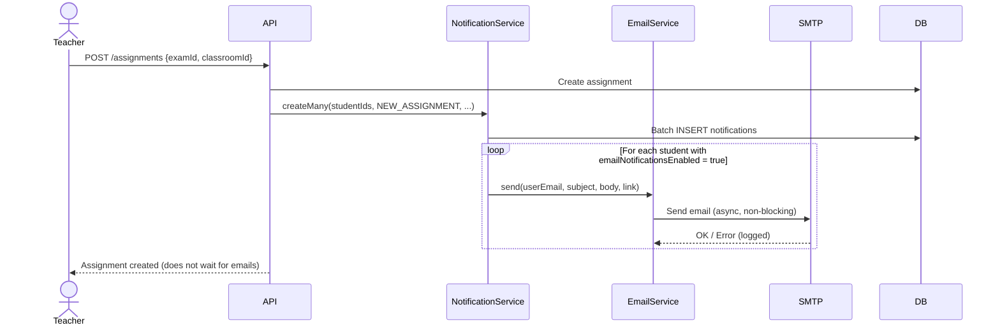
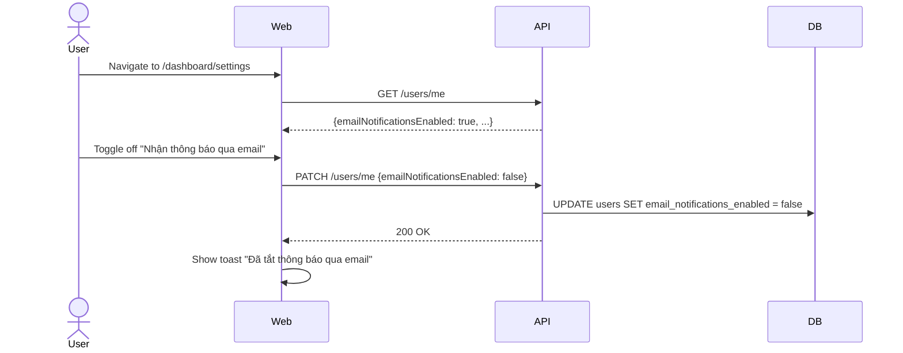
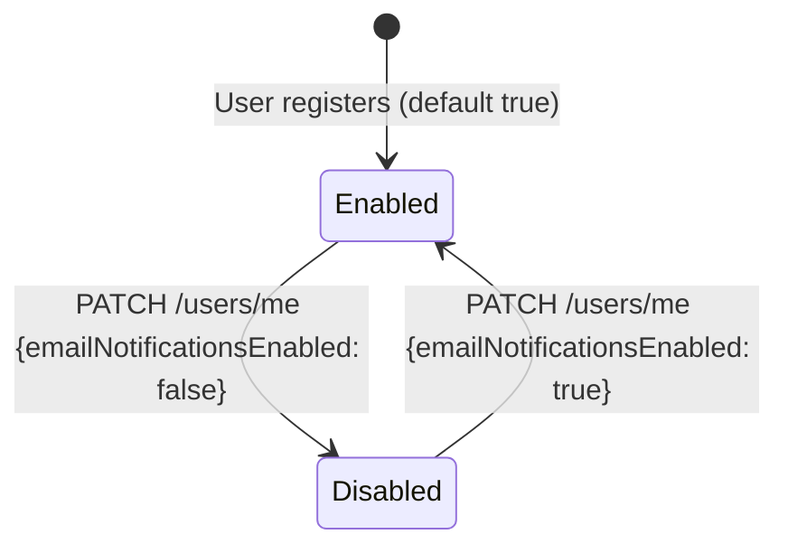

# J4. Email Notifications

## 5.1 Feature Overview

| Field | Value |
|---|---|
| **Feature ID** | J4 |
| **Feature Name** | Email Notifications |
| **Module** | J. Notifications |
| **Priority** | P2 |
| **Complexity** | M |
| **Status** | Not implemented — no email service, no email preferences, no templates exist. |
| **Target Roles** | Teacher, Student |
| **Business Objective** | Deliver email notifications for important events so users are informed even when not logged in. Reduce missed assignments and delayed grading awareness. |
| **User Problem** | In-app notifications require the user to open the platform. A student who does not log in daily may miss a new assignment or result release entirely. Email ensures delivery to an external inbox. |
| **Dependencies** | J1 (In-App Notification System), A1 (User Registration — email field exists on User) |

## 5.2 Actors and Permissions

### Student
- **Can receive**: Email notifications for events targeting them (NEW_ASSIGNMENT, GRADING_COMPLETE, RESULTS_RELEASED)
- **Can update**: Own email notification preference (opt in / opt out)
- **Cannot**: Trigger email notifications manually, configure another user's preferences

### Teacher
- **Can receive**: Email notifications for events targeting them (SUBMISSION_RECEIVED)
- **Can update**: Own email notification preference (opt in / opt out)
- **Cannot**: Trigger email notifications to students manually, configure student preferences

### System (automated)
- **Can send**: Emails when an in-app notification is created AND the target user has email notifications enabled
- Emails are always a side-effect of in-app notification creation — never sent without a corresponding in-app notification

### Backend Authorization
- Email preference endpoints require authentication
- Users can only read and update their own preference
- Email sending is system-internal — no public "send email" endpoint

## 5.3 Preconditions and Business Rules

### Preconditions
1. The platform must have SMTP credentials configured via environment variables. If not configured, the email subsystem is disabled and in-app notifications continue to work.
2. The user must have a verified email address (the `email` field on User, populated at registration).
3. The J1 in-app notification system must be working — email is always paired with an in-app notification.

### Business Rules

| Rule ID | Rule | Enforced |
|---|---|---|
| J4-BR-01 | Every email notification is paired with an in-app notification. The system never sends an email without also creating a Notification row. | Backend |
| J4-BR-02 | Email is sent only if the target user's `emailNotificationsEnabled` field is `true`. The default for new users is `true` (opt-out model). | Backend |
| J4-BR-03 | If SMTP is not configured (environment variables missing or empty), the EmailService logs a warning at startup and all `send` calls are no-ops. In-app notifications are unaffected. | Backend |
| J4-BR-04 | Email sending is fire-and-forget and non-blocking. A failure to send email must not prevent the in-app notification from being created or the triggering action (assignment creation, submission, etc.) from completing. Errors are logged. | Backend |
| J4-BR-05 | Emails are sent for these NotificationType values only: `NEW_ASSIGNMENT`, `SUBMISSION_RECEIVED`, `GRADING_COMPLETE`, `RESULTS_RELEASED`. The `ANNOUNCEMENT` type does not trigger email in this feature. | Backend |
| J4-BR-06 | Email body contains: a greeting with the user's displayName, a description of the event in Vietnamese, and a link to the relevant page. No sensitive data (scores, answers) appears in the email body. | Backend |
| J4-BR-07 | The email subject uses the same title as the in-app notification (Vietnamese). | Backend |
| J4-BR-08 | The "from" address and display name are configured via environment variables (`SMTP_FROM_ADDRESS`, `SMTP_FROM_NAME`). Default display name: "Lumi Lite". | Backend |
| J4-BR-09 | Emails are plain text with an optional HTML version. No complex HTML templates for MVP — a simple layout with the notification text and a CTA button/link. | Backend |
| J4-BR-10 | Batch events (e.g., NEW_ASSIGNMENT to 100 students) send individual emails, not one email with 100 recipients. Each user receives a personalized email. | Backend |
| J4-BR-11 | Email rate is naturally bounded by notification creation rate. No separate rate limiter is needed at ~100 users. If SMTP throughput becomes a bottleneck, emails are queued in-memory and sent sequentially (not in parallel). | Backend |
| J4-BR-12 | The email includes a footer line: "Bạn nhận email này vì đã bật thông báo qua email trên Lumi Lite. Bạn có thể tắt trong phần Cài đặt." with a link to the settings page. | Backend |
| J4-BR-13 | When `emailNotificationsEnabled` is toggled from `true` to `false`, no further emails are sent. Already-queued emails for that user may still be delivered (at-most-once is not guaranteed in the fire-and-forget model). | Backend |
| J4-BR-14 | The toggle applies to all email notification types. Per-type email preferences are not supported in this feature. | Backend, Frontend |

## 5.4 Main User Flow — Happy Path

### Flow: Student Receives Email for New Assignment



### Steps
1. A triggering action occurs (teacher creates assignment, student submits, teacher releases results, etc.).
2. The calling service invokes `NotificationsService.createMany()` or `NotificationsService.create()` as defined in J1.
3. After the in-app notifications are batch-inserted, `NotificationsService` queries which of the target users have `emailNotificationsEnabled = true`.
4. For each such user, `NotificationsService` calls `EmailService.send()` with the user's email, the notification subject, body text, and the link.
5. `EmailService.send()` is asynchronous and non-blocking. It does not throw on failure — it logs the error.
6. The triggering action's HTTP response returns to the caller without waiting for email delivery.

### Flow: User Toggles Email Preference



## 5.5 Alternative Flows

### AF-01: SMTP Not Configured
1. Application starts.
2. `EmailService` checks for `SMTP_HOST` environment variable.
3. Variable is missing or empty.
4. `EmailService` logs: "SMTP not configured — email notifications disabled."
5. All subsequent `send()` calls return immediately without error.
6. In-app notifications work normally.

### AF-02: SMTP Delivery Failure
1. `EmailService.send()` is called with valid parameters.
2. SMTP connection fails or returns an error (timeout, auth failure, rejected recipient).
3. `EmailService` logs the error with the notification ID and user email.
4. The in-app notification remains created. The triggering action is unaffected.
5. No retry is attempted for MVP. The email is lost.

### AF-03: User Has emailNotificationsEnabled = false
1. A notification event occurs for the user.
2. `NotificationsService` creates the in-app notification row.
3. `NotificationsService` checks the user's `emailNotificationsEnabled` — it is `false`.
4. No call to `EmailService.send()`. No email sent.

### AF-04: Batch Event (100 Students)
1. Teacher creates an assignment for a classroom of 100 students.
2. `NotificationsService.createMany()` batch-inserts 100 notification rows.
3. Service queries which of the 100 users have `emailNotificationsEnabled = true`.
4. For each opted-in user, `EmailService.send()` is called sequentially (not in parallel, to avoid SMTP rate limits).
5. Total email sending time for 100 users at ~50ms/email: ~5 seconds. This happens asynchronously after the HTTP response.

## 5.6 Edge Cases and Failure Scenarios

| Scenario ID | Scenario | Trigger | Expected Behavior | User Feedback | Data Integrity | Recovery | Severity |
|---|---|---|---|---|---|---|---|
| J4-E01 | SMTP credentials invalid | App starts with wrong SMTP_PASSWORD | EmailService detects auth failure on first send, logs error | None — in-app notifications work | No data impact | Fix SMTP credentials and restart | Medium |
| J4-E02 | User email is malformed | Registration allowed an invalid email | SMTP rejects the recipient | In-app notification still created | Notification row exists, email not sent | User fixes email in profile | Low |
| J4-E03 | Email sent after user disables preference | User toggles off while batch emails are being sent | Already-in-flight emails may still be delivered | User may receive one extra email | Acceptable — no data inconsistency | None needed | Low |
| J4-E04 | SMTP server rate-limits sends | Sending 100 emails exceeds provider limit | Some emails fail with rate-limit error | Affected users don't receive email | In-app notifications unaffected | Log count of failed sends; consider adding delay between sends | Medium |
| J4-E05 | User deletes account while email is being sent | CASCADE deletes user and notifications | Email may arrive for a non-existent account | User receives email but cannot access platform | No orphan data — user row gone | Email contains a link to a page that will 404 or redirect to login | Low |
| J4-E06 | Very long notification body | Notification body exceeds email size | Email sends normally (email size limit is much higher than notification text) | None | No impact | None needed | Low |
| J4-E07 | Duplicate notification triggers email twice | Same notification event fires twice (J1-E04 idempotency failure) | Duplicate in-app notification → duplicate email | User receives two identical emails | Same as J1-E04 — idempotency check at notification level prevents this | Fix at J1 level | Low |

## 5.7 UI/UX Specification

### Settings Page Addition (`/dashboard/settings`)

The user profile/settings page gains a new section:

**Section: "Thông báo"**
- Toggle: "Nhận thông báo qua email" with a Switch component.
  - Default state: ON (checked).
  - Label text: "Nhận thông báo qua email"
  - Helper text below toggle: "Khi bật, bạn sẽ nhận email khi có bài tập mới, kết quả được công bố, hoặc có bài nộp."
- Save: The toggle saves immediately on change (optimistic update with PATCH /users/me).
- Feedback: Toast notification on success — "Đã cập nhật cài đặt thông báo."
- Error: Toast on failure — "Không thể cập nhật. Vui lòng thử lại."

### Email Content Layout

Emails use a simple HTML template:

```
Subject: {notification.title}

---
Xin chào {user.displayName},

{notification.body}

[Xem chi tiết] → {baseUrl}{notification.link}

---
Bạn nhận email này vì đã bật thông báo qua email trên Lumi Lite.
Bạn có thể tắt trong phần Cài đặt: {baseUrl}/dashboard/settings
```

### Email Templates per Type

| Type | Subject Example | Body Example |
|---|---|---|
| NEW_ASSIGNMENT | "Bài tập mới: Kiểm tra Toán chương 3" | "Bạn có một bài tập mới trong lớp Toán 10A. Hạn nộp: 15/12/2026." |
| SUBMISSION_RECEIVED | "Nguyễn Văn A đã nộp bài: Kiểm tra Toán chương 3" | "Học sinh Nguyễn Văn A đã nộp bài kiểm tra trong lớp Toán 10A." |
| GRADING_COMPLETE | "Bài của bạn đã được chấm: Kiểm tra Toán chương 3" | "Giáo viên đã chấm bài kiểm tra của bạn. Đăng nhập để xem kết quả." |
| RESULTS_RELEASED | "Kết quả đã được công bố: Kiểm tra Toán chương 3" | "Kết quả bài kiểm tra đã được công bố. Đăng nhập để xem điểm của bạn." |

### No UI for Email History
Users cannot see which emails were sent or their delivery status. Email is best-effort.

## 5.8 Data Requirements

### Schema Changes

**User model — add field:**

```prisma
model User {
  // ... existing fields ...
  emailNotificationsEnabled Boolean @default(true) @map("email_notifications_enabled")
}
```

**Migration**: `ALTER TABLE users ADD COLUMN email_notifications_enabled BOOLEAN NOT NULL DEFAULT true;`

### New Environment Variables

| Variable | Required | Default | Description |
|---|---|---|---|
| `SMTP_HOST` | Yes (for email) | — | SMTP server hostname (e.g., `smtp.gmail.com`) |
| `SMTP_PORT` | No | `587` | SMTP port |
| `SMTP_SECURE` | No | `false` | Use TLS (`true` for port 465) |
| `SMTP_USER` | Yes (for email) | — | SMTP username |
| `SMTP_PASSWORD` | Yes (for email) | — | SMTP password or app-specific password |
| `SMTP_FROM_ADDRESS` | No | Value of `SMTP_USER` | Sender email address |
| `SMTP_FROM_NAME` | No | `Lumi Lite` | Sender display name |
| `APP_BASE_URL` | Yes | `http://localhost:3000` | Base URL for links in emails |

### No New Tables
Email sending is stateless (fire-and-forget). No `email_logs` table for MVP. If delivery tracking is needed later, add an `email_log` table.

### Data Volume
- Same as J1 notification volume: ~15,000 notifications/month.
- Opted-in fraction assumed ~70%: ~10,500 emails/month ≈ 350/day.
- Well within free-tier SMTP limits (e.g., Gmail 500/day, SendGrid 100/day free tier).

## 5.9 API Requirements

### PATCH /users/me (Existing Endpoint — Extended)

| Field | Value |
|---|---|
| **Purpose** | Update current user's profile, including email notification preference |
| **Role** | Any authenticated user |
| **Request body** | `{ emailNotificationsEnabled?: boolean }` (added to existing DTO) |
| **Validation** | `emailNotificationsEnabled` must be a boolean if present |
| **Response 200** | Updated user object (excluding passwordHash) |
| **Error 400** | `{ code: "VALIDATION_ERROR", message: "emailNotificationsEnabled phải là true hoặc false." }` |

### GET /users/me (Existing Endpoint — Extended)

| Field | Value |
|---|---|
| **Purpose** | Get current user's profile, now includes `emailNotificationsEnabled` |
| **Response 200** | User object with `emailNotificationsEnabled` field included |

### Internal: EmailService

| Field | Value |
|---|---|
| **Module** | EmailModule (new NestJS module) |
| **Dependency** | `nodemailer` package |
| **Methods** | `send(to: string, subject: string, text: string, html?: string): Promise<void>` |
| **Configuration** | Reads SMTP_* env vars at module initialization |
| **Behavior** | If SMTP not configured, all calls are no-ops (logged once at startup) |
| **Error handling** | Catches all errors, logs them, never throws to caller |

### Internal: NotificationsService Changes

| Field | Value |
|---|---|
| **Change** | After creating notification(s), query opted-in users and call EmailService |
| **Method signature** | No public API change — internal behavior change in `create()` and `createMany()` |
| **Email content** | Built from the same `title`, `body`, `link` passed to the notification |

## 5.10 State Management

Email notification preference has a simple binary state on the User:



Emails themselves are stateless — no tracking of sent/delivered/opened for MVP.

## 5.11 Acceptance Criteria

### Happy Path

```gherkin
Given a student has emailNotificationsEnabled = true,
  and SMTP is configured,
When a teacher creates an assignment for the student's classroom,
Then the student receives an in-app notification AND an email to their registered email address,
  and the email subject matches the notification title,
  and the email body includes the notification text and a link to the assignment page.

Given a teacher has emailNotificationsEnabled = true,
  and SMTP is configured,
When a student submits an exam attempt,
Then the teacher receives an in-app notification AND an email with the student's name and exam title.

Given a student has emailNotificationsEnabled = true,
When results are released for an exam,
Then the student receives an email with the exam title and a link to the results page,
  and the email does NOT contain the student's score.
```

### Preference Toggle

```gherkin
Given a user is on /dashboard/settings,
When the user toggles "Nhận thông báo qua email" to OFF,
Then PATCH /users/me is called with {emailNotificationsEnabled: false},
  and a toast "Đã cập nhật cài đặt thông báo." appears.

Given a user has emailNotificationsEnabled = false,
When a notification event occurs for that user,
Then an in-app notification is created,
  and NO email is sent.
```

### Failure Resilience

```gherkin
Given SMTP_HOST is not set in environment variables,
When the application starts,
Then EmailService logs "SMTP not configured — email notifications disabled",
  and in-app notifications continue to work,
  and no errors are thrown when notification events occur.

Given SMTP is configured but the SMTP server is unreachable,
When a notification event triggers an email,
Then the in-app notification is created successfully,
  and the email failure is logged,
  and the triggering action (assignment creation, etc.) returns successfully.
```

### Negative / Permission Cases

```gherkin
Given User A is authenticated,
When User A sends PATCH /users/me with another user's emailNotificationsEnabled,
Then only User A's own preference is updated (the endpoint always operates on the current user).

Given a notification of type ANNOUNCEMENT is created,
Then no email is sent regardless of user preference (ANNOUNCEMENT is excluded from email).
```

## 5.12 QA Test Scenarios

| Test ID | Scenario | Preconditions | Steps | Expected | Priority |
|---|---|---|---|---|---|
| J4-T01 | Email sent on NEW_ASSIGNMENT | User opted in, SMTP configured | Create assignment → check email | Email received with correct subject and body | High |
| J4-T02 | Email sent on SUBMISSION_RECEIVED | Teacher opted in, SMTP configured | Student submits attempt → check teacher email | Teacher receives email | High |
| J4-T03 | Email sent on GRADING_COMPLETE | Student opted in, SMTP configured | Teacher grades attempt → check student email | Student receives email, no score in body | High |
| J4-T04 | Email sent on RESULTS_RELEASED | Student opted in, SMTP configured | Teacher releases results → check student email | Student receives email with link | High |
| J4-T05 | No email for ANNOUNCEMENT | User opted in | Create ANNOUNCEMENT notification | In-app notification created, no email sent | High |
| J4-T06 | No email when opted out | User set emailNotificationsEnabled = false | Create assignment → check email | In-app notification created, no email | High |
| J4-T07 | Toggle preference ON | User has preference OFF | PATCH /users/me {emailNotificationsEnabled: true} | Preference updated, subsequent events send email | High |
| J4-T08 | Toggle preference OFF | User has preference ON | PATCH /users/me {emailNotificationsEnabled: true → false} | Preference updated, subsequent events do NOT send email | High |
| J4-T09 | SMTP not configured | SMTP_HOST env var missing | Start app, trigger notification event | Warning logged, no email error, in-app notification works | High |
| J4-T10 | SMTP failure | SMTP configured but server down | Trigger notification event | In-app notification created, email error logged, no user-visible error | High |
| J4-T11 | Batch email for 50 students | 50 students in classroom, all opted in | Create assignment | 50 in-app notifications + 50 emails sent | Medium |
| J4-T12 | Mixed opt-in batch | 30 opted in, 20 opted out | Create assignment | 50 in-app notifications, 30 emails | Medium |
| J4-T13 | Email contains correct link | SMTP configured | Trigger notification → inspect email | Email link matches notification.link prefixed with APP_BASE_URL | Medium |
| J4-T14 | Email footer present | Any email sent | Trigger notification → inspect email | Footer contains opt-out instruction and settings link | Medium |
| J4-T15 | Default preference for new user | New user registers | GET /users/me | emailNotificationsEnabled = true | Medium |
| J4-T16 | Email does not contain score | GRADING_COMPLETE or RESULTS_RELEASED | Trigger event → inspect email | Body mentions exam title but not numeric score | Medium |

## 5.13 Open Questions and Assumptions

| Question | Why It Matters | Options | Recommended Default | Impact | Blocks Implementation? |
|---|---|---|---|---|---|
| OQ-J4-01 | Which email service/library to use? | Nodemailer is the standard Node.js library. An external service (SendGrid, Mailgun) provides analytics but adds a dependency and cost. | Nodemailer with SMTP. Teachers or admins configure any SMTP provider. | Low — Nodemailer is swappable. | No |
| OQ-J4-02 | Should email preference be per-type (e.g., opt out of SUBMISSION_RECEIVED but keep NEW_ASSIGNMENT)? | Better control vs. more complexity in UI and schema. | No — single toggle for all email types. Per-type is a future enhancement. | Low — can be added later by replacing the boolean with a JSONB preferences column. | No |
| OQ-J4-03 | Should failed emails be retried? | Improves delivery reliability. Retry logic requires a queue or timer. | No retry for MVP. Fire-and-forget. At ~100 users, occasional lost emails are acceptable. | Low | No |
| OQ-J4-04 | Should email sending be moved to a background queue (BullMQ)? | Prevents any latency impact on the triggering action, especially for batch events. | No queue for MVP. Emails are sent asynchronously (Promise, no await in the request path) but within the same process. Re-evaluate if batch events (100 emails) cause measurable latency. | Medium — affects architecture if needed later. | No |
| OQ-J4-05 | Is email verification required before sending notifications? | Users may register with typos in their email address. | No verification for MVP. The `email` field from registration is trusted. Email verification is a separate feature (A-GAP-04). | Low | No |
| OQ-J4-06 | What SMTP provider should be recommended for self-hosted deployments? | Affects .env.example documentation and deployment guide. | Document Gmail SMTP (App Passwords) as the simplest option. Mention SendGrid free tier as an alternative for higher volume. | Low — documentation only. | No |

### Assumptions

| ID | Assumption | Risk if Wrong |
|---|---|---|
| A-J4-01 | The User.email field is always populated (required at registration) and is a valid email format. | Emails fail silently for malformed addresses. Mitigated by class-validator on registration DTO. |
| A-J4-02 | SMTP providers used at this scale (~350 emails/day) will not require dedicated IP or domain verification. | Emails may land in spam. Mitigated by recommending SPF/DKIM setup in deployment docs. |
| A-J4-03 | Opt-out model (default ON) is acceptable. Some regions require opt-in for marketing emails, but transactional notifications about the user's own activity are generally permitted. | If the PO requires opt-in, change the default to `false` and add a checkbox on the registration form. Schema impact: change `@default(true)` to `@default(false)`. |
| A-J4-04 | Email content does not need localization beyond Vietnamese. All users are Vietnamese-speaking. | If internationalization is needed later, extract email text into a template/i18n system. |
| A-J4-05 | Fire-and-forget (no delivery tracking) is acceptable for MVP. Users will not ask "was my email delivered?" | If delivery tracking is needed, add an `email_logs` table with status (SENT, FAILED, BOUNCED). |
