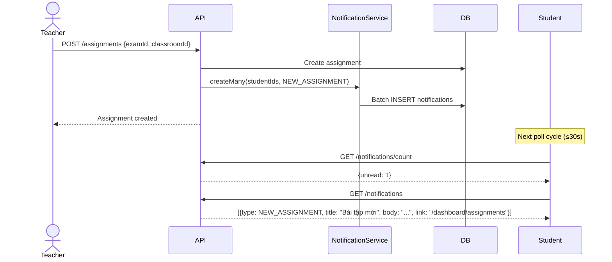
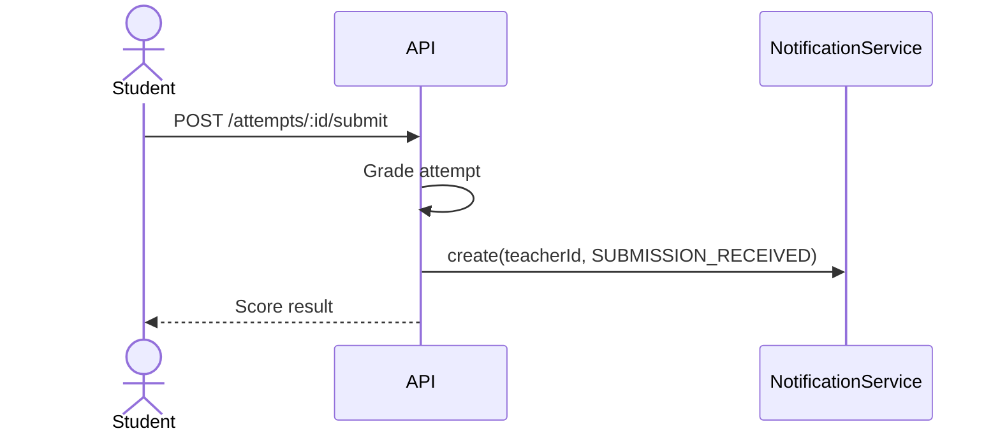
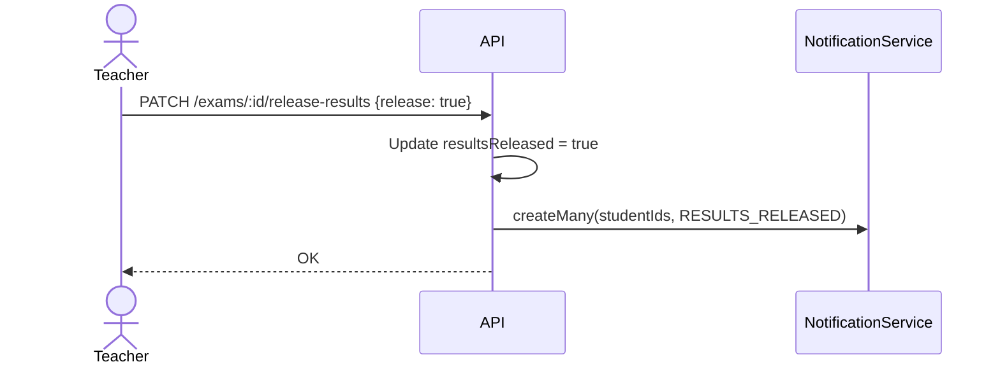
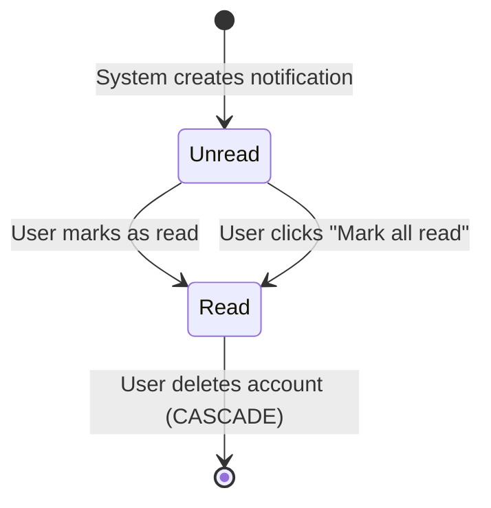

# J1. Notification Management

## 5.1 Feature Overview

| Field | Value |
|---|---|
| **Feature ID** | J1 |
| **Feature Name** | In-App Notification System |
| **Module** | J. Notifications |
| **Priority** | P1 (Model + API + UI), P2 (Email, Deadline Reminders) |
| **Complexity** | M |
| **Status** | Existing — Model, API, and UI implemented. Automatic triggers NOT wired. |
| **Target Roles** | Teacher, Student |
| **Business Objective** | Keep users informed about important events (new assignments, submissions, results) without requiring them to manually check. Improve engagement and reduce missed deadlines. |
| **User Problem** | Without notifications, students may miss new assignments or result releases, and teachers may not know when submissions arrive. |
| **Dependencies** | Assignment module (F), Attempt module (E), Exam module (D) |

## 5.2 Actors and Permissions

### Student
- **Can view**: Own notifications only
- **Can update**: Mark own notifications as read
- **Cannot**: View other users' notifications, create notifications, delete notifications

### Teacher
- **Can view**: Own notifications only
- **Can update**: Mark own notifications as read
- **Cannot**: View student notifications directly

### System (automated triggers)
- **Can create**: Notifications for relevant users when events occur
- Events: NEW_ASSIGNMENT, SUBMISSION_RECEIVED, GRADING_COMPLETE, RESULTS_RELEASED, ANNOUNCEMENT

### Backend Authorization
- All notification endpoints require authentication
- User can only access their own notifications (filtered by userId)
- Notification creation is system-internal only — no public create endpoint

## 5.3 Preconditions and Business Rules

1. **User must exist**: Notifications reference a userId; user deletion cascades to their notifications.
2. **No duplicate triggers**: The system should not create duplicate notifications for the same event (idempotency by checking recent notifications).
3. **Batch creation**: High-volume events (assignment to 100-student classroom) must use batch insert, not individual creates.
4. **Notification link validity**: Links may point to deleted resources (e.g., deleted assignment). The notification remains readable; the link shows a 404.
5. **No email for MVP**: Email notifications are deferred (P2). Only in-app notifications.
6. **Polling model**: Frontend polls every 30 seconds for unread count. No WebSocket/SSE for MVP.

## 5.4 Main User Flow — Happy Path

### Trigger: Teacher Creates Assignment



### Trigger: Student Submits Attempt



### Trigger: Teacher Releases Results



## 5.5 Alternative Flows

### AF-01: Mark Single Notification as Read
1. User clicks a notification in the list.
2. Frontend calls PATCH /notifications/:id/read.
3. Notification updates `read = true`.
4. Unread count decrements.

### AF-02: Mark All as Read
1. User clicks "Đánh dấu tất cả đã đọc" button.
2. Frontend calls POST /notifications/read-all.
3. All user's unread notifications marked as read.
4. Unread badge clears.

### AF-03: Click Notification Link
1. User clicks a notification with a link.
2. Frontend navigates to the link path (e.g., `/dashboard/assignments`).
3. If the target resource no longer exists, user sees a normal 404 page.
4. Notification is marked as read regardless.

## 5.6 Edge Cases and Failure Scenarios

| Scenario ID | Scenario | Trigger | Expected Behavior | User Feedback | Data Integrity | Recovery | Severity |
|---|---|---|---|---|---|---|---|
| J1-E01 | Assignment to large classroom (100 students) | Teacher creates assignment | Batch insert 100 notifications in one query | No delay for teacher | Atomic batch insert | Retry if DB error | Medium |
| J1-E02 | Notification for deleted resource | Assignment deleted after notification created | Notification remains readable; link leads to 404 | "Bài tập không tồn tại" when clicking link | Notification not deleted | User dismisses notification | Low |
| J1-E03 | User deletes account | CASCADE delete | All notifications for that user deleted | N/A | CASCADE handles cleanup | None needed | Low |
| J1-E04 | Duplicate trigger | Network retry causes assignment creation to fire twice | Check if notification for this event already exists (within time window) | No duplicate notifications | Idempotent trigger | None needed | Medium |
| J1-E05 | Polling during high load | 100 students polling every 30s | Simple count query on indexed (userId, read) | No degradation | Indexed query | None needed | Low |
| J1-E06 | Student removed from classroom after notification | Teacher removes student | Existing notifications remain | Student still sees old notifications | Notifications are user-owned, not classroom-bound | None needed | Low |
| J1-E07 | Mark all as read with 1000+ notifications | Bulk update | UPDATE WHERE userId = X AND read = false | May briefly lock rows | Acceptable at this scale | None needed | Low |
| J1-E08 | Notification creation fails mid-batch | DB error during batch insert | Transaction rollback — no partial notifications | Teacher action still succeeds (notification failure is non-blocking) | Non-blocking: log error, continue | Retry or manual notification | Medium |

## 5.7 UI/UX Specification

### Entry Points
1. **Bell icon in header**: Shows in `/dashboard/layout.tsx`. Displays unread count badge (red dot with number). Click navigates to `/dashboard/notifications`.
2. **Sidebar link**: "Thông báo" in navigation.

### Notification List Page (`/dashboard/notifications`)
- **Header**: "Thông báo" with "Đánh dấu tất cả đã đọc" button (right-aligned).
- **List**: Notification cards, most recent first.
  - Unread: white/surface background with left blue border accent.
  - Read: surface-secondary background, muted text.
  - Each card: type icon, title (bold), body (truncated), relative time ("2 giờ trước"), click to navigate.
- **Empty state**: "Không có thông báo nào" with bell-off icon.
- **Loading**: Skeleton cards.

### Bell Icon Behavior
- Poll GET /notifications/count every 30 seconds.
- Show badge only when unread > 0.
- Badge shows count (max "99+").

### Notification Types and Icons
| Type | Icon | Title Template |
|---|---|---|
| NEW_ASSIGNMENT | ClipboardList | "Bài tập mới: {examTitle}" |
| SUBMISSION_RECEIVED | FileCheck | "{studentName} đã nộp bài: {examTitle}" |
| GRADING_COMPLETE | Award | "Bài của bạn đã được chấm: {examTitle}" |
| RESULTS_RELEASED | BarChart | "Kết quả đã được công bố: {examTitle}" |
| ANNOUNCEMENT | Megaphone | "Thông báo mới từ {classroomName}" |

## 5.8 Data Requirements

### Existing Schema (no changes needed)

```
Notification {
  id        UUID PK
  userId    UUID FK → User (CASCADE delete)
  type      NotificationType enum
  title     String
  body      String
  link      String?
  read      Boolean default false
  createdAt DateTime
}
```

**Index**: `(userId, read)` — optimizes unread count and filtered listing.

### Proposed Changes
None. Schema is complete.

### Data Volume Estimate
- 100 users × 5 notifications/day × 30 days = 15,000 rows/month
- Manageable without cleanup for the first year. Consider archival policy later.

## 5.9 API Requirements

### GET /notifications

| Field | Value |
|---|---|
| **Purpose** | List notifications for the current user |
| **Role** | Any authenticated user |
| **Query params** | `unreadOnly` (boolean, optional), `limit` (default 20), `page` (default 1) |
| **Response 200** | `[{id, type, title, body, link, read, createdAt}]` |
| **Auth filter** | Always filtered by request.user.id |

### GET /notifications/count

| Field | Value |
|---|---|
| **Purpose** | Get unread notification count |
| **Response 200** | `{unread: N}` |

### PATCH /notifications/:id/read

| Field | Value |
|---|---|
| **Purpose** | Mark a single notification as read |
| **Validation** | Notification must belong to current user |
| **Response 200** | Updated notification |
| **Error 404** | Notification not found or not owned |

### POST /notifications/read-all

| Field | Value |
|---|---|
| **Purpose** | Mark all current user's notifications as read |
| **Response 200** | `{count: N}` — number of notifications updated |

### Internal: NotificationsService.create / createMany

| Field | Value |
|---|---|
| **Purpose** | System-internal notification creation |
| **Not exposed** | No public endpoint — called by other services |
| **create** | `(userId, type, title, body, link?)` |
| **createMany** | `(userIds[], type, title, body, link?)` — batch insert |

## 5.10 State Management

Notifications have a simple binary state: **unread** → **read**.



No reverse transition (read → unread) is supported.

## 5.11 Acceptance Criteria

```gherkin
Given a teacher creates an assignment for a classroom with 5 students,
When the assignment is saved,
Then all 5 students receive a NEW_ASSIGNMENT notification.

Given a student has 3 unread notifications,
When the student views the bell icon,
Then the badge shows "3".

Given a student marks a notification as read,
When the student views the bell icon next,
Then the badge count decreases by 1.

Given a student clicks "Đánh dấu tất cả đã đọc",
When the action completes,
Then all notifications show as read and the badge clears.

Given a notification links to a deleted assignment,
When the student clicks the notification,
Then the student sees a 404 page but the notification is still marked as read.

Given a student submits an exam attempt,
When the submission completes,
Then the exam owner (teacher) receives a SUBMISSION_RECEIVED notification.
```

### Negative Criteria

```gherkin
Given Student A has notifications,
When Student B requests Student A's notifications via API,
Then the backend returns only Student B's own notifications (userId filter).

Given a notification creation fails during assignment creation,
When the error is caught,
Then the assignment is still created successfully (non-blocking).
```

## 5.12 QA Test Scenarios

| Test ID | Scenario | Preconditions | Steps | Expected | Priority |
|---|---|---|---|---|---|
| J1-T01 | List own notifications | User has 5 notifications | GET /notifications | Returns 5, sorted by createdAt desc | High |
| J1-T02 | Unread count | User has 3 unread, 2 read | GET /notifications/count | {unread: 3} | High |
| J1-T03 | Mark single as read | Notification exists, unread | PATCH /notifications/:id/read | read = true | High |
| J1-T04 | Mark all as read | 5 unread notifications | POST /notifications/read-all | All 5 now read, count returns 0 | High |
| J1-T05 | Cannot access other user's notification | Notification belongs to User B | PATCH /notifications/:id/read as User A | 404 | High |
| J1-T06 | Batch create on assignment | Classroom with 10 students | POST /assignments → check notifications | 10 notifications created | High |
| J1-T07 | Submission triggers teacher notification | Student submits attempt | POST /attempts/:id/submit → check teacher notifications | Teacher has SUBMISSION_RECEIVED | High |
| J1-T08 | Deleted resource link | Assignment deleted | Click notification link | 404 page, notification read | Medium |
| J1-T09 | Empty notifications | New user, no notifications | GET /notifications | Empty array | Medium |
| J1-T10 | Polling load | 50 users polling simultaneously | GET /notifications/count × 50 | All respond within 200ms | Medium |

## 5.13 Open Questions and Assumptions

| Question | Why It Matters | Options | Recommended Default | Impact |
|---|---|---|---|---|
| When should notifications be cleaned up? | Unbounded growth over time | (A) Never (keep all), (B) Delete after 90 days, (C) Keep last 100 per user | A — keep all for MVP, add cleanup later | Low |
| Should notification creation be synchronous or async? | Batch insert for 100 students may add latency to assignment creation | (A) Synchronous (current), (B) Queue with BullMQ | A — synchronous. At ~100 users, batch insert takes <100ms. | Low |
| Should notifications be real-time (WebSocket)? | Better UX vs infrastructure complexity | (A) Polling (current), (B) WebSocket, (C) SSE | A — polling every 30s is sufficient for ~100 users | Low |
| Email notifications? | Some users may miss in-app notifications | (A) In-app only (current), (B) Email for critical events, (C) Configurable per user | A — in-app only. Email deferred to P2. | Medium |
| Deadline reminder notifications? | Students may forget upcoming deadlines | (A) No reminders (current), (B) 24h + 1h before deadline | B — but requires background scheduler (BullMQ/cron). Deferred to P2. | Medium |

### Assumptions
1. **A-J1-01**: Notification creation failure does not block the triggering action (assignment creation, submission, etc.). Errors are logged, not propagated.
2. **A-J1-02**: Notifications are immutable after creation (no editing body/title).
3. **A-J1-03**: Polling interval of 30 seconds is acceptable UX for MVP.
4. **A-J1-04**: The `link` field contains a relative path (e.g., `/dashboard/assignments`), not an absolute URL.
