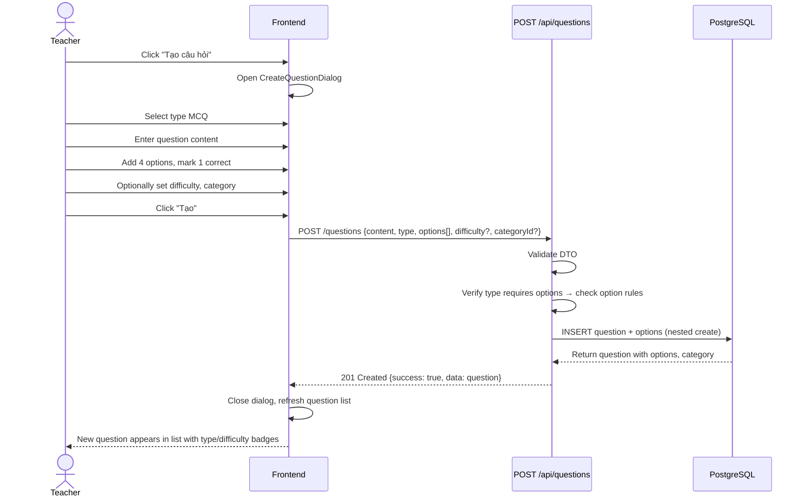

# C1. Create Question

## 5.1 Feature Overview

| Field | Value |
|---|---|
| Feature ID | C1 |
| Feature Name | Create Question |
| Module | C. Question Bank |
| Priority | P0 |
| Complexity | M |
| Status | **Existing** — All six question types are supported |
| Target Roles | Teacher |
| Business Objective | Enable teachers to build a personal question bank as the foundation for all exams and assessments |
| User Problem | Teachers need to digitise their question content (across multiple types) and organize it in a structured, reusable bank so they can compose exams efficiently |
| Dependencies | A1 (Authentication), A3 (Role Management) |

## 5.2 Actors and Permissions

### Teacher

| Action | Permitted | Notes |
|---|---|---|
| Create a question | Yes | Automatically becomes the question's owner |
| View created question | Yes | Own questions only |
| Create with any type | Yes | MCQ, MCQ_MULTI, TRUE_FALSE, SHORT_ANSWER, FILL_BLANK, ESSAY |
| Attach to a category | Yes | Only categories owned by the same teacher |
| Upload image URL | Yes | imageUrl field; upload endpoint is a separate feature |
| Create question in another teacher's bank | No | Ownership is scoped to the authenticated teacher |

### Student

| Action | Permitted | Notes |
|---|---|---|
| Create a question | **No** | 403 Forbidden — entire `/questions` controller is `@Roles('TEACHER')` |
| View questions directly | **No** | Students access questions only through published exam snapshots |

### Backend Authorization (Verified)

- The `QuestionsController` has `@Roles('TEACHER')` at the class level, applied to every route.
- `create()` takes `ownerId` from `@CurrentUser('id')`, not from the request body, preventing spoofing.

## 5.3 Preconditions and Business Rules

### Preconditions

1. User is authenticated with a valid JWT access token.
2. User has `TEACHER` role.
3. For option-based types (MCQ, MCQ_MULTI, TRUE_FALSE): an `options` array is provided.
4. If `categoryId` is supplied, the category must exist and be owned by the same teacher.

### Business Rules

| Rule ID | Rule | Enforcement |
|---|---|---|
| CR-01 | Content is required and cannot be empty | DTO `@IsString()` validation |
| CR-02 | Type defaults to `MCQ` if not provided | Service: `const type = dto.type \|\| 'MCQ'` |
| CR-03 | MCQ and TRUE_FALSE require exactly 1 correct option | Service validation, throws `BadRequestException` |
| CR-04 | MCQ_MULTI requires at least 1 correct option | Service validation |
| CR-05 | All option-based types require at least 2 options | DTO `@ArrayMinSize(2)` |
| CR-06 | TRUE_FALSE should have exactly 2 options | Not enforced in code — only the "exactly 1 correct" check applies. **Gap: no max-options check for TRUE_FALSE.** |
| CR-07 | SHORT_ANSWER and FILL_BLANK may use `correctAnswer` for auto-grading | Service stores the field; grading logic checks it |
| CR-08 | ESSAY questions have no correct answer and require manual grading | No options, no correctAnswer expected |
| CR-09 | Options are created in a single transaction with the question | Prisma nested `create` |
| CR-10 | Each option must have a unique `position` per question | Not enforced by unique constraint in the database. Relies on client correctness. |
| CR-11 | `imageUrl` accepts a URL string; the system does not validate that it resolves | No URL format validation on the field |
| CR-12 | A question can exist without being linked to any exam | Standalone entity |

### Validation Rules (DTO-level)

| Field | Type | Required | Validation |
|---|---|---|---|
| `content` | string | Yes | `@IsString()` |
| `type` | QuestionType enum | No | `@IsEnum(QuestionType)`, defaults to MCQ |
| `explanation` | string | No | `@IsString()` |
| `difficulty` | DifficultyLevel enum | No | `@IsEnum(DifficultyLevel)` — EASY, MEDIUM, HARD |
| `categoryId` | UUID string | No | `@IsUUID()` |
| `imageUrl` | string | No | `@IsString()` |
| `correctAnswer` | string | No | `@IsString()` |
| `options` | CreateOptionDto[] | Conditional | `@ArrayMinSize(2)`, each validated via `@ValidateNested` |
| `options[].content` | string | Yes | `@IsString()` |
| `options[].isCorrect` | boolean | Yes | `@IsBoolean()` |
| `options[].position` | int | Yes | `@IsInt()`, `@Min(0)` |

## 5.4 Main User Flow — Happy Path

### MCQ Single Answer (primary use case)



### Steps

| Step | Actor | Action | System Response | Data Changed | UI State |
|---|---|---|---|---|---|
| 1 | Teacher | Clicks "Tạo câu hỏi" button | — | — | CreateQuestionDialog opens |
| 2 | Teacher | Selects question type from dropdown | Form adapts (options section shown/hidden) | — | Form fields change based on type |
| 3 | Teacher | Enters content text | — | — | Content textarea populated |
| 4 | Teacher | Adds options with content, marks correct | — | — | Options list populated |
| 5 | Teacher | Optionally selects difficulty and category | — | — | Dropdowns selected |
| 6 | Teacher | Clicks "Tạo" | Request sent to API | — | Loading state on button |
| 7 | System | Validates and creates | Question + options inserted | `questions` + `question_options` rows created | — |
| 8 | System | Returns success | Dialog closes, list refreshes | — | New question card appears with badges |

## 5.5 Alternative Flows

### AF-01: Create SHORT_ANSWER question

Same flow as MCQ, but:
- Teacher selects "SHORT_ANSWER" type.
- Options section is hidden.
- `correctAnswer` text input appears.
- Teacher enters the expected correct answer text.
- API creates question with `correctAnswer` field, no options.

### AF-02: Create ESSAY question

- Teacher selects "ESSAY" type.
- Options section and correctAnswer field are both hidden.
- Only content and explanation are required.
- Question is stored with no grading reference — all grading is manual.

### AF-03: Create question without category or difficulty

- Both fields are optional.
- Question is created with `categoryId: null` and `difficulty: null`.
- It appears in the "uncategorized" view and shows no difficulty badge.

### AF-04: Create question and immediately add to a draft exam

- Not implemented as a single operation. Teacher creates the question, then navigates to exam management to add it.
- This is an identified gap (see D9 in exam management specs — P2 proposed).

### AF-05: Teacher cancels creation

- Teacher clicks outside the dialog or presses Cancel.
- No API call is made. No data changes.

## 5.6 Edge Cases and Failure Scenarios

| Scenario ID | Scenario | Trigger | Expected Behavior | User Feedback | Data Integrity | Recovery | Severity |
|---|---|---|---|---|---|---|---|
| C1-E01 | Empty content submitted | Teacher submits with blank content field | DTO validation rejects: 400 Bad Request | Field error: "content must be a string" | No data created | Fix input and resubmit | Medium |
| C1-E02 | MCQ with no correct option | All options have `isCorrect: false` | Service throws BadRequestException: "Exactly one correct option required" | Toast error | No data created | Mark one option as correct | High |
| C1-E03 | MCQ with multiple correct options | Two options marked `isCorrect: true` | Service throws BadRequestException: "Exactly one correct option required" | Toast error | No data created | Uncheck one, or change type to MCQ_MULTI | High |
| C1-E04 | MCQ with only 1 option | Single option provided | DTO rejects: `@ArrayMinSize(2)` | Validation error | No data created | Add at least one more option | Medium |
| C1-E05 | TRUE_FALSE with 3+ options | Teacher adds more than 2 options for TRUE_FALSE | **Currently allowed** — only the "exactly 1 correct" rule applies. No max-options enforcement. | No error shown | Question created with extra options | **Gap: should validate exactly 2 options for TRUE_FALSE** | Medium |
| C1-E06 | MCQ_MULTI with all options correct | Every option marked correct | Allowed — rule is "at least 1 correct". No rule requiring at least 1 incorrect. | No error | Question created | **Gap: consider requiring at least 1 incorrect option** | Low |
| C1-E07 | Non-existent categoryId | UUID provided but category doesn't exist | Prisma foreign key constraint fails → 500 Internal Server Error | Generic server error | No data created | **Gap: should validate categoryId exists before create** | Medium |
| C1-E08 | categoryId owned by another teacher | Valid UUID but belongs to a different teacher | No ownership check on categoryId in `create()` — **creates the question linked to another teacher's category** | No error | **Data integrity issue**: cross-teacher category linkage | **Gap: should validate category ownership** | High |
| C1-E09 | Duplicate option positions | Two options with `position: 0` | No unique constraint on `(questionId, position)` in the database | No error | Duplicate positions stored | **Gap: should enforce unique positions or auto-assign** | Low |
| C1-E10 | Extremely long content | Content exceeds reasonable display length (e.g., 100KB) | No length limit in DTO or schema (`String` type, no `@MaxLength`) | Question created but may render poorly | Stored in full | **Gap: should add `@MaxLength()` to content** | Low |
| C1-E11 | Network failure during creation | Connection drops after request sent | If server received and processed: question created but client shows error. If not received: no data change. | Network error toast | Potentially created without client knowing | Refresh the list; check if question was created | Medium |
| C1-E12 | Concurrent creation of identical questions | Teacher double-clicks submit | No idempotency key. Two identical questions created. | Two questions appear in list | Duplicate data | Delete one manually | Low |
| C1-E13 | SHORT_ANSWER/FILL_BLANK without correctAnswer | Teacher creates but leaves correctAnswer blank | Allowed — correctAnswer is optional | No error | Question created without grading reference | Auto-grading will not work; manual grading required | Medium |
| C1-E14 | Invalid QuestionType enum value | Client sends `type: "UNKNOWN"` | DTO `@IsEnum(QuestionType)` rejects: 400 | Validation error | No data created | Select a valid type | Low |
| C1-E15 | JWT expired during form submission | Token expires while teacher is filling the form | 401 Unauthorized. Frontend interceptor should refresh token and retry. | Transparent if interceptor works; otherwise login redirect | No data created on first failure | Token refresh + retry | Medium |

## 5.7 UI/UX Specification

### Entry Point

- **Page**: `/dashboard/questions`
- **Trigger**: "Tạo câu hỏi" button (primary blue, Plus icon)

### CreateQuestionDialog

- **Component**: Dialog (shadcn `Dialog` with `DialogTrigger render={<Button />}`)
- **Max width**: `max-w-lg`, scrollable content (`max-h-[90vh] overflow-y-auto`)

### Form Fields

| Field | Component | Behavior |
|---|---|---|
| Type selector | Segmented button group or Select dropdown | Options: Trắc nghiệm, Nhiều đáp án, Đúng/Sai, Trả lời ngắn, Điền chỗ trống, Tự luận. Defaults to Trắc nghiệm. Changes visible form fields. |
| Content | Textarea | Required. Placeholder: "Nhập nội dung câu hỏi". 3-4 rows minimum. |
| Explanation | Textarea (collapsible) | Optional. Placeholder: "Giải thích đáp án (tùy chọn)". |
| Difficulty | Select | Options: Dễ, Trung bình, Khó. Optional. |
| Category | Select | Populated from `GET /questions/categories`. Optional. Shows "Không có danh mục" if empty. |
| Options section | Dynamic list | Shown for MCQ, MCQ_MULTI, TRUE_FALSE. Each option: text input + correct checkbox + position. Add/remove buttons. |
| Correct Answer | Input | Shown for SHORT_ANSWER and FILL_BLANK only. Placeholder: "Đáp án đúng". |
| Image URL | Input | Optional. Placeholder: "URL hình ảnh (tùy chọn)". |

### States

| State | Description |
|---|---|
| **Default** | Form empty, type set to MCQ, 2 blank options shown |
| **Loading** | Submit button shows spinner, all fields disabled |
| **Error** | Red border on invalid fields, error text below field |
| **Success** | Dialog closes, question list refreshes, no success toast (immediate visual feedback via new card) |

### Responsive Behavior

- Dialog is full-width on mobile (`<640px`) with slightly reduced padding.
- Option list stacks vertically; correct checkbox is inline with text input.
- Category and difficulty selects stack on mobile (1 column).

### Accessibility

- All form fields have associated `<Label>` elements.
- Tab order follows visual order.
- Error messages are associated with fields via `aria-describedby`.
- Dialog traps focus when open.

## 5.8 Data Requirements

### Existing Entities (verified in schema)

**Question**

| Field | Type | Nullable | Notes |
|---|---|---|---|
| id | UUID | No | Primary key, auto-generated |
| ownerId | UUID FK → users | No | Set from authenticated user |
| type | String | No | Default "MCQ". Values: MCQ, MCQ_MULTI, TRUE_FALSE, SHORT_ANSWER, FILL_BLANK, ESSAY |
| content | String (text) | No | Question body text |
| explanation | String | Yes | Teacher-provided explanation |
| difficulty | Difficulty enum | Yes | EASY, MEDIUM, HARD |
| categoryId | UUID FK → question_categories | Yes | onDelete: SetNull |
| imageUrl | String | Yes | URL to an image |
| correctAnswer | String | Yes | For SHORT_ANSWER, FILL_BLANK types |
| createdAt | DateTime | No | Auto-set |
| updatedAt | DateTime | No | Auto-updated |

**QuestionOption**

| Field | Type | Nullable | Notes |
|---|---|---|---|
| id | UUID | No | Primary key |
| questionId | UUID FK → questions | No | onDelete: Cascade |
| content | String | No | Option text |
| isCorrect | Boolean | No | Default false |
| position | Int | No | Display order |

### Relationships

- Question 1:N QuestionOption (cascade delete)
- Question N:1 User (owner)
- Question N:1 QuestionCategory (optional, SetNull on delete)
- Question 1:N ExamQuestion (sourceQuestionId, SetNull on delete — safe for published exams)

### Proposed Schema Changes

None required for this feature. The existing schema supports all six question types.

### Indexing

- `question_options.questionId` — index exists (`@@index([questionId])`)
- Consider adding index on `questions.categoryId` for category-filtered queries.
- Consider adding index on `questions.ownerId` (used in every query).

## 5.9 API Requirements

### POST /api/questions

| Field | Value |
|---|---|
| HTTP Method | POST |
| Endpoint | `/api/questions` |
| Purpose | Create a new question with optional options |
| Required Role | TEACHER |
| Authorization | User must be authenticated. ownerId is taken from JWT, not request body. |

**Request Body**

```json
{
  "content": "Thủ đô của Việt Nam là gì?",
  "type": "MCQ",
  "explanation": "Hà Nội là thủ đô của Việt Nam từ năm 1010",
  "difficulty": "EASY",
  "categoryId": "uuid-of-category",
  "imageUrl": "https://example.com/image.png",
  "options": [
    { "content": "TP Hồ Chí Minh", "isCorrect": false, "position": 0 },
    { "content": "Hà Nội", "isCorrect": true, "position": 1 },
    { "content": "Đà Nẵng", "isCorrect": false, "position": 2 },
    { "content": "Huế", "isCorrect": false, "position": 3 }
  ]
}
```

**Successful Response (201 Created)**

```json
{
  "success": true,
  "data": {
    "id": "uuid",
    "ownerId": "uuid",
    "type": "MCQ",
    "content": "Thủ đô của Việt Nam là gì?",
    "explanation": "Hà Nội là thủ đô...",
    "difficulty": "EASY",
    "categoryId": "uuid",
    "imageUrl": "https://example.com/image.png",
    "correctAnswer": null,
    "createdAt": "2026-11-11T...",
    "updatedAt": "2026-11-11T...",
    "options": [
      { "id": "uuid", "content": "TP Hồ Chí Minh", "isCorrect": false, "position": 0 },
      { "id": "uuid", "content": "Hà Nội", "isCorrect": true, "position": 1 },
      { "id": "uuid", "content": "Đà Nẵng", "isCorrect": false, "position": 2 },
      { "id": "uuid", "content": "Huế", "isCorrect": false, "position": 3 }
    ],
    "category": { "id": "uuid", "name": "Địa lý" }
  }
}
```

**Error Responses**

| Status | Code | Condition |
|---|---|---|
| 400 | Validation error | Missing required fields, invalid enum values |
| 400 | "Options required for this question type" | MCQ/MCQ_MULTI/TRUE_FALSE without options |
| 400 | "Exactly one correct option required" | MCQ/TRUE_FALSE with 0 or 2+ correct options |
| 400 | "At least one correct option required" | MCQ_MULTI with no correct option |
| 401 | Unauthorized | Missing or invalid JWT |
| 403 | Forbidden | User is not TEACHER role |

**Idempotency**: Not applicable. Each POST creates a new question. Duplicate prevention is the client's responsibility.

## 5.10 State Management

Questions do not have a formal lifecycle state machine. They are either:
- **Active**: Exists in the database, visible in the teacher's question bank.
- **Deleted**: Removed via hard delete. Gone from the bank. ExamQuestions referencing it via `sourceQuestionId` have that field set to null (onDelete: SetNull), but their snapshots remain intact.

The important state concern is the **snapshot boundary**: once a question is included in a published exam, the snapshot (contentSnapshot + optionsSnapshot on ExamQuestion) is the source of truth for that exam. Editing or deleting the source question does not affect any published exam.

## 5.11 Acceptance Criteria

### Positive Cases

```gherkin
Given a teacher is authenticated,
When they submit a valid MCQ question with 4 options and 1 correct,
Then the question is created and returned with all options and the assigned category.

Given a teacher selects TRUE_FALSE type,
When they submit with 2 options and exactly 1 correct,
Then the question is created with type "TRUE_FALSE".

Given a teacher selects SHORT_ANSWER type,
When they submit with content and correctAnswer but no options,
Then the question is created with correctAnswer stored and no options.

Given a teacher selects ESSAY type,
When they submit with only content,
Then the question is created with type "ESSAY", no options, no correctAnswer.

Given a teacher provides a valid categoryId,
When they create a question,
Then the question is linked to that category and the response includes the category name.

Given a teacher does not provide difficulty or category,
When they create a question,
Then the question is created with null difficulty and null categoryId.
```

### Negative Cases

```gherkin
Given a student is authenticated,
When they attempt to POST /questions,
Then the request is rejected with 403 Forbidden.

Given a teacher submits an MCQ with no correct option,
When the service validates,
Then it returns 400 "Exactly one correct option required".

Given a teacher submits MCQ_MULTI with zero correct options,
When the service validates,
Then it returns 400 "At least one correct option required".

Given a teacher submits a MCQ with only 1 option,
When the DTO validates,
Then it returns 400 with an ArrayMinSize validation error.

Given an unauthenticated user sends POST /questions,
When the JWT guard checks,
Then it returns 401 Unauthorized.
```

## 5.12 QA Test Scenarios

| Test ID | Scenario | Preconditions | Steps | Test Data | Expected Result | Priority |
|---|---|---|---|---|---|---|
| C1-T01 | Create valid MCQ | Teacher logged in | POST /questions with 4 options, 1 correct | content: "Test?", options: A(F), B(T), C(F), D(F) | 201, question returned with all fields | P0 |
| C1-T02 | Create MCQ_MULTI | Teacher logged in | POST with type MCQ_MULTI, 2 correct | 4 options, positions 0-3 | 201, question with 2 correct options | P1 |
| C1-T03 | Create TRUE_FALSE | Teacher logged in | POST with type TRUE_FALSE, 2 options | "Đúng"(T), "Sai"(F) | 201, type = TRUE_FALSE | P1 |
| C1-T04 | Create SHORT_ANSWER | Teacher logged in | POST with type SHORT_ANSWER, correctAnswer | No options, correctAnswer: "Hà Nội" | 201, correctAnswer stored | P1 |
| C1-T05 | Create FILL_BLANK | Teacher logged in | POST with type FILL_BLANK, content with ___ | correctAnswer: "oxygen" | 201, type = FILL_BLANK | P2 |
| C1-T06 | Create ESSAY | Teacher logged in | POST with type ESSAY, content only | No options, no correctAnswer | 201, type = ESSAY | P2 |
| C1-T07 | MCQ no correct option | Teacher logged in | POST MCQ, all isCorrect: false | 4 options, none correct | 400 "Exactly one correct option" | P0 |
| C1-T08 | MCQ multiple correct | Teacher logged in | POST MCQ, 2 isCorrect: true | 4 options | 400 "Exactly one correct option" | P0 |
| C1-T09 | MCQ only 1 option | Teacher logged in | POST MCQ with 1 option | Single option | 400 ArrayMinSize error | P0 |
| C1-T10 | Student attempt | Student logged in | POST /questions | Valid body | 403 Forbidden | P0 |
| C1-T11 | Unauthenticated | No token | POST /questions | Valid body | 401 Unauthorized | P0 |
| C1-T12 | With category | Teacher + category exists | POST with valid categoryId | categoryId: existing UUID | 201, category included in response | P1 |
| C1-T13 | With difficulty | Teacher logged in | POST with difficulty: "HARD" | Valid body + HARD | 201, difficulty = HARD | P1 |
| C1-T14 | Invalid categoryId | Teacher logged in | POST with non-existent categoryId | Random UUID | Should return 400 (currently: 500 FK error) | P1 |
| C1-T15 | Empty content | Teacher logged in | POST with content: "" | Empty string | 400 validation error | P0 |
| C1-T16 | Invalid type enum | Teacher logged in | POST with type: "UNKNOWN" | Invalid enum value | 400 validation error | P1 |
| C1-T17 | No body | Teacher logged in | POST with empty body | {} | 400 validation error | P0 |

## 5.13 Open Questions and Assumptions

| # | Question | Why It Matters | Options | Recommended Default | Impact |
|---|---|---|---|---|---|
| 1 | Should TRUE_FALSE enforce exactly 2 options? | Currently no max-options check. A teacher could add 3 options. | A) Enforce exactly 2 options for TRUE_FALSE. B) Leave as-is (1 correct suffices). | **A) Enforce exactly 2** — matches the type semantics | Low: add one validation check |
| 2 | Should MCQ_MULTI require at least 1 incorrect option? | Currently allows all options to be correct, which is semantically meaningless. | A) Require at least 1 incorrect. B) Leave as-is. | **A) Require at least 1 incorrect** | Low: add one check |
| 3 | Should categoryId ownership be validated? | Currently a teacher can link to another teacher's category (FK exists in DB). | A) Validate ownership. B) Leave as-is. | **A) Validate ownership** — prevents data leaks | Medium: add a DB lookup before create |
| 4 | Should content have a max length? | No `@MaxLength` on the DTO. Very long content could cause display issues. | A) Add @MaxLength(10000). B) Leave unlimited. | **A) Add limit** — 10,000 chars is generous | Low: DTO change |
| 5 | Should option positions be unique per question? | No DB constraint. Duplicate positions lead to ambiguous ordering. | A) Add unique constraint `(questionId, position)`. B) Auto-assign positions server-side. C) Leave as-is. | **B) Auto-assign positions** — simplest fix | Low: remove position from DTO input, compute server-side |
| 6 | Should the imageUrl be validated as a URL format? | Currently accepts any string. | A) Add `@IsUrl()` decorator. B) Leave as-is (teacher may use relative paths or pending upload URLs). | **B) Leave as-is** for now — upload infrastructure may change | Low |

### Assumptions

1. **Assumed**: Questions are owned by the teacher who creates them and cannot be transferred to another teacher.
2. **Assumed**: The question bank is private to each teacher. There is no shared question bank across teachers. (Azota supports shared banks — this is a deliberate scope reduction.)
3. **Assumed**: Question type cannot be changed after creation. The `type` field is set at creation and the update DTO does not include it.
4. **Assumed**: Hard delete is used (not soft delete). Once deleted, the question is gone from the bank. Published exam snapshots remain unaffected.
