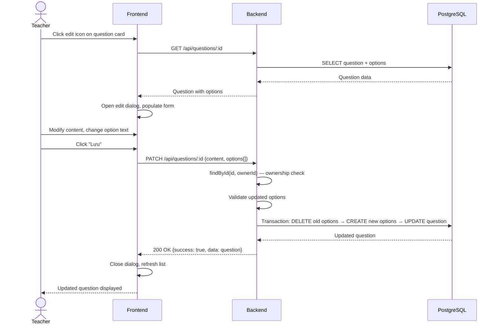
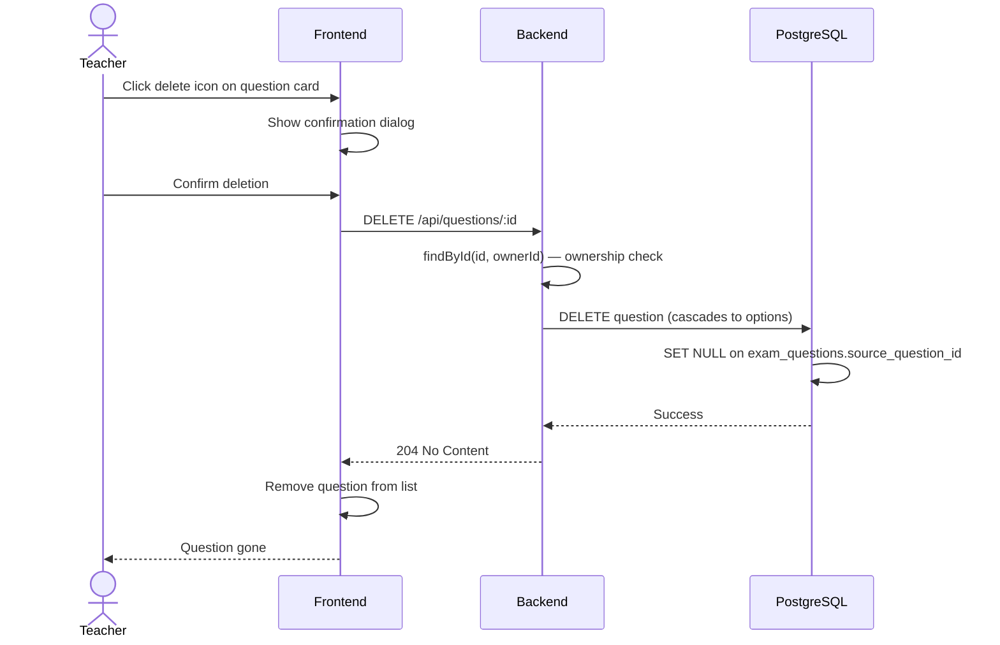

# C2. Edit and Delete Question

## 5.1 Feature Overview

| Field | Value |
|---|---|
| Feature ID | C2 |
| Feature Name | Edit and Delete Question |
| Module | C. Question Bank |
| Priority | P0 |
| Complexity | M |
| Status | **Existing** — PATCH and DELETE endpoints implemented |
| Target Roles | Teacher |
| Business Objective | Allow teachers to refine, correct, and remove questions in their bank to maintain quality |
| User Problem | Teachers need to fix typos, change correct answers, update options, adjust metadata, and remove obsolete questions without affecting already-published exams |
| Dependencies | C1 (Create Question), D1 (Exam Publish — snapshot mechanism) |

## 5.2 Actors and Permissions

### Teacher

| Action | Permitted | Notes |
|---|---|---|
| Edit own question content, options, metadata | Yes | Only DRAFT-state data; snapshots of published exams are unaffected |
| Delete own question | Yes | Hard delete with cascade on options |
| Edit another teacher's question | **No** | `findById` checks `ownerId` and throws ForbiddenException |
| Delete another teacher's question | **No** | Same ownership check |
| Change question type after creation | **No** | `type` is not in the UpdateQuestionDto |

### Student

All question-bank operations are blocked (controller-level `@Roles('TEACHER')`).

### Backend Authorization (Verified)

- `update()` calls `findById(id, ownerId)` which throws 403 if not the owner.
- `delete()` calls `findById(id, ownerId)` with the same check.
- Options are replaced atomically inside a `$transaction`.

## 5.3 Preconditions and Business Rules

### Preconditions

1. User is authenticated with TEACHER role.
2. The question exists and is owned by the authenticated teacher.

### Business Rules

| Rule ID | Rule | Enforcement |
|---|---|---|
| CU-01 | Only the question owner can edit or delete | Service checks `question.ownerId !== ownerId` |
| CU-02 | Editing a question does NOT modify published exam snapshots | Snapshots live in `exam_questions.content_snapshot` and `options_snapshot`, independent of the source question |
| CU-03 | When options are updated, all existing options are deleted and re-created | `deleteMany` + `createMany` in transaction |
| CU-04 | For MCQ/TRUE_FALSE: updated options must have exactly 1 correct | Validated in `update()` |
| CU-05 | Content, explanation, difficulty, categoryId, imageUrl, correctAnswer can be updated independently | Each field is conditionally spread |
| CU-06 | Empty update (no fields provided) is a no-op | Results in `question.update({ data: {} })` — valid Prisma operation |
| CU-07 | Deleting a question cascades to its options | `onDelete: Cascade` on QuestionOption.questionId |
| CU-08 | Deleting a question sets `sourceQuestionId` to null on any ExamQuestion referencing it | `onDelete: SetNull` on ExamQuestion.sourceQuestionId |
| CU-09 | Question type cannot be changed after creation | `type` is absent from UpdateQuestionDto |
| CU-10 | Updating options for MCQ_MULTI should maintain "at least 1 correct" | **Gap: the update method only validates MCQ/TRUE_FALSE correct count, not MCQ_MULTI** |

## 5.4 Main User Flow — Happy Path

### Edit Question



### Delete Question



## 5.5 Alternative Flows

### AF-01: Edit only metadata (no options change)

- Teacher opens edit dialog, changes only difficulty from MEDIUM to HARD.
- PATCH body: `{ "difficulty": "HARD" }` (no `options` field).
- Service skips the option replacement logic entirely.
- Only the `questions` row is updated.

### AF-02: Remove a question that is referenced by a draft exam

- Teacher deletes a question that is linked via `exam_questions.sourceQuestionId` in a DRAFT exam.
- The `sourceQuestionId` on the ExamQuestion row becomes null (SetNull).
- The draft exam still has the ExamQuestion row, but with no source reference.
- **Impact**: When the teacher publishes that exam, the snapshot logic skips ExamQuestions where `sourceQuestion` is null (`if (!eq.sourceQuestion) continue`). This means the exam question would be published without content.
- **This is a gap**: Deleting a source question for a draft exam silently breaks the exam.

### AF-03: Remove the correct answer from options during update

- Teacher submits options for an MCQ where no option has `isCorrect: true`.
- Service throws `BadRequestException: "Exactly one correct option required"`.
- No data changes.

### AF-04: Clear the category from a question

- Teacher sends `PATCH { "categoryId": null }` (or an empty categoryId).
- Question's categoryId is set to null.
- The question becomes uncategorized.

## 5.6 Edge Cases and Failure Scenarios

| Scenario ID | Scenario | Trigger | Expected Behavior | User Feedback | Data Integrity | Recovery | Severity |
|---|---|---|---|---|---|---|---|
| C2-E01 | Edit non-existent question | Question was deleted by another tab | `findById` throws 404 NotFound | "Question not found" error | No change | Refresh the list | Medium |
| C2-E02 | Edit another teacher's question | Crafted request with another teacher's question ID | `findById` throws 403 Forbidden | "Forbidden" error | No change | None needed | High |
| C2-E03 | Delete question used in published exam | Question linked to ExamQuestion with snapshot | Question deleted. ExamQuestion.sourceQuestionId → null. **Snapshot is preserved.** Published exam is unaffected. | Question removed from list. No warning about published usage. | Snapshots intact | **Consider: show warning "Question used in X published exams"** | Medium |
| C2-E04 | Delete question used in draft exam (no snapshot) | Question linked to ExamQuestion without snapshot | Question deleted. ExamQuestion.sourceQuestionId → null. ExamQuestion has no contentSnapshot. **Publishing the exam will skip this question.** | Question removed. No warning. | **Draft exam silently broken** — exam question has no content | **Gap: block deletion if used in draft exams, or warn** | High |
| C2-E05 | Update options with invalid MCQ_MULTI | All options set to isCorrect: false | **Currently NOT validated** — update only checks MCQ/TRUE_FALSE | No error shown | MCQ_MULTI question stored with no correct option | **Gap: add MCQ_MULTI validation in update** | High |
| C2-E06 | Partial transaction failure | DB crashes between deleteMany and createMany in the option update | Transaction rolls back. Old options restored. Question unchanged. | Server error shown | Data consistent (transaction guarantee) | Retry the update | Medium |
| C2-E07 | Concurrent edit by same teacher in two tabs | Teacher opens same question in two tabs, edits both | Last write wins. Second update replaces the first's options entirely. | No conflict warning. Last save is the final state. | Consistent but potentially surprising | **Gap: consider optimistic locking (updatedAt check)** | Medium |
| C2-E08 | Delete cascade removes many options | Question with 100 options | CASCADE delete handles all. Single query. | Instant deletion | All options deleted atomically | None needed | Low |
| C2-E09 | Update with empty options array | PATCH with `options: []` | DTO `@ArrayMinSize(2)` rejects: 400 | Validation error | No change | Provide at least 2 options | Low |
| C2-E10 | Network failure during delete | Request sent, server deletes, response lost | Question is deleted. Client may show stale list. | Network error toast | Question gone from DB | Refresh list | Medium |

## 5.7 UI/UX Specification

### Edit Question UI

- **Entry point**: Edit icon (Pencil) on each question card in the question bank list.
- **Component**: Same dialog as CreateQuestionDialog but pre-populated with existing data.
- **Behavior**: On open, fetches `GET /questions/:id` to get latest data. Populates all form fields. Teacher modifies and saves.
- **Submit**: PATCH request. On success, closes dialog and refreshes list.

### Delete Question UI

- **Entry point**: Delete icon (Trash) on each question card.
- **Confirmation**: Must show a confirmation dialog before deletion: "Bạn có chắc muốn xóa câu hỏi này? Hành động này không thể hoàn tác."
- **Warning**: If the question is used in any exam (draft or published), the confirmation should mention it. **Currently not implemented — gap.**
- **Submit**: DELETE request. On success, removes the card from the list.

### States

| State | UI Treatment |
|---|---|
| Loading (fetching question for edit) | Spinner in dialog body |
| Submitting edit | Button shows "Đang lưu...", fields disabled |
| Submitting delete | Confirmation button shows "Đang xóa...", disabled |
| Error (validation) | Red borders on fields, error text |
| Error (403/404) | Toast notification with error message |
| Success (edit) | Dialog closes, list refreshes silently |
| Success (delete) | Card removed with fade-out transition |

## 5.8 Data Requirements

No schema changes needed. Uses existing `questions` and `question_options` tables.

### Key Behaviors

- **Option update strategy**: Replace-all. Old options are deleted, new ones created. This means option IDs change on every update. Any system referencing option IDs (published exam snapshots) uses the snapshot, not the live option ID.
- **Cascade on delete**: `question_options` rows cascade-deleted. `exam_questions.sourceQuestionId` set to null.

### Proposed Improvements

1. Add `@@index([ownerId])` on `questions` for ownership queries.
2. Consider adding a `usedInExams` count or check before deletion.

## 5.9 API Requirements

### PATCH /api/questions/:id

| Field | Value |
|---|---|
| HTTP Method | PATCH |
| Endpoint | `/api/questions/:id` |
| Purpose | Update a question's content, metadata, and/or options |
| Required Role | TEACHER |
| Authorization | Must be the question owner |

**Request Body** (all fields optional)

```json
{
  "content": "Updated question text",
  "explanation": "Updated explanation",
  "difficulty": "HARD",
  "categoryId": "uuid-or-null",
  "imageUrl": "https://example.com/new-image.png",
  "correctAnswer": "Updated answer",
  "options": [
    { "content": "Option A", "isCorrect": false, "position": 0 },
    { "content": "Option B", "isCorrect": true, "position": 1 }
  ]
}
```

**Success Response (200 OK)**

Same shape as create response — full question with options and category.

**Error Responses**

| Status | Code | Condition |
|---|---|---|
| 400 | Validation error | Invalid fields, ArrayMinSize violation |
| 400 | "Exactly one correct option required" | MCQ/TRUE_FALSE with wrong correct count |
| 401 | Unauthorized | Missing/invalid JWT |
| 403 | Forbidden | Not question owner or not TEACHER |
| 404 | Not Found | Question ID does not exist |

### DELETE /api/questions/:id

| Field | Value |
|---|---|
| HTTP Method | DELETE |
| Endpoint | `/api/questions/:id` |
| Purpose | Permanently delete a question and its options |
| Required Role | TEACHER |
| Authorization | Must be the question owner |

**Success Response**: 204 No Content (empty body).

**Error Responses**

| Status | Code | Condition |
|---|---|---|
| 401 | Unauthorized | Missing/invalid JWT |
| 403 | Forbidden | Not question owner or not TEACHER |
| 404 | Not Found | Question ID does not exist |

## 5.10 State Management

Questions do not have explicit state transitions. See C1 (Create Question) section 5.10 for the active/deleted lifecycle and the snapshot boundary explanation.

**Key concern for edit**: When a teacher edits a question, the edit affects only the source question in the bank. Any published exam that used this question continues to use its frozen snapshot. Only future publishes of draft exams that reference this question will pick up the changes.

## 5.11 Acceptance Criteria

```gherkin
Given a teacher owns a question,
When they PATCH it with new content,
Then the question content is updated and the response reflects the change.

Given a teacher owns an MCQ question,
When they PATCH with new options (2 options, 1 correct),
Then old options are replaced and new options are stored.

Given a teacher owns a question used in a published exam,
When they edit the question content,
Then the published exam's snapshot remains unchanged.

Given a teacher owns a question,
When they DELETE it,
Then the question and its options are removed, and 204 is returned.

Given a teacher owns a question used in a published exam,
When they DELETE the question,
Then the published exam's ExamQuestion retains its snapshot; sourceQuestionId becomes null.

Given a teacher attempts to edit another teacher's question,
When they PATCH /questions/:id,
Then 403 Forbidden is returned and no changes are made.

Given a student attempts to delete any question,
When they DELETE /questions/:id,
Then 403 Forbidden is returned.

Given a teacher updates MCQ options without a correct answer,
When the service validates,
Then 400 is returned with "Exactly one correct option required".
```

## 5.12 QA Test Scenarios

| Test ID | Scenario | Preconditions | Steps | Expected Result | Priority |
|---|---|---|---|---|---|
| C2-T01 | Update content only | Teacher owns MCQ question | PATCH {content: "New text"} | 200, content updated, options unchanged | P0 |
| C2-T02 | Update options (replace all) | Teacher owns MCQ question | PATCH {options: [...new options...]} | 200, old options gone, new options stored | P0 |
| C2-T03 | Update difficulty | Teacher owns question | PATCH {difficulty: "HARD"} | 200, difficulty changed | P1 |
| C2-T04 | Update categoryId | Teacher owns question, category exists | PATCH {categoryId: "valid-uuid"} | 200, category linked | P1 |
| C2-T05 | Clear categoryId | Teacher owns question with category | PATCH {categoryId: null} | 200, categoryId null | P1 |
| C2-T06 | Delete own question | Teacher owns question | DELETE /questions/:id | 204, question gone | P0 |
| C2-T07 | Delete question used in published exam | Question in ExamQuestion with snapshot | DELETE /questions/:id | 204, snapshot preserved, sourceQuestionId null | P0 |
| C2-T08 | Edit non-existent question | Question ID doesn't exist | PATCH /questions/random-uuid | 404 | P0 |
| C2-T09 | Edit other teacher's question | Question owned by different teacher | PATCH /questions/:id | 403 | P0 |
| C2-T10 | Delete other teacher's question | Question owned by different teacher | DELETE /questions/:id | 403 | P0 |
| C2-T11 | Update MCQ with 0 correct options | Teacher owns MCQ | PATCH {options: [all false]} | 400 "Exactly one correct..." | P0 |
| C2-T12 | MCQ_MULTI update with 0 correct | Teacher owns MCQ_MULTI | PATCH {options: [all false]} | Should be 400 (currently not checked — gap) | P1 |
| C2-T13 | Student attempts edit | Student token | PATCH /questions/:id | 403 | P0 |
| C2-T14 | Empty PATCH body | Teacher owns question | PATCH {} | 200, no changes (no-op) | P1 |

## 5.13 Open Questions and Assumptions

| # | Question | Why It Matters | Options | Recommended Default | Impact |
|---|---|---|---|---|---|
| 1 | Should deletion be blocked if the question is used in a draft exam? | Deleting makes the draft exam's ExamQuestion lose its source content, breaking publish. | A) Block deletion with 400 "Question used in draft exam(s)". B) Warn but allow. C) Leave as-is. | **A) Block deletion** when used in a draft exam | Medium: add a check query before delete |
| 2 | Should the update method validate MCQ_MULTI correct option count? | Currently only MCQ/TRUE_FALSE are validated on update. MCQ_MULTI could end up with 0 correct. | A) Add the check. B) Leave as-is. | **A) Add the check** — same as create validation | Low: one condition added |
| 3 | Should edit show a warning about published exam independence? | Teachers may expect edits to propagate to published exams. | A) Show an info banner: "Changes do not affect exams already published." B) No banner. | **A) Show info banner** — prevents confusion | Low: UI-only change |
| 4 | Should there be optimistic locking for concurrent edits? | Two tabs editing the same question — last write wins silently. | A) Add `updatedAt` check (optimistic lock). B) Leave last-write-wins. | **B) Leave as-is** for MVP — rare scenario at ~100 users | Deferred |

### Assumptions

1. **Assumed**: Option IDs change on every update because of the delete-all + create-all strategy. No external system depends on stable option IDs.
2. **Assumed**: Question type cannot be changed after creation. If a teacher needs a different type, they create a new question and delete the old one.
3. **Assumed**: There is no "undo delete" functionality. Hard delete is permanent. (Azota supports trash/restore — this is a scope reduction.)
