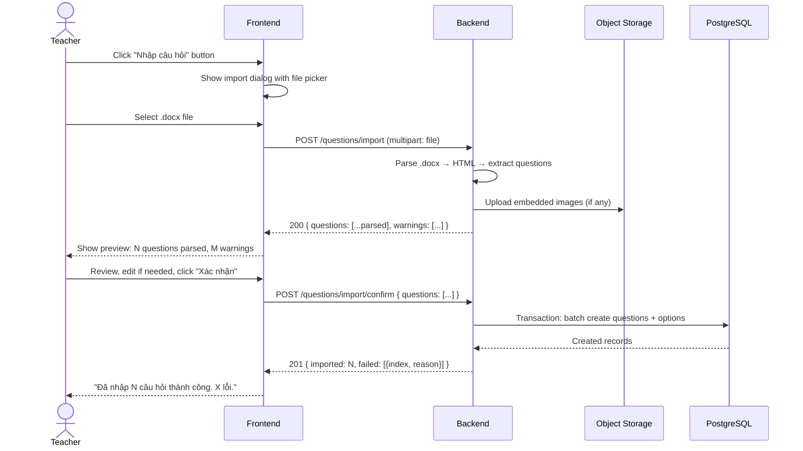
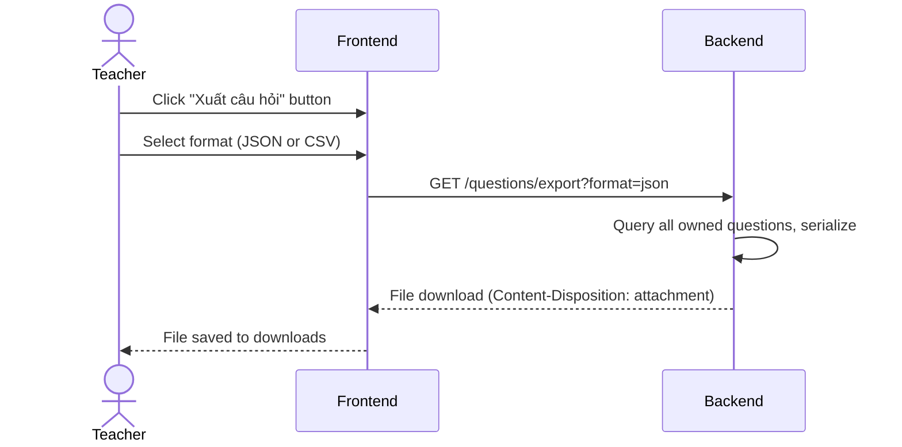

# C6. Import and Export Questions

## 5.1 Feature Overview

| Field | Value |
|---|---|
| Feature ID | C6 |
| Feature Name | Import and Export Questions |
| Module | C. Question Bank |
| Priority | P2 |
| Complexity | L |
| Status | **Proposed** — Schema supports it; no API endpoints or frontend UI implemented |
| Target Roles | Teacher |
| Business Objective | Dramatically reduce the time needed to build a question bank by enabling bulk import from common formats, and allow teachers to export their bank for backup or sharing |
| User Problem | Typing 100+ questions one-by-one is tedious. Many teachers already have questions in Word documents, Excel spreadsheets, or other digital formats. They need a way to bulk-import without re-typing. |
| Dependencies | C1 (Create Question), C4 (Categories), M3A (File Upload — for embedded images in .docx) |

## 5.2 Actors and Permissions

### Teacher

| Action | Permitted | Notes |
|---|---|---|
| Import questions from file | Yes | .docx, .json, .csv formats |
| Preview parsed questions before confirming | Yes | Two-step flow: parse → review → confirm |
| Export own questions to file | Yes | JSON or CSV format |
| Import into another teacher's bank | No | ownerId from JWT |
| Export another teacher's bank | No | Query filtered by ownerId |

### Student

No access.

## 5.3 Preconditions and Business Rules

### Import Rules

| Rule ID | Rule |
|---|---|
| CI-01 | Import is a two-step process: upload + parse → teacher reviews → confirm to create |
| CI-02 | Each imported question goes through the same validation as C1 (Create Question) |
| CI-03 | Partially successful imports are supported: some questions may fail, others succeed |
| CI-04 | Failed questions are reported with the reason and position/line number |
| CI-05 | Import does not update existing questions — it only creates new ones |
| CI-06 | All imported questions are owned by the authenticated teacher |
| CI-07 | Batch creation uses a database transaction |
| CI-08 | Maximum file size: 10MB |
| CI-09 | Maximum questions per import: 500 |

### Export Rules

| Rule ID | Rule |
|---|---|
| CE-01 | Export includes all questions matching current filters (or all if no filters) |
| CE-02 | Export format: JSON (structured, machine-readable) or CSV (spreadsheet-friendly) |
| CE-03 | Export includes: content, type, difficulty, category name, options, correctAnswer, explanation |
| CE-04 | Export does NOT include internal IDs, ownerId, or timestamps |
| CE-05 | Exported file can be re-imported (round-trip compatibility) |

### Supported Import Formats

| Format | Source | Parser | Notes |
|---|---|---|---|
| .docx | Google Docs export, Microsoft Word | `mammoth` library (HTML conversion) | Requires template convention for question/option detection |
| .json | Exported from this system or API | Direct JSON parse | Array of question objects |
| .csv | Spreadsheet | CSV parser | Column-based: content, type, option_a, option_b, ..., correct, difficulty |

### .docx Template Convention (from IMPLEMENTATION_PLAN.md)

```
Câu 1. Thủ đô của Việt Nam là gì?
A. TP Hồ Chí Minh
B. Đà Nẵng
*C. Hà Nội
D. Huế

Câu 2. ...
```

- Questions: detected by `Câu X.` or numbered pattern
- Options: `A.`, `B.`, `C.`, `D.` patterns
- Correct answer: `*` prefix marks the correct option
- Embedded images: extracted from .docx and uploaded to object storage

## 5.4 Main User Flow — Happy Path

### Import Flow



### Export Flow



## 5.5 Alternative Flows

### AF-01: Import with parse errors

- Some questions in the .docx cannot be parsed (e.g., no options found, no correct answer marker).
- Preview shows these as warnings: "Câu 5: Không tìm thấy đáp án đúng."
- Teacher can edit the question in the preview, or remove it from the import batch.

### AF-02: Import JSON from another system

- Teacher has a JSON file with questions from a different platform.
- If the format matches the expected schema, questions are parsed successfully.
- If not, the parser reports errors for each malformed entry.

### AF-03: Export filtered set

- Teacher has category "Toán" selected in the filter.
- Export generates a file with only "Toán" questions.

### AF-04: Re-import previously exported file

- Teacher exports as JSON, then imports the same JSON file.
- New questions are created (import always creates, never updates).
- Duplicates are possible — teacher's responsibility to manage.

## 5.6 Edge Cases and Failure Scenarios

| Scenario ID | Scenario | Trigger | Expected Behavior | User Feedback | Data Integrity | Recovery | Severity |
|---|---|---|---|---|---|---|---|
| C6-E01 | Empty file uploaded | .docx or .csv with no content | Parser returns 0 questions | "Không tìm thấy câu hỏi nào trong file" | No data created | Upload a different file | Low |
| C6-E02 | Malformed .docx | Corrupted file or non-.docx with .docx extension | mammoth fails to parse | "File không hợp lệ hoặc bị hỏng" | No data created | Upload a valid file | Medium |
| C6-E03 | .docx without correct answer markers | Teacher forgot to use `*` prefix | Questions parsed but no option marked correct | Warning per question: "Không tìm thấy đáp án đúng" | Preview shows warnings | Teacher marks correct answers in preview | Medium |
| C6-E04 | Embedded images in .docx | .docx contains inline images | Images extracted, uploaded to storage, URLs replaced in content | Images shown in preview | Images stored in object storage | Requires M3A (File Upload) to be implemented | Medium |
| C6-E05 | File exceeds size limit | >10MB file | 413 Payload Too Large | "File quá lớn. Tối đa 10MB." | No data created | Split file or reduce content | Low |
| C6-E06 | >500 questions in one file | Large question bank import | Return 400: "Tối đa 500 câu hỏi mỗi lần nhập" | Error message with limit | No data created | Split into multiple files | Low |
| C6-E07 | Partial import failure | 100 questions, 3 fail validation | Transaction creates 97, reports 3 failures | "Đã nhập 97/100. 3 lỗi: [details]" | 97 created, 3 not | Review failures, fix, import separately | Medium |
| C6-E08 | CSV with wrong column order | Teacher rearranges columns | Parser expects fixed column order | Garbage data parsed | Bad questions in preview | Teacher reviews and cancels | Medium |
| C6-E09 | JSON with missing required fields | `content` field missing from some entries | Validation catches during confirm | Per-question error: "content is required" | Partial import | Fix JSON and re-import | Medium |
| C6-E10 | Vietnamese encoding issues | .docx with non-UTF-8 encoding | mammoth handles most encodings, but edge cases exist | Characters may be garbled | Questions stored with wrong characters | Check encoding, re-export file | Medium |
| C6-E11 | Duplicate questions in import | Same question appears twice in file | Both imported — no duplicate detection | Two identical questions in bank | Duplicates exist | Teacher deletes one manually | Low |
| C6-E12 | Export with 1000+ questions | Large bank export | Response may be slow. Stream preferred. | Download may take several seconds | Read-only operation | Retry if timeout | Low |
| C6-E13 | Network failure during confirm | Connection drops after confirming import | If server processed: questions created but client doesn't know. If not: no change. | Network error | May have partial creation | Refresh bank, check what was imported | Medium |

## 5.7 UI/UX Specification

### Import Dialog

- **Trigger**: "Nhập câu hỏi" button on `/dashboard/questions` (outline style, Upload icon).
- **Step 1 — File Upload**:
  - File picker accepts `.docx`, `.json`, `.csv`.
  - Max file size shown: "Tối đa 10MB".
  - Upload progress indicator.
- **Step 2 — Preview**:
  - List of parsed questions shown in a scrollable panel.
  - Each question shows: number, content (truncated), options, correct indicator, warnings (amber badge).
  - Warning items: missing correct answer, no options found, parsing issues.
  - Teacher can edit individual questions inline (content, options, correct) or remove them.
  - Summary header: "Đã phân tích: X câu hỏi, Y cảnh báo".
- **Step 3 — Confirm**:
  - "Xác nhận nhập X câu hỏi" button (primary).
  - Loading state during batch creation.
  - Result: "Đã nhập N thành công. M thất bại." with expandable failure details.

### Export Button

- "Xuất câu hỏi" button beside the import button.
- Dropdown: "JSON" or "CSV".
- Triggers file download immediately.
- If filters are active, exports only filtered questions (with note: "Xuất X câu hỏi theo bộ lọc hiện tại").

## 5.8 Data Requirements

No new tables. Uses existing `questions` and `question_options` tables.

### Import Data Flow

1. Raw file → parser → `ParsedQuestion[]` (intermediate format)
2. Teacher review → modified `ParsedQuestion[]`
3. Confirm → `CreateQuestionDto[]` → batch validate → batch create

### ParsedQuestion Intermediate Format

```typescript
interface ParsedQuestion {
  index: number;
  content: string;
  type: QuestionType;
  options?: { content: string; isCorrect: boolean }[];
  correctAnswer?: string;
  difficulty?: DifficultyLevel;
  explanation?: string;
  warnings: string[];
}
```

### Export Format — JSON

```json
[
  {
    "content": "Thủ đô của Việt Nam là gì?",
    "type": "MCQ",
    "difficulty": "EASY",
    "category": "Địa lý",
    "explanation": "Hà Nội là thủ đô...",
    "options": [
      { "content": "TP Hồ Chí Minh", "isCorrect": false },
      { "content": "Hà Nội", "isCorrect": true },
      { "content": "Đà Nẵng", "isCorrect": false },
      { "content": "Huế", "isCorrect": false }
    ]
  }
]
```

### Export Format — CSV

```csv
content,type,difficulty,category,explanation,option_a,option_b,option_c,option_d,correct
"Thủ đô của Việt Nam là gì?",MCQ,EASY,Địa lý,"Hà Nội là thủ đô...","TP HCM","Hà Nội","Đà Nẵng","Huế",B
```

## 5.9 API Requirements

### POST /api/questions/import (Parse and Preview)

| Field | Value |
|---|---|
| Method | POST |
| Endpoint | `/api/questions/import` |
| Purpose | Upload a file, parse it, return preview without saving |
| Role | TEACHER |
| Content-Type | `multipart/form-data` |

**Request**: Multipart with `file` field (.docx, .json, or .csv)

**Response (200)**:
```json
{
  "success": true,
  "data": {
    "questions": [
      {
        "index": 0,
        "content": "Question text...",
        "type": "MCQ",
        "options": [{"content": "A", "isCorrect": false}, {"content": "B", "isCorrect": true}],
        "warnings": []
      }
    ],
    "warnings": ["Câu 5: Không tìm thấy đáp án đúng"],
    "totalParsed": 10,
    "totalWarnings": 1
  }
}
```

**Errors**: 400 (unsupported format, empty file), 413 (file too large), 401, 403

### POST /api/questions/import/confirm (Batch Create)

| Field | Value |
|---|---|
| Method | POST |
| Endpoint | `/api/questions/import/confirm` |
| Purpose | Batch-create the previewed questions |
| Role | TEACHER |

**Request**:
```json
{
  "questions": [
    {
      "content": "...",
      "type": "MCQ",
      "options": [{"content": "A", "isCorrect": false, "position": 0}, ...],
      "difficulty": "EASY",
      "categoryId": "uuid-optional"
    }
  ]
}
```

**Response (201)**:
```json
{
  "success": true,
  "data": {
    "imported": 8,
    "failed": [
      { "index": 3, "reason": "No correct option" },
      { "index": 7, "reason": "Content is empty" }
    ]
  }
}
```

### GET /api/questions/export

| Field | Value |
|---|---|
| Method | GET |
| Endpoint | `/api/questions/export` |
| Purpose | Export questions as a downloadable file |
| Role | TEACHER |

**Query Parameters**:
- `format`: `json` or `csv` (required)
- `categoryId`, `difficulty`, `type`, `search`: same filters as list endpoint (optional)

**Response**: File download with `Content-Disposition: attachment; filename="questions-export.json"` and appropriate Content-Type.

## 5.10 State Management

Import flow has an implicit two-phase state:
1. **Preview phase**: File parsed, results held in client memory (not stored server-side).
2. **Confirm phase**: Questions created in the database.

If the teacher closes the import dialog during preview, the parsed data is discarded. There is no server-side session for in-progress imports.

## 5.11 Acceptance Criteria

```gherkin
Given a teacher uploads a valid .docx with 10 questions,
When the parser extracts them,
Then the preview shows 10 questions with content, options, and correct indicators.

Given a .docx has a question without a correct answer marker,
When the parser processes it,
Then a warning is shown for that question, and it can be edited in preview.

Given a teacher confirms importing 10 questions,
When the batch create runs,
Then 10 questions are created in the database, owned by the teacher.

Given 3 of 10 questions fail validation during confirm,
When the import runs,
Then 7 are created and 3 failures are reported with reasons.

Given a teacher exports their question bank as JSON,
When they download the file,
Then it contains all their questions in the documented JSON format.

Given a teacher exports and then re-imports the JSON,
When the import confirm runs,
Then new copies of the questions are created successfully.

Given a student attempts to import or export,
Then 403 Forbidden is returned.
```

## 5.12 QA Test Scenarios

| Test ID | Scenario | Preconditions | Steps | Expected Result | Priority |
|---|---|---|---|---|---|
| C6-T01 | Import valid .docx | .docx with 5 questions using template convention | POST /questions/import, then /confirm | 5 questions created | P2 |
| C6-T02 | Import .docx with images | .docx with embedded images | Parse → images uploaded → URLs in content | Questions with image URLs | P2 |
| C6-T03 | Import .docx with no correct markers | .docx questions without * prefix | Preview shows warnings | All questions flagged | P2 |
| C6-T04 | Import empty file | Empty .docx | Parse returns 0 questions | "No questions found" message | P2 |
| C6-T05 | Import corrupted file | Random binary file with .docx extension | Parser error | "Invalid file" error | P2 |
| C6-T06 | Import valid JSON | JSON array of question objects | Parse → confirm | Questions created | P2 |
| C6-T07 | Import JSON with missing fields | content missing in some entries | Confirm reports failures | Partial import | P2 |
| C6-T08 | Import CSV | CSV with correct columns | Parse → confirm | Questions created | P2 |
| C6-T09 | Import >500 questions | File with 600 questions | Reject with 400 | "Maximum 500" error | P2 |
| C6-T10 | Import >10MB file | Large file | Reject with 413 | "File too large" error | P2 |
| C6-T11 | Export as JSON | Teacher has 20 questions | GET /questions/export?format=json | JSON file downloaded | P2 |
| C6-T12 | Export as CSV | Teacher has 20 questions | GET /questions/export?format=csv | CSV file downloaded | P2 |
| C6-T13 | Export filtered | Category filter active | Export with categoryId param | Only filtered questions in file | P2 |
| C6-T14 | Round-trip JSON | Export → re-import | Import the exported JSON | New copies created | P2 |
| C6-T15 | Vietnamese encoding | .docx with Vietnamese diacritics | Parse → check content | Correct Unicode characters | P2 |

## 5.13 Open Questions and Assumptions

| # | Question | Why It Matters | Options | Recommended Default | Impact |
|---|---|---|---|---|---|
| 1 | Should import be server-stateful or client-stateful? | Server-stateful: parsed data stored temporarily. Client-stateful: parsed data held in browser memory. | A) Client-stateful (current proposal). B) Server-stateful with session ID. | **A) Client-stateful** — simpler, no server session needed | Low |
| 2 | Should duplicate detection be performed during import? | Teacher may accidentally import the same file twice. | A) No duplicate detection (current). B) Warn if content matches existing question. | **A) No detection** for MVP — teacher can manage duplicates manually | Deferred |
| 3 | Should partial import success use a transaction? | If 3/10 fail, should the other 7 be created? | A) All-or-nothing transaction. B) Partial success (create what validates). | **B) Partial success** — more useful; teacher sees what failed | Medium: different error handling |
| 4 | Should the export include question IDs? | IDs are useful for API integration but could expose internal data. | A) Include IDs. B) Exclude IDs (more portable). | **B) Exclude IDs** — export is for portability, not API use | Low |
| 5 | Which .docx conventions should be supported beyond the basic template? | Azota supports MCQ, multi-answer MCQ, true/false, short-answer, and essay all from .docx. | A) MCQ only (simplest). B) All types via extended conventions. | **A) MCQ only** for initial implementation, extend later | Medium: parser complexity |
| 6 | Is .docx import dependent on M3A (File Upload)? | Embedded images need object storage. | A) Yes, block until M3A done. B) Import text only, ignore images. | **B) Import text only** first, add image extraction when M3A is ready | Unblocks sooner |

### Assumptions

1. **Assumed**: Import is always additive — it creates new questions, never updates existing ones.
2. **Assumed**: Export is a synchronous download, not an async background job. Acceptable for banks up to ~1000 questions.
3. **Assumed**: The .docx parser uses the `mammoth` library for HTML conversion, then a custom extractor for question structure.
4. **Assumed**: No import from Google Sheets or other cloud services directly. Teacher exports to .docx/.csv first.
5. **Assumed**: Import/export for non-MCQ types (essay, short answer) from .docx requires extended template conventions that are not yet defined.
