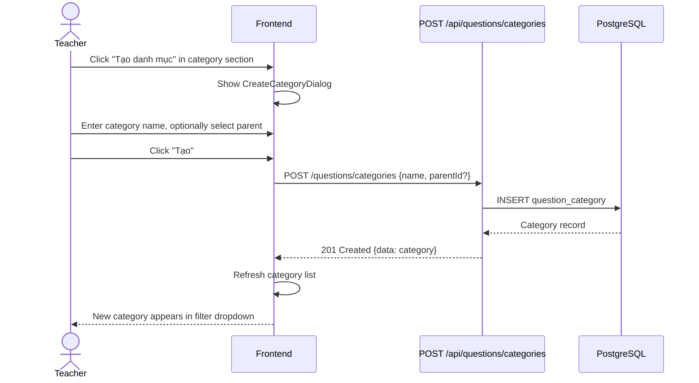
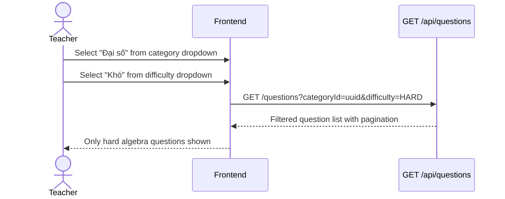

# C4. Question Categories and Difficulty Levels

## 5.1 Feature Overview

| Field | Value |
|---|---|
| Feature ID | C4 |
| Feature Name | Question Categories and Difficulty Levels |
| Module | C. Question Bank |
| Priority | P1 |
| Complexity | S |
| Status | **Existing** — CRUD categories implemented; difficulty field on Question implemented |
| Target Roles | Teacher |
| Business Objective | Enable teachers to organize their question bank by subject, topic, and difficulty so they can efficiently find, filter, and compose exams |
| User Problem | A teacher with hundreds of questions needs categorization (e.g., "Toán > Đại số > Phương trình bậc 2") and difficulty tags (Easy/Medium/Hard) to locate and balance exam content |
| Dependencies | C1 (Create Question) |

## 5.2 Actors and Permissions

### Teacher

| Action | Permitted | Notes |
|---|---|---|
| Create category | Yes | Scoped to own categories |
| List own categories | Yes | Returns hierarchical tree with question counts |
| Delete own category | Yes | Questions under it get `categoryId: null` |
| Create category for another teacher | No | `ownerId` is from JWT |
| Delete another teacher's category | No | Ownership check in service |
| Set difficulty on a question | Yes | EASY, MEDIUM, HARD, or null |
| Create subcategory (child) | Yes | Via `parentId` field |

### Student

No access to categories or difficulty management. Students see category/difficulty info only if the teacher chooses to display it in results.

## 5.3 Preconditions and Business Rules

### Category Rules

| Rule ID | Rule | Enforcement |
|---|---|---|
| CC-01 | Category name is required (non-empty string) | DTO `@IsString()` |
| CC-02 | `parentId` is optional; if provided, must be a valid UUID | DTO `@IsUUID()` |
| CC-03 | Categories are owner-scoped: teacher A cannot see or use teacher B's categories | Service filters by `ownerId` |
| CC-04 | Deleting a category sets `categoryId: null` on all linked questions (SetNull) | Prisma `onDelete: SetNull` on Question.categoryId FK |
| CC-05 | Deleting a category does NOT delete child categories | No cascade on QuestionCategory self-relation. **Gap: orphan children remain with invalid parentId** |
| CC-06 | No unique constraint on category name per owner | A teacher can create two categories with the same name |
| CC-07 | Category hierarchy depth is unlimited | No depth validation. Deep nesting is possible but unlikely. |
| CC-08 | `parentId` does not validate that the parent exists or is owned by the same teacher | **Gap: FK constraint exists but ownership is not checked** |

### Difficulty Rules

| Rule ID | Rule | Enforcement |
|---|---|---|
| CD-01 | Difficulty is optional (nullable) on each question | Prisma schema: `difficulty Difficulty?` |
| CD-02 | Valid values: EASY, MEDIUM, HARD | Prisma enum + DTO `@IsEnum(DifficultyLevel)` |
| CD-03 | Difficulty can be set at creation or updated later | CreateQuestionDto and UpdateQuestionDto both include `difficulty` |
| CD-04 | Difficulty has no effect on grading or scoring | Purely organizational metadata |
| CD-05 | Difficulty can be cleared by setting to null | Standard nullable field behavior |

## 5.4 Main User Flow — Happy Path

### Create Category



### Filter Questions by Category and Difficulty



## 5.5 Alternative Flows

### AF-01: Create a subcategory

- Teacher selects an existing category as parent when creating.
- Creates a child category linked via `parentId`.
- UI shows the hierarchy as nested items in the category list.

### AF-02: Delete a category with questions

- Teacher deletes "Đại số" category.
- All questions previously in "Đại số" have `categoryId` set to null.
- Questions are not deleted, just uncategorized.
- Teacher can reassign them by editing each question.

### AF-03: Bulk reassign category

- **Not implemented**. Teacher must edit each question individually to change category.
- Potential improvement: "Move all questions from category X to category Y."

## 5.6 Edge Cases and Failure Scenarios

| Scenario ID | Scenario | Trigger | Expected Behavior | User Feedback | Data Integrity | Recovery | Severity |
|---|---|---|---|---|---|---|---|
| C4-E01 | Create category with empty name | Teacher submits blank name | DTO validation rejects | "name must be a string" error | No data created | Enter a name | Low |
| C4-E02 | Create category with invalid parentId | UUID format valid but doesn't exist | FK constraint fails → 500 | Generic server error | No data created | **Gap: should validate parent exists** | Medium |
| C4-E03 | Create category with parentId from another teacher | Valid UUID but different owner | Category created with cross-owner parent link | No error | **Cross-teacher hierarchy** — data integrity issue | **Gap: validate parent ownership** | High |
| C4-E04 | Delete category used by 100+ questions | Category linked to many questions | All questions get categoryId = null. Could be slow for large sets. | Category removed. Questions still exist. | Consistent (SetNull) | May need to reassign questions | Medium |
| C4-E05 | Delete parent category with children | Parent deleted, children remain | Children keep their `parentId` pointing to deleted ID. **Orphaned children.** | Parent disappears. Children still show in flat list. | **Gap: parentId references deleted record** | Cascade delete children, or set parentId = null | High |
| C4-E06 | Create circular parent reference | Category A.parentId = B, then B.parentId = A | No circular reference detection. Both records stored. | No error | Infinite loop possible in tree rendering | **Gap: validate no cycles** | Medium |
| C4-E07 | Duplicate category name | Same teacher creates "Toán" twice | No unique constraint. Both created. | Two "Toán" categories appear | Confusing but not broken | **Gap: consider unique(ownerId, name, parentId)** | Low |
| C4-E08 | Set invalid difficulty | PATCH question with difficulty: "EXTREME" | DTO enum validation rejects | Validation error | No change | Use valid enum value | Low |
| C4-E09 | Filter by non-existent categoryId | Category deleted after page load | Query returns empty results (no error) | "Không có câu hỏi" shown | Consistent | Refresh category list | Low |

## 5.7 UI/UX Specification

### Category Management Section

- **Location**: Top of `/dashboard/questions` page, above the question list.
- **Components**:
  - Category filter dropdown (populated from GET /questions/categories).
  - "Tạo danh mục" button (secondary style).
  - In the dropdown or a separate panel: list of categories with question counts and delete icons.

### CreateCategoryDialog

| Field | Component | Notes |
|---|---|---|
| Name | Input | Required. Placeholder: "Tên danh mục" |
| Parent Category | Select | Optional. Lists existing categories. "Không có danh mục cha" as default. |

### Category Display

- In question cards: Category name shown as a muted text badge.
- In filter: Hierarchical display ideally (parent > child), or flat list with indentation.
- Count: Number of questions in each category shown beside the name.

### Difficulty Display

- In question cards: Colored badge.
  - EASY → green badge "Dễ"
  - MEDIUM → amber badge "Trung bình"
  - HARD → red badge "Khó"
  - null → no badge
- In filter: Dropdown with options: Tất cả, Dễ, Trung bình, Khó.

## 5.8 Data Requirements

### Existing Schema (Verified)

**QuestionCategory**

| Field | Type | Nullable | Notes |
|---|---|---|---|
| id | UUID | No | PK |
| ownerId | UUID FK → users | No | Scoped to teacher |
| name | String | No | Category name |
| parentId | UUID FK → question_categories (self) | Yes | Hierarchical |

**Relations**: QuestionCategory has `children` (1:N self), `questions` (1:N Question), `owner` (N:1 User).

### Proposed Changes

1. Add unique constraint `@@unique([ownerId, name, parentId])` to prevent duplicate names at the same level.
2. Validate `parentId` ownership before creating a child category.
3. Handle orphan children on parent deletion (either cascade or reparent to null).

## 5.9 API Requirements

### POST /api/questions/categories

| Field | Value |
|---|---|
| Method | POST |
| Endpoint | `/api/questions/categories` |
| Purpose | Create a new category |
| Role | TEACHER |
| Authorization | ownerId from JWT |

**Request**: `{ "name": "Đại số", "parentId": "uuid-optional" }`

**Response (201)**: `{ "success": true, "data": { "id": "uuid", "ownerId": "uuid", "name": "Đại số", "parentId": null } }`

**Errors**: 400 (validation), 401, 403

### GET /api/questions/categories

| Field | Value |
|---|---|
| Method | GET |
| Endpoint | `/api/questions/categories` |
| Purpose | List all categories for the authenticated teacher |
| Role | TEACHER |

**Response (200)**:
```json
{
  "success": true,
  "data": [
    {
      "id": "uuid",
      "name": "Toán",
      "parentId": null,
      "children": [
        { "id": "uuid", "name": "Đại số", "parentId": "uuid-parent", "children": [] }
      ],
      "_count": { "questions": 15 }
    }
  ]
}
```

### DELETE /api/questions/categories/:id

| Field | Value |
|---|---|
| Method | DELETE |
| Endpoint | `/api/questions/categories/:id` |
| Purpose | Delete a category; linked questions get categoryId = null |
| Role | TEACHER |
| Authorization | Must own the category |

**Response**: 204 No Content

**Errors**: 401, 403 (not owner), 404 (not found)

## 5.10 State Management

Categories have no lifecycle states. They exist or they don't (hard delete). The important side-effects on deletion are:
- Questions linked to the category → `categoryId` set to null.
- Child categories → remain with orphaned `parentId` (gap).

## 5.11 Acceptance Criteria

```gherkin
Given a teacher is authenticated,
When they create a category with name "Toán",
Then the category is created and appears in the category list.

Given a teacher has categories "Toán" and "Văn",
When they GET /questions/categories,
Then both categories are returned with question counts.

Given a teacher creates a subcategory "Đại số" under "Toán",
When they list categories,
Then "Đại số" appears as a child of "Toán".

Given a category "Toán" has 5 linked questions,
When the teacher deletes "Toán",
Then the 5 questions have categoryId set to null and still exist in the bank.

Given a teacher filters questions by difficulty "HARD",
When the API returns results,
Then only questions with difficulty = HARD are included.

Given a teacher filters by both categoryId and difficulty,
When the API returns results,
Then only questions matching BOTH filters are included (AND logic).

Given teacher A attempts to delete teacher B's category,
When the service checks ownership,
Then 403 Forbidden is returned.
```

## 5.12 QA Test Scenarios

| Test ID | Scenario | Preconditions | Steps | Expected Result | Priority |
|---|---|---|---|---|---|
| C4-T01 | Create category | Teacher logged in | POST /questions/categories {name: "Toán"} | 201, category returned | P1 |
| C4-T02 | Create subcategory | Parent category exists | POST with parentId | 201, parentId set | P1 |
| C4-T03 | List categories with counts | Teacher has categories with questions | GET /questions/categories | Categories with children and _count | P1 |
| C4-T04 | Delete category | Teacher owns category | DELETE /questions/categories/:id | 204, linked questions uncategorized | P1 |
| C4-T05 | Delete another teacher's category | Category owned by teacher B | DELETE as teacher A | 403 | P1 |
| C4-T06 | Filter by category | Questions in "Toán" category | GET /questions?categoryId=uuid | Only "Toán" questions | P1 |
| C4-T07 | Filter by difficulty | Questions with difficulty HARD | GET /questions?difficulty=HARD | Only HARD questions | P1 |
| C4-T08 | Combined filter | Category + difficulty | GET /questions?categoryId=uuid&difficulty=EASY | AND filter | P1 |
| C4-T09 | Category with empty name | Teacher submits blank | POST {name: ""} | 400 validation | P1 |
| C4-T10 | Delete parent with children | Parent has child categories | DELETE parent | Children orphaned (gap behavior) | P2 |

## 5.13 Open Questions and Assumptions

| # | Question | Why It Matters | Options | Recommended Default | Impact |
|---|---|---|---|---|---|
| 1 | How to handle orphan children when a parent category is deleted? | Children retain a parentId pointing to a non-existent record. | A) Cascade delete children. B) Set children.parentId = null (reparent to root). C) Block deletion of non-empty parent. | **B) Reparent to root** — non-destructive | Low: modify delete logic |
| 2 | Should parentId ownership be validated? | Teacher could reference another teacher's category as parent. | A) Validate. B) Leave as-is. | **A) Validate** | Low: add one check |
| 3 | Should category names be unique per owner+parent? | Duplicate names at same level cause confusion. | A) Add unique constraint. B) Leave flexible. | **A) Unique per (ownerId, name, parentId)** | Low: migration + validation |
| 4 | Is the current flat delete approach sufficient? | Teacher deletes a category with 500 questions. All become uncategorized. | A) Current (set null). B) Require moving questions first. | **A) Current** — simplest, teacher can bulk-reassign later | Low |
| 5 | Should Azota-style "cognitive levels" be supported? | Azota has learning-requirements and cognitive-level metadata per question. | A) Add later as additional metadata fields. B) Not needed for MVP. | **B) Not needed** — difficulty (EASY/MEDIUM/HARD) covers the primary use case | Deferred |

### Assumptions

1. **Assumed**: The category hierarchy is for organizational purposes only and does not affect exam behavior or grading.
2. **Assumed**: Difficulty is a flat enum (EASY/MEDIUM/HARD), not a numeric scale.
3. **Assumed**: There is no "update category" endpoint (rename). **This is a gap** — teachers cannot rename a category without deleting and recreating.
4. **Assumed**: Categories do not have a description or color. They are simple name-based tags.
