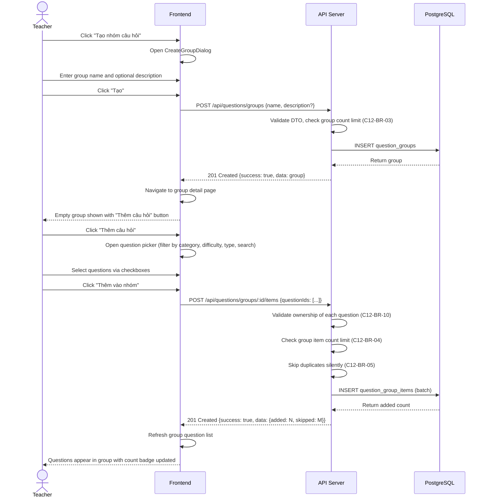

# C12. Question Groups

## 5.1 Feature Overview

| Field | Value |
|---|---|
| Feature ID | C12 |
| Feature Name | Question Groups |
| Module | C. Question Bank |
| Priority | P2 |
| Complexity | M |
| Status | **Schema exists, NOT implemented** — `QuestionGroup` and `QuestionGroupItem` models are in Prisma schema but no controller, service, DTOs, or frontend exist |
| Target Roles | Teacher |
| Business Objective | Enable teachers to organize questions into reusable named collections (e.g., "Chương 1 - Đại số", "Đề cương ôn tập HK1") for efficient exam composition and random question selection |
| User Problem | Teachers accumulate hundreds of questions across categories and difficulties. Categories organize by topic, but teachers also need to curate arbitrary subsets — a review set, a chapter quiz pool, or an exam's candidate pool — without duplicating questions. |
| Dependencies | C1 (Create Question), A1 (Authentication), A5 (Role Management) |

## 5.2 Actors and Permissions

### Teacher

| Action | Permitted | Notes |
|---|---|---|
| Create a question group | Yes | Automatically becomes the group's owner |
| View own groups | Yes | Own groups only |
| Edit group name/description | Yes | Own groups only |
| Add questions to a group | Yes | Only questions owned by the same teacher |
| Remove questions from a group | Yes | Own groups only |
| Delete a group | Yes | Own groups only; does not delete the questions |
| View another teacher's groups | **No** | 403 Forbidden |

### Student

| Action | Permitted | Notes |
|---|---|---|
| Any group operation | **No** | 403 Forbidden — controller is `@Roles('TEACHER')` |

### Backend Authorization

- The group controller must have `@Roles('TEACHER')` at the class level.
- `ownerId` on `QuestionGroup` is set from `@CurrentUser('id')`, never from the request body.
- Every read/update/delete checks `group.ownerId === currentUser.id`.
- Adding a question to a group checks `question.ownerId === currentUser.id` (prevents cross-teacher linkage).

## 5.3 Preconditions and Business Rules

### Preconditions

1. User is authenticated with a valid JWT access token.
2. User has `TEACHER` role.
3. For adding a question: the question must exist and be owned by the same teacher.

### Business Rules

| Rule ID | Rule | Enforcement |
|---|---|---|
| C12-BR-01 | A group name is required and must be between 1 and 200 characters | DTO: `@IsString()`, `@MinLength(1)`, `@MaxLength(200)` |
| C12-BR-02 | A group description is optional and cannot exceed 1000 characters | DTO: `@IsOptional()`, `@IsString()`, `@MaxLength(1000)` |
| C12-BR-03 | A teacher can create at most 100 groups | Service: count check before create; throws 400 "Bạn đã đạt giới hạn 100 nhóm câu hỏi" |
| C12-BR-04 | A group can contain at most 500 questions | Service: count check before add; throws 400 "Nhóm đã đạt giới hạn 500 câu hỏi" |
| C12-BR-05 | The same question cannot appear in the same group twice | Database: `@@unique([groupId, questionId])` on `QuestionGroupItem` (exists) |
| C12-BR-06 | A question can belong to multiple groups simultaneously | No restriction — junction table allows it |
| C12-BR-07 | Deleting a group does not delete its questions | `onDelete: Cascade` on `QuestionGroupItem.group` removes junction rows only |
| C12-BR-08 | Deleting a question removes it from all groups it belongs to | `onDelete: Cascade` on `QuestionGroupItem.question` (exists) |
| C12-BR-09 | Only the group owner can view, edit, or delete the group | Service: ownership check on every operation; throws 403 |
| C12-BR-10 | Only questions owned by the same teacher can be added to a group | Service: `question.ownerId === group.ownerId`; throws 400 "Câu hỏi không tồn tại hoặc không thuộc quyền sở hữu của bạn" |
| C12-BR-11 | Group names need not be unique per teacher | Duplicate names are allowed — a teacher may have "Ôn tập HK1" for different subjects |
| C12-BR-12 | Adding or removing questions from a group does not affect any published exam | Groups are organizational only; exam snapshots are independent |

### Validation Rules (DTO-level)

**CreateQuestionGroupDto**

| Field | Type | Required | Validation |
|---|---|---|---|
| `name` | string | Yes | `@IsString()`, `@MinLength(1)`, `@MaxLength(200)` |
| `description` | string | No | `@IsOptional()`, `@IsString()`, `@MaxLength(1000)` |

**AddGroupItemsDto**

| Field | Type | Required | Validation |
|---|---|---|---|
| `questionIds` | string[] | Yes | `@IsArray()`, `@ArrayMinSize(1)`, `@ArrayMaxSize(50)`, each `@IsUUID()` |

**UpdateQuestionGroupDto**

| Field | Type | Required | Validation |
|---|---|---|---|
| `name` | string | No | `@IsOptional()`, `@IsString()`, `@MinLength(1)`, `@MaxLength(200)` |
| `description` | string | No | `@IsOptional()`, `@IsString()`, `@MaxLength(1000)` |

## 5.4 Main User Flow — Happy Path

### Create Group and Add Questions



### Steps

| Step | Actor | Action | System Response | Data Changed | UI State |
|---|---|---|---|---|---|
| 1 | Teacher | Clicks "Tạo nhóm câu hỏi" | — | — | CreateGroupDialog opens |
| 2 | Teacher | Enters name and optional description | — | — | Form populated |
| 3 | Teacher | Clicks "Tạo" | Group created | `question_groups` row created | Dialog closes, navigates to group detail |
| 4 | Teacher | Clicks "Thêm câu hỏi" on group page | — | — | Question picker modal opens |
| 5 | Teacher | Filters and selects questions | — | — | Checkboxes selected |
| 6 | Teacher | Clicks "Thêm vào nhóm" | Questions added to group | `question_group_items` rows created | Modal closes, question list refreshes |

## 5.5 Alternative Flows

### AF-01: Add questions during group creation

- Teacher creates a group and immediately opens the question picker on the group detail page.
- No single-step "create group with questions" endpoint. Teacher creates the group first, then adds questions. This matches the two-step Azota pattern and keeps the API simple.

### AF-02: Remove a single question from a group

- On the group detail page, teacher clicks the remove icon on a question row.
- Confirmation dialog: "Xóa câu hỏi này khỏi nhóm?"
- `DELETE /api/questions/groups/:groupId/items/:questionId`
- Question is removed from the group but remains in the question bank.

### AF-03: Remove multiple questions from a group (batch)

- Teacher selects multiple questions via checkboxes on the group detail page.
- Clicks "Xóa khỏi nhóm" bulk action.
- `DELETE /api/questions/groups/:groupId/items` with body `{questionIds: [...]}`.
- Selected questions are removed from the group.

### AF-04: Edit group name or description

- Teacher clicks the edit icon next to the group name on the detail page.
- Inline edit or modal opens.
- `PATCH /api/questions/groups/:id` with `{name?, description?}`.

### AF-05: Delete an entire group

- Teacher clicks "Xóa nhóm" on the group detail or list page.
- Confirmation dialog: "Xóa nhóm '[name]'? Các câu hỏi trong nhóm sẽ không bị xóa."
- `DELETE /api/questions/groups/:id`
- Group and all junction rows are deleted. Questions remain.

### AF-06: View group list

- Teacher navigates to `/dashboard/questions` and sees a "Nhóm câu hỏi" tab or sidebar section.
- `GET /api/questions/groups` returns all groups owned by the teacher with item counts.

### AF-07: Adding a question that is already in the group

- The add-items endpoint silently skips duplicates (DB `@@unique` constraint).
- Response indicates how many were added vs skipped: `{added: 3, skipped: 1}`.
- No error is thrown.

## 5.6 Edge Cases and Failure Scenarios

| Scenario ID | Scenario | Trigger | Expected Behavior | User Feedback | Data Integrity | Recovery | Severity |
|---|---|---|---|---|---|---|---|
| C12-E01 | Create group with empty name | Teacher submits with blank name | DTO validation rejects: 400 | Field error: "Tên nhóm không được để trống" | No data created | Fix input and resubmit | Medium |
| C12-E02 | Create group exceeding 100-group limit | Teacher already has 100 groups | 400: "Bạn đã đạt giới hạn 100 nhóm câu hỏi" | Toast error | No data created | Delete unused groups first | Low |
| C12-E03 | Add question not owned by teacher | Request body includes another teacher's question ID | 400: "Câu hỏi không tồn tại hoặc không thuộc quyền sở hữu của bạn" | Toast error | No items created | Remove invalid ID | High |
| C12-E04 | Add question to group exceeding 500-item limit | Group already has 500 items | 400: "Nhóm đã đạt giới hạn 500 câu hỏi" | Toast error | No items created | Remove questions or create a new group | Low |
| C12-E05 | Add duplicate question to group | Question already in the group | Silently skipped, response shows `skipped: 1` | No error; info in response | No duplicate created | None needed | Low |
| C12-E06 | Add non-existent question ID | UUID does not match any question | 400: "Câu hỏi không tồn tại hoặc không thuộc quyền sở hữu của bạn" | Toast error | No items created | Use valid question ID | Medium |
| C12-E07 | Delete group that is referenced by a random selection rule | Group is used as a source in a random selection (C13) | Group is deleted; random selection rule referencing it becomes invalid | Toast warning: group deleted | Group + items removed; orphaned references must be handled by C13 | Teacher must update the selection rule | Medium |
| C12-E08 | Delete a question that is in multiple groups | Question deleted via question bank | Question removed from all groups automatically (cascade) | No extra notification | Junction rows cascade-deleted | None needed | Low |
| C12-E09 | Edit group owned by another teacher | Crafted request with another teacher's group ID | 403 Forbidden | Generic error | No data changed | None | High |
| C12-E10 | Delete group owned by another teacher | Crafted request | 403 Forbidden | Generic error | No data changed | None | High |
| C12-E11 | Add questions with empty array | `questionIds: []` | DTO validation rejects: 400 (ArrayMinSize) | Validation error | No data changed | Select at least one question | Low |
| C12-E12 | Add more than 50 questions in one request | `questionIds` array with 51+ items | DTO validation rejects: 400 (ArrayMaxSize) | Validation error | No data changed | Split into multiple requests | Low |
| C12-E13 | Group name with 201+ characters | Very long name string | DTO validation rejects: 400 (MaxLength) | Field error | No data created | Shorten name | Low |

## 5.7 UI/UX Specification

### Entry Point

- **Page**: `/dashboard/questions`
- **Access**: "Nhóm câu hỏi" tab alongside the existing "Câu hỏi" and "Danh mục" sections
- **Trigger**: Teacher selects the "Nhóm câu hỏi" tab, then "Tạo nhóm" button

### Group List View

- **URL**: `/dashboard/questions` with "Nhóm câu hỏi" tab selected
- **Layout**: Card grid or list view showing:
  - Group name (bold, clickable)
  - Description (truncated to 2 lines)
  - Question count badge (e.g., "42 câu hỏi")
  - Created date
  - Actions: edit, delete
- **Empty state**: Illustration + "Bạn chưa có nhóm câu hỏi nào. Tạo nhóm để tổ chức câu hỏi theo chủ đề hoặc mục đích sử dụng."
- **Sorting**: By name (A-Z), by creation date (newest first, default), by question count

### Group Detail Page

- **URL**: `/dashboard/questions/groups/:id`
- **Header**: Group name (editable inline), description (editable), question count
- **Question list**: Table or card list showing questions in the group:
  - Content (truncated), type badge, difficulty badge, category name
  - Checkbox for bulk selection
  - Remove button per row
- **Actions**:
  - "Thêm câu hỏi" — opens question picker modal
  - "Xóa khỏi nhóm" (bulk) — appears when questions are selected
  - "Xóa nhóm" — delete the entire group
- **Pagination**: Same pagination as question bank (page/limit, default 20)
- **Empty state**: "Nhóm này chưa có câu hỏi. Nhấn 'Thêm câu hỏi' để bắt đầu."

### Question Picker Modal

- **Purpose**: Select existing questions to add to the group
- **Layout**: Reuses the question bank list with filters (search, category, difficulty, type)
- **Selection**: Checkboxes. Questions already in the group are shown as disabled with a "Đã thêm" badge
- **Footer**: "Thêm N câu hỏi vào nhóm" button with count, Cancel button
- **Max selection**: 50 per batch (matches API limit)

### CreateGroupDialog

- **Component**: Dialog (shadcn)
- **Fields**: Name (required), Description (optional textarea)
- **Buttons**: "Tạo" (primary), "Hủy" (secondary)

### States

| State | Description |
|---|---|
| **Default** | Group list with cards/rows |
| **Loading** | Skeleton cards/rows |
| **Empty** | Illustration with create prompt |
| **Error** | Toast notification for operation failures |

### Responsive Behavior

- Group list: 1 column on mobile, 2 on tablet, 3 on desktop (if card grid)
- Group detail: question table scrolls horizontally on mobile; actions stack vertically
- Question picker modal: full-screen on mobile

## 5.8 Data Requirements

### Existing Entities (verified in schema)

**QuestionGroup**

| Field | Type | Nullable | Notes |
|---|---|---|---|
| id | UUID | No | Primary key, auto-generated |
| ownerId | UUID FK → users | No | Set from authenticated user |
| name | String | No | Group name |

**QuestionGroupItem**

| Field | Type | Nullable | Notes |
|---|---|---|---|
| id | UUID | No | Primary key, auto-generated |
| groupId | UUID FK → question_groups | No | onDelete: Cascade |
| questionId | UUID FK → questions | No | onDelete: Cascade |
| — | — | — | `@@unique([groupId, questionId])` |

### Proposed Schema Changes

| Change | Reason |
|---|---|
| Add `description String?` to `QuestionGroup` | Teachers benefit from a short description of the group's purpose |
| Add `createdAt DateTime @default(now()) @map("created_at")` to `QuestionGroup` | Needed for sorting and display |
| Add `updatedAt DateTime @updatedAt @map("updated_at")` to `QuestionGroup` | Standard audit field |
| Add `owner User @relation(fields: [ownerId], references: [id])` to `QuestionGroup` | Relation is missing; needed for Prisma includes |
| Add `questionGroups QuestionGroup[]` to `User` model | Back-relation for Prisma |

Updated `QuestionGroup` model:

```prisma
model QuestionGroup {
  id          String   @id @default(uuid()) @db.Uuid
  ownerId     String   @map("owner_id") @db.Uuid
  name        String
  description String?
  createdAt   DateTime @default(now()) @map("created_at")
  updatedAt   DateTime @updatedAt @map("updated_at")

  owner User              @relation(fields: [ownerId], references: [id])
  items QuestionGroupItem[]

  @@map("question_groups")
}
```

### Indexing

- `question_group_items.(groupId, questionId)` — unique index exists
- Consider adding index on `question_groups.ownerId` for listing queries

## 5.9 API Requirements

### POST /api/questions/groups

| Field | Value |
|---|---|
| HTTP Method | POST |
| Endpoint | `/api/questions/groups` |
| Purpose | Create a new question group |
| Required Role | TEACHER |
| Authorization | `ownerId` from JWT |

**Request Body**

```json
{
  "name": "Chương 1 - Đại số",
  "description": "Các câu hỏi trắc nghiệm chương 1 sách giáo khoa Toán 10"
}
```

**Successful Response (201 Created)**

```json
{
  "success": true,
  "data": {
    "id": "uuid",
    "ownerId": "uuid",
    "name": "Chương 1 - Đại số",
    "description": "Các câu hỏi trắc nghiệm chương 1 sách giáo khoa Toán 10",
    "createdAt": "2026-11-11T...",
    "updatedAt": "2026-11-11T...",
    "_count": { "items": 0 }
  }
}
```

**Error Responses**

| Status | Code | Condition | Message |
|---|---|---|---|
| 400 | VALIDATION_ERROR | Name empty or too long | DTO validation message |
| 400 | GROUP_LIMIT_REACHED | Teacher already has 100 groups | "Bạn đã đạt giới hạn 100 nhóm câu hỏi" |
| 401 | UNAUTHORIZED | Missing or invalid JWT | — |
| 403 | FORBIDDEN | User is not TEACHER | — |

---

### GET /api/questions/groups

| Field | Value |
|---|---|
| HTTP Method | GET |
| Endpoint | `/api/questions/groups` |
| Purpose | List all groups owned by the teacher |
| Required Role | TEACHER |

**Query Parameters**

| Param | Type | Default | Description |
|---|---|---|---|
| `page` | int | 1 | Page number |
| `limit` | int | 20 | Items per page (max 100) |
| `search` | string | — | Filter by name (case-insensitive contains) |
| `sort` | string | `createdAt` | Sort field: `name`, `createdAt`, `itemCount` |
| `order` | string | `desc` | Sort order: `asc`, `desc` |

**Successful Response (200 OK)**

```json
{
  "success": true,
  "data": [
    {
      "id": "uuid",
      "name": "Chương 1 - Đại số",
      "description": "...",
      "createdAt": "2026-11-11T...",
      "_count": { "items": 42 }
    }
  ],
  "meta": { "page": 1, "limit": 20, "total": 5 }
}
```

---

### GET /api/questions/groups/:id

| Field | Value |
|---|---|
| HTTP Method | GET |
| Endpoint | `/api/questions/groups/:id` |
| Purpose | Get group details with its questions (paginated) |
| Required Role | TEACHER |

**Query Parameters**

| Param | Type | Default | Description |
|---|---|---|---|
| `page` | int | 1 | Page for the group's question items |
| `limit` | int | 20 | Items per page (max 100) |

**Successful Response (200 OK)**

```json
{
  "success": true,
  "data": {
    "id": "uuid",
    "name": "Chương 1 - Đại số",
    "description": "...",
    "createdAt": "2026-11-11T...",
    "updatedAt": "2026-11-11T...",
    "_count": { "items": 42 },
    "items": [
      {
        "id": "group-item-uuid",
        "question": {
          "id": "question-uuid",
          "content": "Giải phương trình...",
          "type": "MCQ",
          "difficulty": "MEDIUM",
          "category": { "id": "uuid", "name": "Đại số" }
        }
      }
    ]
  },
  "meta": { "page": 1, "limit": 20, "total": 42 }
}
```

**Error Responses**

| Status | Code | Condition |
|---|---|---|
| 404 | NOT_FOUND | Group does not exist |
| 403 | FORBIDDEN | Group not owned by current user |

---

### PATCH /api/questions/groups/:id

| Field | Value |
|---|---|
| HTTP Method | PATCH |
| Endpoint | `/api/questions/groups/:id` |
| Purpose | Update group name and/or description |
| Required Role | TEACHER |

**Request Body**

```json
{
  "name": "Chương 1 - Đại số (cập nhật)",
  "description": "Updated description"
}
```

**Successful Response (200 OK)**: Updated group object.

**Error Responses**: 404 if not found, 403 if not owner, 400 if validation fails.

---

### POST /api/questions/groups/:id/items

| Field | Value |
|---|---|
| HTTP Method | POST |
| Endpoint | `/api/questions/groups/:id/items` |
| Purpose | Add one or more questions to the group |
| Required Role | TEACHER |
| Rules | C12-BR-04, C12-BR-05, C12-BR-10 |

**Request Body**

```json
{
  "questionIds": ["uuid-1", "uuid-2", "uuid-3"]
}
```

**Successful Response (201 Created)**

```json
{
  "success": true,
  "data": {
    "added": 2,
    "skipped": 1
  }
}
```

**Error Responses**

| Status | Code | Condition | Message |
|---|---|---|---|
| 400 | VALIDATION_ERROR | Empty array or >50 items | DTO validation message |
| 400 | QUESTION_NOT_OWNED | Any questionId not found or not owned | "Câu hỏi không tồn tại hoặc không thuộc quyền sở hữu của bạn" |
| 400 | GROUP_ITEM_LIMIT_REACHED | Adding would exceed 500 items | "Nhóm đã đạt giới hạn 500 câu hỏi" |
| 403 | FORBIDDEN | Group not owned by current user | — |
| 404 | NOT_FOUND | Group does not exist | — |

**Behavior**: The endpoint validates all question IDs for existence and ownership first. If any ID fails, the entire batch is rejected (no partial insert). Duplicates (questions already in the group) are silently skipped and counted in `skipped`.

---

### DELETE /api/questions/groups/:groupId/items/:questionId

| Field | Value |
|---|---|
| HTTP Method | DELETE |
| Endpoint | `/api/questions/groups/:groupId/items/:questionId` |
| Purpose | Remove a single question from the group |
| Required Role | TEACHER |
| Response | 204 No Content |

**Error Responses**: 404 if group or item not found, 403 if not owner.

---

### DELETE /api/questions/groups/:groupId/items

| Field | Value |
|---|---|
| HTTP Method | DELETE |
| Endpoint | `/api/questions/groups/:groupId/items` |
| Purpose | Remove multiple questions from the group (batch) |
| Required Role | TEACHER |

**Request Body**

```json
{
  "questionIds": ["uuid-1", "uuid-2"]
}
```

**Successful Response (200 OK)**

```json
{
  "success": true,
  "data": { "removed": 2 }
}
```

---

### DELETE /api/questions/groups/:id

| Field | Value |
|---|---|
| HTTP Method | DELETE |
| Endpoint | `/api/questions/groups/:id` |
| Purpose | Delete a group and all its items (not the questions themselves) |
| Required Role | TEACHER |
| Response | 204 No Content |

**Error Responses**: 404 if not found, 403 if not owner.

---

### Idempotency

- POST /groups: Not idempotent — each call creates a new group.
- POST /groups/:id/items: Idempotent for duplicates (skipped silently), but new items are created.
- DELETE operations: Idempotent — deleting a non-existent item returns 404.

## 5.10 State Management

Question groups have no formal lifecycle state machine. They are either:

- **Active**: Exists in the database, visible in the teacher's group list.
- **Deleted**: Hard-deleted. Gone from the list. Junction rows cascade-deleted. Questions remain in the bank.

No draft/published states — groups are organizational containers, not publishable entities.

## 5.11 Acceptance Criteria

### Positive Cases

```gherkin
Given a teacher is authenticated,
When they submit POST /questions/groups with a valid name,
Then a new group is created and returned with id, name, and _count.items = 0.
Rule: C12-BR-01

Given a teacher owns a group and 3 questions,
When they submit POST /questions/groups/:id/items with those 3 questionIds,
Then all 3 questions are added to the group and response shows added: 3, skipped: 0.
Rule: C12-BR-06, C12-BR-10

Given a teacher owns a group with 5 questions,
When they request GET /questions/groups/:id,
Then the response includes the group details and a paginated list of 5 questions with their content, type, difficulty, and category.
Rule: C12-BR-09

Given a teacher owns a group,
When they submit PATCH /questions/groups/:id with a new name,
Then the group name is updated and the response reflects the change.
Rule: C12-BR-09

Given a teacher owns a group with questions,
When they submit DELETE /questions/groups/:id,
Then the group and junction rows are deleted, but the questions still exist in the bank.
Rule: C12-BR-07

Given a teacher owns a group with a question already in it,
When they submit POST /questions/groups/:id/items with that same questionId,
Then the response shows added: 0, skipped: 1 and no duplicate is created.
Rule: C12-BR-05

Given a teacher deletes a question from the question bank,
When the question was in 3 groups,
Then the question is removed from all 3 groups automatically.
Rule: C12-BR-08
```

### Negative Cases

```gherkin
Given a student is authenticated,
When they attempt any /questions/groups endpoint,
Then the request is rejected with 403 Forbidden.

Given a teacher submits POST /questions/groups with name: "",
When the DTO validates,
Then it returns 400 with a validation error.
Rule: C12-BR-01

Given a teacher owns a group,
When they try to add a question owned by another teacher,
Then it returns 400 "Câu hỏi không tồn tại hoặc không thuộc quyền sở hữu của bạn".
Rule: C12-BR-10

Given a teacher already has 100 groups,
When they try to create a 101st group,
Then it returns 400 "Bạn đã đạt giới hạn 100 nhóm câu hỏi".
Rule: C12-BR-03

Given a teacher tries to view/edit/delete a group owned by another teacher,
When the service checks ownership,
Then it returns 403 Forbidden.
Rule: C12-BR-09

Given an unauthenticated user sends any /questions/groups request,
When the JWT guard checks,
Then it returns 401 Unauthorized.
```

## 5.12 QA Test Scenarios

| Test ID | Scenario | Preconditions | Steps | Test Data | Expected Result | Priority |
|---|---|---|---|---|---|---|
| C12-T01 | Create group with valid name | Teacher logged in | POST /questions/groups with name | name: "Chương 1" | 201, group returned with id and _count.items=0 | P0 |
| C12-T02 | Create group with description | Teacher logged in | POST /questions/groups with name + description | name: "Test", description: "Mô tả" | 201, description stored | P1 |
| C12-T03 | Create group with empty name | Teacher logged in | POST /questions/groups with name: "" | name: "" | 400 validation error | P0 |
| C12-T04 | Create group exceeding limit | Teacher has 100 groups | POST /questions/groups | name: "Group 101" | 400 "Bạn đã đạt giới hạn 100 nhóm câu hỏi" | P1 |
| C12-T05 | List groups | Teacher has 3 groups | GET /questions/groups | — | 200, array of 3 groups with counts | P0 |
| C12-T06 | List groups with search | Teacher has groups | GET /questions/groups?search=Đại | — | 200, filtered results | P1 |
| C12-T07 | Get group detail | Teacher owns group with 5 items | GET /questions/groups/:id | — | 200, group + 5 question items | P0 |
| C12-T08 | Get group owned by another teacher | Teacher A, Group owned by B | GET /questions/groups/:id | — | 403 Forbidden | P0 |
| C12-T09 | Update group name | Teacher owns group | PATCH /questions/groups/:id | name: "New name" | 200, name updated | P1 |
| C12-T10 | Add questions to group | Teacher owns group + 3 questions | POST /groups/:id/items | questionIds: [q1, q2, q3] | 201, added: 3, skipped: 0 | P0 |
| C12-T11 | Add duplicate question | Question already in group | POST /groups/:id/items | questionIds: [existing] | 201, added: 0, skipped: 1 | P1 |
| C12-T12 | Add another teacher's question | Teacher A, question by B | POST /groups/:id/items | questionIds: [B's question] | 400 ownership error | P0 |
| C12-T13 | Add non-existent question | Invalid UUID | POST /groups/:id/items | questionIds: [random-uuid] | 400 ownership error | P1 |
| C12-T14 | Add exceeding 500-item limit | Group has 498 items | POST /groups/:id/items with 5 IDs | 5 questionIds | 400 "Nhóm đã đạt giới hạn 500 câu hỏi" | P1 |
| C12-T15 | Remove question from group | Group has question | DELETE /groups/:id/items/:questionId | — | 204 | P0 |
| C12-T16 | Batch remove questions | Group has 3 questions | DELETE /groups/:id/items with 2 IDs | questionIds: [q1, q2] | 200, removed: 2 | P1 |
| C12-T17 | Delete group | Teacher owns group | DELETE /questions/groups/:id | — | 204, questions still exist | P0 |
| C12-T18 | Delete question in groups | Question in 2 groups | DELETE /questions/:id | — | 204, removed from both groups | P1 |
| C12-T19 | Student attempts group endpoint | Student logged in | POST /questions/groups | Valid body | 403 Forbidden | P0 |
| C12-T20 | Unauthenticated request | No token | GET /questions/groups | — | 401 Unauthorized | P0 |

## 5.13 Open Questions and Assumptions

| # | Question | Why It Matters | Options | Recommended Default | Impact |
|---|---|---|---|---|---|
| 1 | Should the group limit per teacher be 100 or unlimited? | Prevents abuse and unbounded DB growth, but may be restrictive for power users. | A) 100 limit. B) No limit. C) Higher limit (500). | **A) 100** — generous for ~100-user platform; can increase later | Low: one count query |
| 2 | Should the items-per-group limit be 500 or unlimited? | A group with 10,000 questions has performance implications for listing and random selection. | A) 500 limit. B) 1000 limit. C) No limit. | **A) 500** — covers any reasonable exam pool; paginated display | Low |
| 3 | Should adding items fail entirely if any question ID is invalid, or should it succeed for valid ones? | Partial success is more forgiving but harder to reason about. Full rejection is simpler. | A) All-or-nothing (recommended). B) Partial success. | **A) All-or-nothing** — except for already-in-group duplicates which are skipped | Low: developer preference |
| 4 | Should the schema add a `description` field to `QuestionGroup`? | Not in current schema, but useful for teachers managing many groups. | A) Add description. B) Name only. | **A) Add description** — optional field, trivial migration | Low |
| 5 | Should groups be usable as sources for C13 (Random Question Selection)? | Groups are the natural pool for random selection, but this creates a dependency. | A) Yes — groups are a source option in C13. B) No — C13 only uses categories and difficulty. | **A) Yes** — primary use case for groups | Medium: C13 spec depends on this |

### Assumptions

1. **Assumed**: Groups are private to the teacher who creates them. No sharing across teachers.
2. **Assumed**: Groups do not have a sort order for their questions. Questions are displayed in the order they were added (by `QuestionGroupItem.id`, which is UUID, so effectively by insertion order). If explicit ordering is needed, a `position` column would be added to `QuestionGroupItem` — deferred.
3. **Assumed**: Groups have no effect on exam behavior. They are organizational tools only. A group being deleted does not affect any existing exam or attempt.
4. **Assumed**: The question picker modal reuses the existing question bank list component with filters.
5. **Assumed**: Hard delete is used for groups (no soft delete, no archiving).
