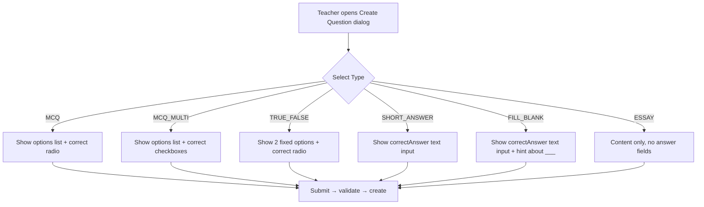

# C3. Question Type Reference

## 5.1 Feature Overview

| Field | Value |
|---|---|
| Feature ID | C3 |
| Feature Name | Question Type Reference |
| Module | C. Question Bank |
| Priority | P0 (MCQ), P1 (MCQ_MULTI, TRUE_FALSE), P2 (SHORT_ANSWER, FILL_BLANK, ESSAY) |
| Complexity | L |
| Status | **Existing** — All six types supported in create/edit DTOs and service validation |
| Target Roles | Teacher (creates), Student (answers via exam) |
| Business Objective | Support the range of assessment methods teachers need, from objective auto-graded types to subjective manually-graded ones |
| User Problem | Different subjects and assessment goals require different question formats. A math quiz needs short answers; a literature exam needs essays; a standardized test needs MCQ. |
| Dependencies | C1 (Create Question), D1 (Exam Publish), E4 (Answer Questions), G1 (Grading) |

## 5.2 Actors and Permissions

Permissions are identical to C1/C2 — teachers create and manage, students interact only through published exams.

**Student-facing difference by type**: When a student takes an exam, the answer input rendered depends on the question type:

| Type | Student Input | Auto-Graded |
|---|---|---|
| MCQ | Radio button (select one) | Yes |
| MCQ_MULTI | Checkbox (select multiple) | Yes (all-or-nothing by default) |
| TRUE_FALSE | Radio button (select one of two) | Yes |
| SHORT_ANSWER | Text input (single line) | Yes (exact match) |
| FILL_BLANK | Text input (one or more blanks) | Yes (exact match per blank) |
| ESSAY | Textarea (multi-line, max 10,000 chars) | No (manual grading) |

## 5.3 Preconditions and Business Rules

### Type Definitions

#### MCQ — Multiple Choice, Single Answer

| Rule | Description |
|---|---|
| Options required | Yes, minimum 2 |
| Correct options | Exactly 1 |
| `correctAnswer` field | Not used |
| Auto-grading | Compare `selectedOptionId` against the option with `isCorrect: true` in snapshot |
| Typical option count | 4 (A, B, C, D) |

#### MCQ_MULTI — Multiple Choice, Multiple Answers

| Rule | Description |
|---|---|
| Options required | Yes, minimum 2 |
| Correct options | At least 1 (should also have at least 1 incorrect — see open questions) |
| `correctAnswer` field | Not used |
| Auto-grading | Default: ALL_OR_NOTHING (all correct selected, no incorrect selected → full points; otherwise 0). P2: PARTIAL grading mode available via `exam.gradingMode` |
| Answer payload | `{ selectedOptionIds: string[] }` (array) |

#### TRUE_FALSE — True or False

| Rule | Description |
|---|---|
| Options required | Yes, exactly 2 |
| Correct options | Exactly 1 |
| `correctAnswer` field | Not used |
| Option content | Conventionally "Đúng" and "Sai" but not enforced |
| Auto-grading | Same as MCQ |
| Shuffle behavior | Exam's `shuffleOptions` should NOT shuffle TRUE_FALSE options (preserve Đúng/Sai order). **Currently not enforced — gap noted in D4 spec.** |

#### SHORT_ANSWER — Short Text Answer

| Rule | Description |
|---|---|
| Options required | No |
| Correct options | N/A |
| `correctAnswer` field | Used for auto-grading. Stores the expected answer text. |
| Auto-grading | Case-insensitive, trimmed comparison. Multiple acceptable answers separated by comma: match any one. |
| Answer payload | `{ text: string }` |
| Max answer length | Not currently enforced. Should be limited (e.g., 500 chars). |

#### FILL_BLANK — Fill in the Blank

| Rule | Description |
|---|---|
| Options required | No |
| Correct options | N/A |
| `correctAnswer` field | Stores expected text. Content contains `___` placeholder(s). |
| Auto-grading | Same as SHORT_ANSWER — exact match, case-insensitive, trimmed |
| Multiple blanks | Not currently supported as separate fields. Single `correctAnswer` for the entire question. **Limitation.** |
| Answer payload | `{ text: string }` |

#### ESSAY — Free Text / Tự luận

| Rule | Description |
|---|---|
| Options required | No |
| Correct options | N/A |
| `correctAnswer` field | Not used |
| Auto-grading | **Not auto-graded**. Teacher must manually grade. |
| Answer payload | `{ text: string }` |
| Max answer length | Should be 10,000 characters |
| Grading | Teacher uses manual scoring (PATCH /attempts/:id/score) and per-answer feedback |

### Cross-Type Rules

| Rule ID | Rule |
|---|---|
| CT-01 | Question type is set at creation and cannot be changed |
| CT-02 | When a question is added to an exam and published, the snapshot includes: `contentSnapshot` (text), `optionsSnapshot` (JSON array of {id, content, isCorrect, position}). For types without options, `optionsSnapshot` is null. |
| CT-03 | Grading logic operates on the snapshot, never the live question data |
| CT-04 | The `isCorrect` field in options is never sent to students during an exam — it is stripped from the API response |
| CT-05 | `correctAnswer` is never sent to students during an exam |

## 5.4 Main User Flow — Happy Path

See C1 (Create Question) for the creation flow, which adapts the form based on type selection.

### Type Selection Flow (UI)



## 5.5 Alternative Flows

### AF-01: Teacher creates MCQ then realizes it should be MCQ_MULTI

- Cannot change type after creation.
- Teacher must create a new MCQ_MULTI question and delete the old MCQ.
- Consider: a "duplicate question" feature that copies content to a new question with a different type. **Not implemented — potential improvement.**

### AF-02: Teacher uses FILL_BLANK with multiple blanks

- Content: "The capital of ___ is ___"
- Current `correctAnswer` is a single string — cannot represent two distinct blanks.
- Workaround: Teacher uses a single correctAnswer with comma separation (e.g., "Vietnam,Hanoi"), but the grading logic treats it as alternative answers for ONE blank (match any).
- **This is a limitation**. Multi-blank fill-in requires a schema change (e.g., JSON array for correctAnswer).

## 5.6 Edge Cases and Failure Scenarios

| Scenario ID | Scenario | Trigger | Expected Behavior | User Feedback | Data Integrity | Recovery | Severity |
|---|---|---|---|---|---|---|---|
| C3-E01 | MCQ created with 0 options | Type = MCQ, empty options array | DTO rejects: @ArrayMinSize(2) | Validation error | No data created | Add options | High |
| C3-E02 | MCQ_MULTI with all options correct | Teacher marks every option correct | Currently allowed (only "at least 1 correct" checked) | No error | Semantically meaningless question stored | Gap: should require at least 1 incorrect | Medium |
| C3-E03 | TRUE_FALSE with 5 options | Teacher adds extra options beyond Đúng/Sai | Currently allowed (only correct-count validated) | No error | Extra options stored | Gap: enforce exactly 2 for TRUE_FALSE | Medium |
| C3-E04 | SHORT_ANSWER with empty correctAnswer | Teacher omits correctAnswer | Allowed — correctAnswer is optional | No error | Question cannot be auto-graded | Manual grading required | Medium |
| C3-E05 | SHORT_ANSWER grading with special characters | Student types "Hà Nội" vs correctAnswer "Ha Noi" (no diacritics) | Current grading: case-insensitive match, but diacritics differ → INCORRECT | Student marked wrong despite being arguably correct | Grading is strict exact-match | Gap: consider Unicode normalization / accent-insensitive matching | High |
| C3-E06 | ESSAY answer exceeds reasonable length | Student pastes 100KB of text | No max-length on answer_payload in current schema | Large payload stored | Gap: enforce max length (10,000 chars recommended) | Medium |
| C3-E07 | FILL_BLANK with no ___ in content | Teacher creates FILL_BLANK but forgets the blank marker | Allowed — no content format validation for FILL_BLANK | Confusing question for students | Question is valid but semantically wrong | Gap: consider warning if content lacks ___ | Low |
| C3-E08 | Mixed types in same exam | Exam has MCQ + ESSAY questions | Supported. Exam can mix any types. | Each question renders appropriate input | Score calculation includes auto-graded + manual | Partial score until teacher grades essays | Medium |
| C3-E09 | ESSAY in exam with showResultImmediately=true | Student submits, expects score | Score shown is from auto-graded questions only. Essay score is 0 until manual grading. | Student sees partial/low score | Correct — score is not final until teacher grades | Gap: UI should indicate "Đang chờ chấm tự luận" | Medium |

## 5.7 UI/UX Specification

### Type Selector in Create/Edit Dialog

- **Component**: Segmented button group (preferred) or Select dropdown.
- **Labels (Vietnamese)**:
  - MCQ → "Trắc nghiệm"
  - MCQ_MULTI → "Nhiều đáp án"
  - TRUE_FALSE → "Đúng/Sai"
  - SHORT_ANSWER → "Trả lời ngắn"
  - FILL_BLANK → "Điền chỗ trống"
  - ESSAY → "Tự luận"
- **Behavior**: Switching type changes which form sections are visible. If teacher has already entered options and switches to ESSAY, options data is discarded (with confirmation if non-empty).

### Question Card Display (Bank List)

Each question card shows:
- Content text (truncated to 2 lines)
- Type badge with color:
  - MCQ → blue outline badge
  - MCQ_MULTI → blue outline badge
  - TRUE_FALSE → green outline badge
  - SHORT_ANSWER → amber outline badge
  - FILL_BLANK → amber outline badge
  - ESSAY → purple outline badge
- Difficulty badge (if set): EASY → green, MEDIUM → amber, HARD → red
- Category name (if set)
- Option count (for option-based types)

### Student Exam View (by type)

| Type | Input Component | Interaction |
|---|---|---|
| MCQ | Radio button group | Click to select one option. Previous selection deselected. |
| MCQ_MULTI | Checkbox group | Click to toggle each option independently. |
| TRUE_FALSE | Radio button group (2 options) | Same as MCQ. |
| SHORT_ANSWER | Single-line text input | Type answer. Autosave on blur/debounce. |
| FILL_BLANK | Single-line text input (one or more) | Type answer. Autosave. |
| ESSAY | Multi-line textarea | Type answer. Character count shown. Autosave. |

**Note**: The current exam-taking UI (`take-exam/[examId]/page.tsx`) only renders radio buttons for option-based questions. Text-input rendering for SHORT_ANSWER/FILL_BLANK/ESSAY is **not yet implemented in the frontend** — the backend types exist but the student-facing UI only handles the option-click pattern.

## 5.8 Data Requirements

### Current Schema (verified)

The `Question` model supports all types via:
- `type: String @default("MCQ")` — stores the enum value
- `correctAnswer: String?` — for SHORT_ANSWER / FILL_BLANK
- `options: QuestionOption[]` — for MCQ / MCQ_MULTI / TRUE_FALSE

The `Answer` model uses:
- `answerPayload: Json` — flexible JSON that adapts per type

### Answer Payload Schema by Type

| Type | Payload Shape | Example |
|---|---|---|
| MCQ | `{ selectedOptionId: string }` | `{ "selectedOptionId": "uuid-of-option-B" }` |
| MCQ_MULTI | `{ selectedOptionIds: string[] }` | `{ "selectedOptionIds": ["uuid-A", "uuid-C"] }` |
| TRUE_FALSE | `{ selectedOptionId: string }` | `{ "selectedOptionId": "uuid-of-true" }` |
| SHORT_ANSWER | `{ text: string }` | `{ "text": "Hà Nội" }` |
| FILL_BLANK | `{ text: string }` | `{ "text": "oxygen" }` |
| ESSAY | `{ text: string }` | `{ "text": "Lorem ipsum long essay text..." }` |

### Proposed Changes

1. Add `@MaxLength(10000)` to content field (question text).
2. Consider migrating `type` from `String` to a proper Prisma `enum` for type safety.
3. Consider adding a JSON schema validation for `answerPayload` based on question type.

## 5.9 API Requirements

No new API endpoints for this feature. This is a reference document describing the type system used by C1 (Create) and C2 (Edit) APIs.

### Grading API Behavior by Type

When `POST /attempts/:id/submit` triggers grading:

| Type | Grading Logic | Score |
|---|---|---|
| MCQ | `payload.selectedOptionId` matches option with `isCorrect: true` in snapshot | Full points or 0 |
| MCQ_MULTI | Default (ALL_OR_NOTHING): all correct selected AND no incorrect selected | Full points or 0 |
| TRUE_FALSE | Same as MCQ | Full points or 0 |
| SHORT_ANSWER | `payload.text.trim().toLowerCase()` matches any of `correctAnswer.split(',').map(a => a.trim().toLowerCase())` | Full points or 0 |
| FILL_BLANK | Same as SHORT_ANSWER | Full points or 0 |
| ESSAY | Not auto-graded. Score = 0 until manual override. | 0 until teacher grades |

**Note**: SHORT_ANSWER and FILL_BLANK grading is **not fully implemented** in the current `attempts.service.ts` — the submit logic only handles `selectedOptionId` matching. Text-based answer grading is a gap.

## 5.10 State Management

No type-specific state transitions. Types are immutable after creation. The type influences:
1. Which form fields appear during creation/editing.
2. Which input component renders during an exam.
3. Which grading logic applies on submit.
4. Whether manual grading is required (ESSAY).

## 5.11 Acceptance Criteria

```gherkin
Given a teacher creates an MCQ question with 4 options and 1 correct,
When a student answers it correctly in an exam,
Then the auto-grading awards full points.

Given a teacher creates an MCQ_MULTI question with options A(T), B(T), C(F), D(F),
When a student selects A and B only,
Then the auto-grading awards full points (ALL_OR_NOTHING mode).

Given a teacher creates an MCQ_MULTI question,
When a student selects A but not B (both correct),
Then the auto-grading awards 0 points (ALL_OR_NOTHING mode).

Given a teacher creates a TRUE_FALSE question,
When a student selects the correct option,
Then the auto-grading awards full points.

Given a teacher creates a SHORT_ANSWER question with correctAnswer "Hà Nội",
When a student types "hà nội" (case different),
Then the auto-grading awards full points (case-insensitive match).

Given a teacher creates an ESSAY question,
When a student submits an answer,
Then the score for that question is 0 until the teacher manually grades it.

Given a teacher creates a SHORT_ANSWER with correctAnswer "Paris,London",
When a student types "London",
Then the auto-grading awards full points (matches any of the comma-separated answers).
```

## 5.12 QA Test Scenarios

| Test ID | Scenario | Preconditions | Steps | Expected Result | Priority |
|---|---|---|---|---|---|
| C3-T01 | MCQ grading — correct | Published exam with MCQ question | Student selects correct option, submits | Full points awarded | P0 |
| C3-T02 | MCQ grading — incorrect | Published exam with MCQ question | Student selects wrong option, submits | 0 points | P0 |
| C3-T03 | MCQ grading — unanswered | Published exam with MCQ question | Student skips question, submits | 0 points | P0 |
| C3-T04 | MCQ_MULTI — all correct selected | Published exam with MCQ_MULTI | Student selects all correct, no incorrect | Full points | P1 |
| C3-T05 | MCQ_MULTI — partial correct | Published exam with MCQ_MULTI | Student selects 1 of 2 correct | 0 points (ALL_OR_NOTHING) | P1 |
| C3-T06 | MCQ_MULTI — includes incorrect | Published exam with MCQ_MULTI | Student selects 1 correct + 1 incorrect | 0 points | P1 |
| C3-T07 | TRUE_FALSE — correct | Published exam with TRUE_FALSE | Student selects correct option | Full points | P1 |
| C3-T08 | SHORT_ANSWER — exact match | Published exam with SHORT_ANSWER | Student types matching answer | Full points | P2 |
| C3-T09 | SHORT_ANSWER — case mismatch | Published exam with SHORT_ANSWER | Student types same word, different case | Full points (case-insensitive) | P2 |
| C3-T10 | SHORT_ANSWER — wrong answer | Published exam with SHORT_ANSWER | Student types wrong text | 0 points | P2 |
| C3-T11 | ESSAY — auto-grading skipped | Published exam with ESSAY | Student submits text | 0 points, awaiting manual grading | P2 |
| C3-T12 | Mixed types in one exam | Exam with MCQ + ESSAY | Student answers all, submits | Score = MCQ auto-graded; ESSAY = 0 | P2 |
| C3-T13 | Type badge display | Question bank with all types | View question list | Each card shows correct type badge | P1 |
| C3-T14 | Type selector changes form | Create question dialog | Switch between types | Form sections appear/disappear correctly | P1 |

## 5.13 Open Questions and Assumptions

| # | Question | Why It Matters | Options | Recommended Default | Impact |
|---|---|---|---|---|---|
| 1 | Should SHORT_ANSWER grading support accent-insensitive matching? | Vietnamese has many diacritics. "Ha Noi" vs "Hà Nội" is a common mismatch. | A) Strict exact match (current). B) Accent-insensitive + case-insensitive. C) Levenshtein distance threshold. | **B) Accent-insensitive** — most appropriate for Vietnamese | Medium: requires Unicode normalization in grading logic |
| 2 | How should FILL_BLANK handle multiple blanks? | Current `correctAnswer` is a single string; can't represent answers for multiple blanks independently. | A) Leave as single-blank. B) Use JSON array in `correctAnswer`. C) Use `\|` separator for blank boundaries. | **A) Single-blank for MVP**, document limitation | Deferred |
| 3 | Should the answer payload be validated by type? | Currently `answerPayload` accepts any JSON. A student could send MCQ payload for an ESSAY question. | A) Validate payload shape per question type. B) Leave flexible. | **A) Validate** — prevents data corruption | Medium: add type-based payload validation in attempts service |
| 4 | How should ESSAY be scored in the overall exam? | Exam with 8 MCQ (auto) + 2 ESSAY (manual). Score shown is auto-graded portion. | A) Show partial score with "(chờ chấm)". B) Show only auto-graded score. C) Don't show score until all graded. | **A) Show partial with indicator** — transparent to student | Medium: frontend change |
| 5 | Should `type` be migrated from String to Prisma enum? | Current: `type String @default("MCQ")`. No DB-level constraint. | A) Migrate to enum. B) Keep String with app-level validation. | **B) Keep String** for now — enums require a migration for each new type | Low |

### Assumptions

1. **Assumed**: All six types are defined and final for the current phase. No additional types planned.
2. **Assumed**: The grading mode (ALL_OR_NOTHING vs PARTIAL) is per-exam, not per-question. Set on the `Exam.gradingMode` field.
3. **Assumed**: SHORT_ANSWER and FILL_BLANK grading is not yet implemented in the submit/grading flow. The backend types exist but grading only handles option-based matching today.
4. **Assumed**: The student-facing exam UI currently only renders option-based questions (radio buttons). Text input rendering for SHORT_ANSWER/FILL_BLANK/ESSAY is a frontend gap.
