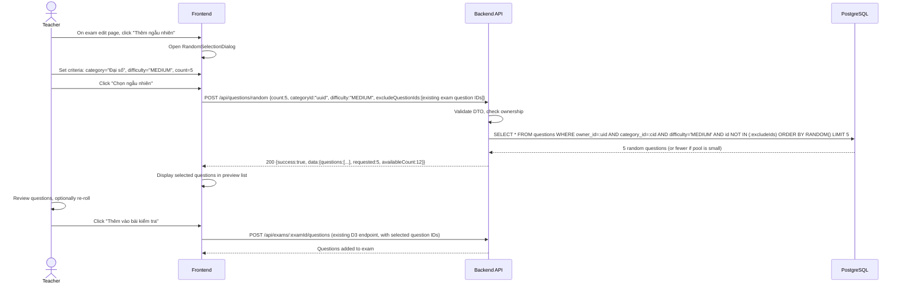

# C13. Random Question Selection

## 5.1 Feature Overview

| Field | Value |
|---|---|
| Feature ID | C13 |
| Feature Name | Random Question Selection |
| Module | C. Question Bank |
| Priority | P2 |
| Complexity | S |
| Status | **Not Implemented** — no random selection endpoint or UI exists. Gap: C-GAP-05. The `GET /questions` endpoint supports filtering by category, difficulty, and type but has no random sampling or count parameter. |
| Target Roles | TEACHER |
| Business Objective | Provide a mechanism for teachers to randomly select questions from their question bank based on criteria (category, difficulty, type, question group), for use in exam composition. This is the selection engine; D10 (Random Exam Generation) will use it to build complete exams. |
| User Problem | Teachers with hundreds of questions must manually browse and pick individual questions for each exam. Random selection from a filtered pool saves time and creates varied exams across sections or retakes. |
| Dependencies | C1 (Create Question), C4 (Question Categories), C5 (Search & Filter), C12 (Question Groups — groups as a source pool) |

## 5.2 Actors and Permissions

### Teacher (TEACHER role)

| Action | Permitted | Notes |
|---|---|---|
| Request a random selection from own questions | Yes | Filtered by any combination of criteria |
| Preview the randomly selected questions | Yes | Before adding to an exam |
| Re-roll the selection (request new random set) | Yes | Same criteria, new random sample |
| Use selection results to add questions to an exam | Yes | Integration with D3 (Manage Questions) |
| Select from another teacher's questions | **No** | `ownerId` filter always applied |

### Student (STUDENT role)

| Action | Permitted | Notes |
|---|---|---|
| Any random selection operation | **No** | 403 Forbidden — controller is `@Roles('TEACHER')` |

### Backend Authorization

- The selection endpoint lives under the questions controller with `@Roles('TEACHER')`.
- All queries include `ownerId = currentUser.id` as a mandatory filter.
- If `groupId` is provided, the service verifies `group.ownerId === currentUser.id`.

## 5.3 Preconditions and Business Rules

### Preconditions

1. User is authenticated with a valid JWT access token.
2. User has `TEACHER` role.
3. The teacher has at least one question in their bank.
4. If `groupId` is specified, the group must exist and be owned by the teacher.

### Business Rules

| Rule ID | Rule | Enforcement |
|---|---|---|
| C13-BR-01 | The selection engine queries only questions owned by the requesting teacher (`ownerId = currentUser.id`). | Backend — mandatory where clause; never overridable from request |
| C13-BR-02 | Filter criteria are all optional and combinable: `categoryId`, `difficulty` (EASY/MEDIUM/HARD), `type` (MCQ, MCQ_MULTI, TRUE_FALSE, SHORT_ANSWER, FILL_BLANK, ESSAY), `groupId`. When multiple are specified, all must match (AND logic). | Backend — Prisma `where` clause composition |
| C13-BR-03 | `count` is required and must be between 1 and 100. This is the number of questions the teacher wants selected. | Backend — DTO validation: `@IsInt()`, `@Min(1)`, `@Max(100)` |
| C13-BR-04 | If `groupId` is provided, only questions that belong to that group (via `QuestionGroupItem`) are eligible. The `groupId` filter combines with category, difficulty, and type filters (AND logic). | Backend — JOIN through `QuestionGroupItem` |
| C13-BR-05 | If `groupId` is provided but the group does not belong to the current teacher, return 403 with code `GROUP_NOT_OWNED`. | Backend — ownership check |
| C13-BR-06 | If fewer questions match the criteria than `count`, the endpoint returns all matching questions and includes `availableCount` in the response metadata. The frontend shows a warning. | Backend — response includes `availableCount` and `requested` |
| C13-BR-07 | Random selection uses PostgreSQL's `ORDER BY RANDOM()` for simplicity. At ~100 users and typical question bank sizes (< 5,000 questions per teacher), this is performant. | Backend — `orderBy: { raw: 'RANDOM()' }` or `$queryRaw` |
| C13-BR-08 | The selection result is stateless. The server does not remember previous selections. Each request is independent. "Re-roll" is simply a new request with the same parameters. | Backend — no server-side state |
| C13-BR-09 | `excludeQuestionIds` is an optional array of UUIDs. Questions with these IDs are excluded from the pool before random selection. This allows the teacher to exclude questions already added to the current exam. | Backend — `NOT IN` clause |
| C13-BR-10 | `excludeQuestionIds` can contain at most 500 UUIDs. If more are provided, return 400 with code `EXCLUDE_LIST_TOO_LARGE`. | Backend — DTO validation: `@ArrayMaxSize(500)` |
| C13-BR-11 | The endpoint returns full question objects (id, content, type, difficulty, category, options) so the teacher can preview them before adding to an exam. Options include `isCorrect` (visible to teacher). | Backend — include options and category in response |
| C13-BR-12 | If `categoryId` is provided but does not exist or is not owned by the teacher, return 404 with code `CATEGORY_NOT_FOUND`. | Backend — ownership check |
| C13-BR-13 | If no criteria match any questions (0 results), the response returns an empty array with `availableCount: 0`. This is not an error. | Backend — normal 200 response with empty data |
| C13-BR-14 | Multiple `difficulty` values can be provided to select across difficulties (e.g., 3 EASY + 5 MEDIUM). This is achieved by making multiple requests, one per difficulty, not by the engine in a single call. | Frontend — multiple requests; backend handles one difficulty per call |

### Validation Rules (DTO-level)

**RandomSelectionDto**

| Field | Type | Required | Validation |
|---|---|---|---|
| `count` | number | Yes | `@IsInt()`, `@Min(1)`, `@Max(100)` |
| `categoryId` | string | No | `@IsOptional()`, `@IsUUID()` |
| `difficulty` | string | No | `@IsOptional()`, `@IsEnum(Difficulty)` |
| `type` | string | No | `@IsOptional()`, `@IsString()`, must be a valid question type |
| `groupId` | string | No | `@IsOptional()`, `@IsUUID()` |
| `excludeQuestionIds` | string[] | No | `@IsOptional()`, `@IsArray()`, `@ArrayMaxSize(500)`, each `@IsUUID()` |

## 5.4 Main User Flow — Happy Path

### Random Selection for Exam Building



### Steps

| Step | Actor | Action | System Response | Data Changed |
|---|---|---|---|---|
| 1 | Teacher | Opens random selection dialog from exam edit | Dialog opens with filter controls | — |
| 2 | Teacher | Sets category, difficulty, type, and count | — | — |
| 3 | Teacher | Clicks "Chọn ngẫu nhiên" | Random questions returned | — |
| 4 | Teacher | Reviews selected questions | Preview list displayed | — |
| 5 | Teacher | Optionally clicks "Chọn lại" for a new set | New random selection returned | — |
| 6 | Teacher | Clicks "Thêm vào bài kiểm tra" | Questions added to exam via D3 | `exam_questions` rows created |

## 5.5 Alternative Flows

### AF-C13-01: Selection from a question group

- **Trigger**: Teacher selects a group from the "Nhóm câu hỏi" dropdown in the selection dialog.
- **Behavior**: `groupId` is sent with the request. Only questions in that group (AND matching other filters) are eligible.
- **Result**: Random selection drawn from the group's question pool.

### AF-C13-02: Fewer questions available than requested

- **Trigger**: Teacher requests 10 but only 7 match the criteria.
- **Behavior**: Endpoint returns all 7 with `requested: 10, availableCount: 7`.
- **UI**: Warning banner: "Chỉ có 7 câu hỏi phù hợp (yêu cầu 10). Bạn có thể thêm tất cả hoặc thay đổi tiêu chí."
- **Result**: Teacher can add the 7 or adjust criteria.

### AF-C13-03: No questions match criteria

- **Trigger**: Filter combination matches 0 questions.
- **Behavior**: Endpoint returns empty array with `availableCount: 0`.
- **UI**: Empty state: "Không tìm thấy câu hỏi phù hợp. Hãy thay đổi tiêu chí tìm kiếm."
- **Result**: Teacher adjusts filters.

### AF-C13-04: Re-roll (select again with same criteria)

- **Trigger**: Teacher clicks "Chọn lại" button.
- **Behavior**: Frontend re-sends the same request. Backend returns a new random set (may overlap with previous).
- **Result**: New preview displayed. Previous selection is discarded on the frontend.

### AF-C13-05: Standalone selection (not from exam editor)

- **Trigger**: Teacher uses random selection from the question bank page (outside exam context).
- **Behavior**: Same endpoint, but `excludeQuestionIds` is empty. Result is presented for review only — no "add to exam" action.
- **Result**: Teacher can view random questions, useful for reviewing a sample from a category.

### AF-C13-06: Exclude questions already in the exam

- **Trigger**: Teacher is building an exam that already has 5 questions and wants 10 more random ones.
- **Behavior**: Frontend collects the `sourceQuestionId` values of existing exam questions and passes them as `excludeQuestionIds`.
- **Result**: Selected questions do not overlap with questions already in the exam.

## 5.6 Edge Cases and Failure Scenarios

| Scenario ID | Scenario | Trigger | Expected Behavior | User Feedback | Data Integrity | Recovery | Severity |
|---|---|---|---|---|---|---|---|
| EC-C13-01 | Count is 0 or negative | `count: 0` or `count: -1` | 400 DTO validation error | Validation error message | No query executed | Fix input | Low |
| EC-C13-02 | Count exceeds 100 | `count: 150` | 400 DTO validation error | "Tối đa 100 câu hỏi mỗi lần chọn" | No query executed | Reduce count | Low |
| EC-C13-03 | groupId does not exist | Invalid UUID for groupId | 404 `GROUP_NOT_FOUND` | Toast: "Không tìm thấy nhóm câu hỏi" | No query executed | Use valid group | Medium |
| EC-C13-04 | groupId owned by another teacher | Valid UUID, wrong owner | 403 `GROUP_NOT_OWNED` | Toast: "Bạn không có quyền sử dụng nhóm này" | No query executed | Use own group | High |
| EC-C13-05 | categoryId does not exist | Invalid category UUID | 404 `CATEGORY_NOT_FOUND` | Toast: "Không tìm thấy danh mục" | No query executed | Use valid category | Medium |
| EC-C13-06 | All questions in pool are in excludeQuestionIds | 20 matching questions, all 20 excluded | Returns empty array, `availableCount: 0` | "Không tìm thấy câu hỏi phù hợp" | No change | Remove exclusions or expand criteria | Low |
| EC-C13-07 | excludeQuestionIds contains > 500 IDs | Array with 501 UUIDs | 400 `EXCLUDE_LIST_TOO_LARGE` | Validation error | No query executed | Reduce exclusion list | Low |
| EC-C13-08 | excludeQuestionIds contains non-existent IDs | UUIDs that don't match any question | Silently ignored — `NOT IN` handles gracefully | No issue | No change | N/A | Low |
| EC-C13-09 | Group is empty (has 0 questions) | groupId references a group with no items | Returns empty array, `availableCount: 0` | "Nhóm câu hỏi này chưa có câu hỏi" | No change | Add questions to group first | Low |
| EC-C13-10 | Concurrent selection requests | Two requests with same criteria at same time | Each returns an independent random set | Both succeed | No integrity issue — read-only operation | N/A | Low |
| EC-C13-11 | Question deleted between selection and adding to exam | Teacher selects, then question is deleted before adding to exam | The D3 endpoint (add to exam) handles missing questions with its own validation | D3 returns error for missing question ID | No stale data — selection is stateless | Re-roll selection | Low |
| EC-C13-12 | Teacher has 0 questions total | Empty question bank | Returns empty array, `availableCount: 0` | "Bạn chưa có câu hỏi nào. Hãy tạo câu hỏi trước." | No change | Create questions first | Low |

## 5.7 UI/UX Specification

### Entry Points

1. **Exam edit page** (`/dashboard/exams/[id]/edit`): "Thêm ngẫu nhiên" button alongside "Thêm câu hỏi" in the exam questions section.
2. **Question bank page** (`/dashboard/questions`): "Chọn ngẫu nhiên" button in the toolbar (for standalone preview).

### RandomSelectionDialog

```
┌──────────────────────────────────────────────────┐
│  Chọn câu hỏi ngẫu nhiên                         │
│                                                  │
│  Danh mục       [Tất cả          ▼]              │
│  Độ khó         [Tất cả          ▼]              │
│  Loại câu hỏi  [Tất cả          ▼]              │
│  Nhóm câu hỏi  [Không chọn      ▼]              │
│  Số lượng       [5               ]               │
│                                                  │
│  [Chọn ngẫu nhiên]                               │
├──────────────────────────────────────────────────┤
│  Kết quả: 5/12 câu hỏi phù hợp                  │
│                                                  │
│  ┌──────────────────────────────────────────┐    │
│  │ 1. Giải phương trình...   MCQ   MEDIUM  │    │
│  │ 2. Tính tích phân...      MCQ   HARD    │    │
│  │ 3. Chứng minh rằng...     ESSAY MEDIUM  │    │
│  │ 4. Đúng hay sai...        T/F   EASY    │    │
│  │ 5. Điền vào chỗ trống...  FILL  MEDIUM  │    │
│  └──────────────────────────────────────────┘    │
│                                                  │
│  [Chọn lại]   [Hủy]   [Thêm vào bài kiểm tra]  │
└──────────────────────────────────────────────────┘
```

### Filter Controls

| Control | Values | Default |
|---|---|---|
| Danh mục | Teacher's categories (hierarchical) + "Tất cả" | "Tất cả" |
| Độ khó | EASY / MEDIUM / HARD + "Tất cả" | "Tất cả" |
| Loại câu hỏi | MCQ / MCQ_MULTI / TRUE_FALSE / SHORT_ANSWER / FILL_BLANK / ESSAY + "Tất cả" | "Tất cả" |
| Nhóm câu hỏi | Teacher's groups + "Không chọn" | "Không chọn" |
| Số lượng | Number input, 1–100 | 5 |

### Result Preview

- Each question shows: truncated content (first 100 chars), type badge, difficulty badge.
- Clicking a question row expands it to show full content and options (if MCQ).
- Questions already in the current exam (if launched from exam editor) are not shown (excluded via `excludeQuestionIds`).

### States

| State | Appearance |
|---|---|
| Initial | Filter controls visible, result area hidden |
| Loading | Spinner in result area: "Đang chọn câu hỏi..." |
| Results ready | Question list with count indicator |
| Fewer than requested | Yellow warning banner above results |
| No results | Empty state: "Không tìm thấy câu hỏi phù hợp" |
| Re-rolling | Brief spinner, then new results |

### Responsive Behavior

- Dialog: full-screen on mobile, centered modal on desktop.
- Filter controls: stack vertically on mobile, 2-column grid on desktop.
- Question list: full-width cards on mobile.

## 5.8 Data Requirements

### Existing Entities (Verified)

No schema changes required. The selection engine is a read-only query over existing tables.

**Question** — `apps/api/prisma/schema.prisma`

| Field | Used By |
|---|---|
| id | Return value, exclusion list |
| ownerId | Mandatory filter (C13-BR-01) |
| type | Filter criterion |
| content | Return value (preview) |
| difficulty | Filter criterion |
| categoryId | Filter criterion |
| options (relation) | Return value (preview) |
| category (relation) | Return value (preview) |
| groupItems (relation) | JOIN for group filter |

**QuestionGroupItem** — `apps/api/prisma/schema.prisma`

| Field | Used By |
|---|---|
| groupId | Filter: join to restrict to group members |
| questionId | Join key to Question |

**QuestionGroup** — `apps/api/prisma/schema.prisma`

| Field | Used By |
|---|---|
| id | Path for group filter |
| ownerId | Ownership check (C13-BR-05) |

### Proposed Schema Changes

None.

### Query Performance

The random selection query with all filters:

```sql
SELECT q.*
FROM questions q
LEFT JOIN question_group_items qgi ON q.id = qgi.question_id
WHERE q.owner_id = :ownerId
  AND (:categoryId IS NULL OR q.category_id = :categoryId)
  AND (:difficulty IS NULL OR q.difficulty = :difficulty)
  AND (:type IS NULL OR q.type = :type)
  AND (:groupId IS NULL OR qgi.group_id = :groupId)
  AND q.id NOT IN (:excludeIds)
ORDER BY RANDOM()
LIMIT :count
```

At ~100 users with up to 5,000 questions per teacher, `ORDER BY RANDOM()` scans and sorts the filtered set. With proper indexes on `owner_id`, `category_id`, and `difficulty`, the filtered set will typically be small (tens to hundreds). This is well within PostgreSQL's performance for this scale.

Recommended indexes (if not already present):
- `questions(owner_id, category_id)`
- `questions(owner_id, difficulty)`
- `question_group_items(group_id)` — already covered by the unique index

## 5.9 API Requirements

### POST /api/questions/random — Random Question Selection

| Field | Value |
|---|---|
| Method | POST |
| Endpoint | `/api/questions/random` |
| Purpose | Randomly select questions from the teacher's bank based on filter criteria |
| Required Role | TEACHER |
| Authorization | `@Roles('TEACHER')`, `ownerId` from JWT |

POST is used instead of GET because the `excludeQuestionIds` array can be large and would exceed URL length limits.

**Request Body**:

```json
{
  "count": 5,
  "categoryId": "uuid-category",
  "difficulty": "MEDIUM",
  "type": "MCQ",
  "groupId": "uuid-group",
  "excludeQuestionIds": ["uuid-1", "uuid-2"]
}
```

**Success Response (200 OK)**:

```json
{
  "success": true,
  "data": {
    "questions": [
      {
        "id": "uuid-q1",
        "content": "Giải phương trình bậc hai: x² - 5x + 6 = 0",
        "type": "MCQ",
        "difficulty": "MEDIUM",
        "category": { "id": "uuid-cat", "name": "Đại số" },
        "options": [
          { "id": "uuid-opt1", "content": "x = 2 hoặc x = 3", "isCorrect": true, "position": 0 },
          { "id": "uuid-opt2", "content": "x = -2 hoặc x = -3", "isCorrect": false, "position": 1 },
          { "id": "uuid-opt3", "content": "x = 1 hoặc x = 6", "isCorrect": false, "position": 2 },
          { "id": "uuid-opt4", "content": "x = -1 hoặc x = -6", "isCorrect": false, "position": 3 }
        ],
        "explanation": "Phân tích: (x-2)(x-3) = 0"
      }
    ],
    "requested": 5,
    "availableCount": 12,
    "returned": 5
  }
}
```

| Response Field | Type | Description |
|---|---|---|
| questions | array | The randomly selected question objects |
| requested | number | The `count` value from the request |
| availableCount | number | Total questions matching the criteria (before `LIMIT`) |
| returned | number | Actual number of questions returned (min of requested, availableCount) |

**Error Responses**:

| Status | Code | Message | Condition |
|---|---|---|---|
| 400 | VALIDATION_ERROR | DTO validation message | count < 1, count > 100, invalid UUID, invalid enum value |
| 400 | EXCLUDE_LIST_TOO_LARGE | "Danh sách loại trừ quá lớn (tối đa 500)" | excludeQuestionIds > 500 items |
| 401 | UNAUTHORIZED | — | Missing or invalid JWT |
| 403 | FORBIDDEN | — | User is not TEACHER |
| 403 | GROUP_NOT_OWNED | "Bạn không có quyền sử dụng nhóm này" | groupId belongs to another teacher |
| 404 | CATEGORY_NOT_FOUND | "Không tìm thấy danh mục" | categoryId does not exist or not owned |
| 404 | GROUP_NOT_FOUND | "Không tìm thấy nhóm câu hỏi" | groupId does not exist |

### Idempotency

The endpoint is NOT idempotent by design. Each call returns a different random set (unless the pool is small enough to be deterministic). This is expected and desired behavior.

## 5.10 State Management

This feature is stateless. No state is created, modified, or persisted. The endpoint is a pure query that returns a random subset of existing data.

The questions returned by random selection have no special status. They become part of an exam only when the teacher explicitly adds them via the D3 (Manage Questions) endpoint.

## 5.11 Acceptance Criteria

### Positive Cases

```gherkin
Given a teacher has 20 MCQ questions in category "Đại số" with difficulty MEDIUM,
When they request POST /api/questions/random with count=5, categoryId="Đại số", difficulty="MEDIUM",
Then 5 randomly selected questions are returned,
And all 5 belong to category "Đại số" with difficulty MEDIUM,
And availableCount is 20.
Rule: C13-BR-01, C13-BR-02, C13-BR-03

Given a teacher has 3 questions matching the criteria and requests count=5,
When POST /api/questions/random is called,
Then all 3 questions are returned,
And returned is 3, requested is 5, availableCount is 3.
Rule: C13-BR-06

Given a teacher requests random selection with groupId pointing to a group they own,
When the group has 15 questions,
Then only questions from that group are eligible for selection.
Rule: C13-BR-04

Given a teacher provides excludeQuestionIds with 3 question IDs,
When the random selection runs,
Then none of the excluded questions appear in the result.
Rule: C13-BR-09

Given a teacher makes two requests with the same criteria,
When both complete,
Then the results may differ (different random selection).
Rule: C13-BR-07, C13-BR-08

Given a teacher requests random selection with no filters (only count),
When the request is processed,
Then questions are selected randomly from the teacher's entire bank.
Rule: C13-BR-01, C13-BR-02
```

### Negative Cases

```gherkin
Given a teacher provides groupId owned by another teacher,
When POST /api/questions/random is called,
Then the response is 403 with code GROUP_NOT_OWNED.
Rule: C13-BR-05

Given count is 0,
When POST /api/questions/random is called,
Then the response is 400 with a DTO validation error.
Rule: C13-BR-03

Given count is 150 (exceeds max),
When POST /api/questions/random is called,
Then the response is 400 with a DTO validation error.
Rule: C13-BR-03

Given excludeQuestionIds has 501 items,
When POST /api/questions/random is called,
Then the response is 400 with code EXCLUDE_LIST_TOO_LARGE.
Rule: C13-BR-10

Given a student is authenticated,
When they call POST /api/questions/random,
Then the response is 403 Forbidden.

Given a teacher provides a non-existent categoryId,
When POST /api/questions/random is called,
Then the response is 404 with code CATEGORY_NOT_FOUND.
Rule: C13-BR-12
```

## 5.12 QA Test Scenarios

| Test ID | Scenario | Preconditions | Steps | Test Data | Expected Result | Priority |
|---|---|---|---|---|---|---|
| TC-C13-01 | Basic random selection | Teacher has 20 questions | POST /random with count=5 | count: 5 | 200, 5 questions returned, availableCount=20 | P0 |
| TC-C13-02 | Selection with all filters | Teacher has questions across categories, difficulties, types | POST /random with categoryId, difficulty, type, count | All filters set | 200, only matching questions returned | P0 |
| TC-C13-03 | Selection from group | Teacher has group with 10 questions | POST /random with groupId, count=3 | groupId: teacher's group | 200, 3 questions from the group | P0 |
| TC-C13-04 | Fewer available than requested | Teacher has 3 matching questions | POST /random with count=10 | count: 10 | 200, returned=3, availableCount=3 | P0 |
| TC-C13-05 | No matching questions | Filter matches 0 questions | POST /random with restrictive filters | count: 5, difficulty: HARD + narrow category | 200, questions=[], availableCount=0 | P1 |
| TC-C13-06 | Exclude questions | Teacher has 10 questions, exclude 3 | POST /random with excludeQuestionIds | 3 IDs to exclude | 200, none of excluded IDs in result | P0 |
| TC-C13-07 | All questions excluded | 5 questions, all 5 in exclude list | POST /random with all IDs excluded | excludeQuestionIds: all 5 | 200, questions=[], availableCount=0 | P1 |
| TC-C13-08 | Re-roll returns different set | Teacher has 20 questions | POST /random twice with count=5 | Same params | Both return 5 questions; high probability of different sets | P1 |
| TC-C13-09 | Group not owned by teacher | Group belongs to another teacher | POST /random with other teacher's groupId | groupId: other's group | 403 GROUP_NOT_OWNED | P0 |
| TC-C13-10 | Non-existent group | Invalid groupId | POST /random with random UUID | groupId: non-existent | 404 GROUP_NOT_FOUND | P1 |
| TC-C13-11 | Non-existent category | Invalid categoryId | POST /random with random UUID | categoryId: non-existent | 404 CATEGORY_NOT_FOUND | P1 |
| TC-C13-12 | Count = 0 | Invalid count | POST /random with count=0 | count: 0 | 400 validation error | P1 |
| TC-C13-13 | Count > 100 | Invalid count | POST /random with count=150 | count: 150 | 400 validation error | P1 |
| TC-C13-14 | excludeQuestionIds > 500 | Large exclude list | POST /random with 501 UUIDs | 501 UUIDs | 400 EXCLUDE_LIST_TOO_LARGE | P1 |
| TC-C13-15 | Student cannot access | Student logged in | POST /random | Valid body | 403 Forbidden | P0 |
| TC-C13-16 | Unauthenticated | No JWT | POST /random | Valid body | 401 Unauthorized | P0 |
| TC-C13-17 | Results include options and category | Teacher has MCQ questions | POST /random with count=1 | count: 1 | Question includes options with isCorrect, category name | P1 |
| TC-C13-18 | Group + difficulty filter combined | Group has 10 questions, 4 are EASY | POST /random with groupId + difficulty=EASY, count=3 | groupId + EASY | 200, 3 EASY questions from the group | P1 |
| TC-C13-19 | Selection never returns other teacher's questions | Teacher A has 10 questions, Teacher B has 20 | POST /random as Teacher A with count=100 | count: 100 | Only Teacher A's questions returned, max 10 | P0 |
| TC-C13-20 | Concurrent requests | Two tabs open | POST /random simultaneously | Same params | Both return valid results, no errors | P2 |

## 5.13 Open Questions and Assumptions

| # | Question | Why It Matters | Options | Recommended Default | Impact |
|---|---|---|---|---|---|
| 1 | Should `ORDER BY RANDOM()` be replaced with application-level shuffling for larger question banks? | `ORDER BY RANDOM()` scans the entire filtered set. At 5,000 questions per teacher, this takes ~10ms. At 50,000 it could take 100ms+. | A) `ORDER BY RANDOM()` (recommended for MVP). B) Two-step: count, generate random offsets, fetch by offset. C) `TABLESAMPLE` (not precise enough for filtered sets). | **A) `ORDER BY RANDOM()`** — well within performance for ~100 users with typical bank sizes. Optimize only if profiling shows a bottleneck. | Low: purely a performance trade-off |
| 2 | Should the endpoint support multiple difficulty values in one request (e.g., "3 EASY + 5 MEDIUM")? | Convenient for mixed-difficulty exam generation. | A) Single difficulty per request — frontend makes multiple calls (recommended). B) Add `criteria[]` array for multi-slot selection. | **A) Single difficulty per request** — simpler API. D10 (Random Exam Generation) can compose multiple calls. Adding multi-slot complicates the DTO and query. | Low: frontend composition vs API complexity |
| 3 | Should the endpoint support `search` text filtering in addition to category/difficulty/type? | Could be useful for keyword-based selection. | A) No search — criteria-based only (recommended). B) Add optional `search` param like `GET /questions`. | **A) No search** — random selection is about pool criteria, not specific content. Text search is for manual browsing (existing `GET /questions` endpoint). | Low |
| 4 | Should the response include the `availableCount` of matching questions? | Helps the teacher understand pool size and make informed count decisions. Requires an additional `COUNT(*)` query. | A) Include availableCount (recommended). B) Omit for simplicity. | **A) Include** — one extra count query is trivial and the UX benefit is significant. | Low: one extra query |
| 5 | When C12 (Question Groups) is fully implemented, should `groupId` filter be available from day one? | Groups are the primary organizational tool for building exam pools. Without group support, random selection is less useful. | A) Include groupId from day one (recommended). B) Start with category/difficulty/type only, add group later. | **A) Include** — the schema already supports the JOIN. The code is minimal. | Low: one additional JOIN clause |

### Assumptions

1. **Assumed**: `ORDER BY RANDOM()` uses PostgreSQL's built-in random function, which provides uniform distribution. No cryptographic randomness is required — this is for variety, not security.
2. **Assumed**: The random selection endpoint does not create any data. It is purely a read operation that returns question objects. Adding questions to an exam is a separate step via D3.
3. **Assumed**: `excludeQuestionIds` is populated by the frontend from the current exam's question list (their `sourceQuestionId` values). The backend does not automatically exclude any questions.
4. **Assumed**: The endpoint returns the same question object shape as `GET /questions/:id`, including `options` with `isCorrect` visible to the teacher.
5. **Assumed**: If `groupId` is provided along with `categoryId` and/or `difficulty`, all filters apply as AND conditions. A question must be in the group AND match the category AND match the difficulty to be eligible.
