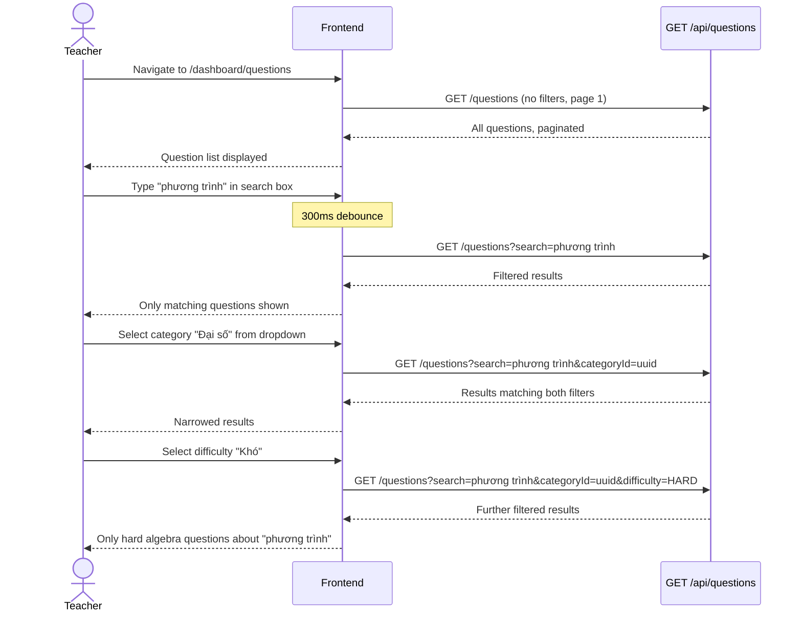

# C5. Search, Filter, and Paginate Questions

## 5.1 Feature Overview

| Field | Value |
|---|---|
| Feature ID | C5 |
| Feature Name | Search, Filter, and Paginate Questions |
| Module | C. Question Bank |
| Priority | P1 |
| Complexity | S |
| Status | **Existing** — search, category, difficulty, type filters with pagination implemented |
| Target Roles | Teacher |
| Business Objective | Allow teachers to efficiently locate questions in a growing bank for reuse in exams |
| User Problem | A bank with 500+ questions becomes unusable without search and filtering. Teachers need to find questions by keyword, subject, difficulty, and type to compose balanced exams. |
| Dependencies | C1 (Create Question), C4 (Categories & Difficulty) |

## 5.2 Actors and Permissions

### Teacher

| Action | Permitted | Notes |
|---|---|---|
| Search own questions by keyword | Yes | ILIKE on `content` field |
| Filter by category, difficulty, type | Yes | AND combination |
| Paginate results | Yes | Offset-based pagination |
| Search another teacher's questions | No | `findAll` filters by `ownerId` from JWT |

### Student

No access to the question bank search. Students encounter questions only through published exams.

## 5.3 Preconditions and Business Rules

| Rule ID | Rule | Enforcement |
|---|---|---|
| CS-01 | All questions returned are owned by the authenticated teacher | `where: { ownerId }` in query |
| CS-02 | Search keyword matches against `content` field, case-insensitive | Prisma `contains` with `mode: 'insensitive'` |
| CS-03 | Multiple filters combine with AND logic | Each filter adds a `where` clause |
| CS-04 | Empty search string returns all questions (no filter) | Conditional: `if (query.search) where.content = ...` |
| CS-05 | No results returns an empty array, not 404 | Standard paginated response with `data: [], meta: {total: 0}` |
| CS-06 | Default sort: `createdAt DESC` (newest first) | Hardcoded in service |
| CS-07 | Pagination defaults: page 1, limit 20 | From `PaginationQueryDto` defaults |
| CS-08 | Maximum limit: 100 per page | Should be enforced in pagination DTO |
| CS-09 | Response includes options and category for each question | Prisma `include: { options, category }` |

## 5.4 Main User Flow — Happy Path



## 5.5 Alternative Flows

### AF-01: No results found

- All filters applied, but no questions match.
- API returns `{ data: [], meta: { page: 1, limit: 20, total: 0 } }`.
- UI shows empty state: "Không tìm thấy câu hỏi nào" with a suggestion to adjust filters.

### AF-02: Clear all filters

- Teacher clicks a "Xóa bộ lọc" button or removes filters one by one.
- Query resets to `GET /questions` with no params.
- Full question list displayed again.

### AF-03: Paginate through results

- Teacher scrolls to the bottom or clicks page 2.
- Request: `GET /questions?page=2&limit=20&search=...&categoryId=...`
- Next batch of results loaded.

### AF-04: Filter by type only

- Teacher selects "Tự luận" (ESSAY) from type dropdown.
- `GET /questions?type=ESSAY`
- Only ESSAY questions returned.

## 5.6 Edge Cases and Failure Scenarios

| Scenario ID | Scenario | Trigger | Expected Behavior | User Feedback | Data Integrity | Recovery | Severity |
|---|---|---|---|---|---|---|---|
| C5-E01 | Search with special characters | Teacher types `%_\` in search | Prisma `contains` handles these safely (parameterized query). No SQL injection. | Results may be empty | No risk | Normal behavior | Low |
| C5-E02 | Search with very long keyword | Teacher pastes a 10,000-character string | No max-length on search query param. Long query may be slow. | Potentially slow response | No risk | **Gap: add max-length on search param** | Low |
| C5-E03 | Search with Vietnamese diacritics | "phương" vs "phuong" | `mode: 'insensitive'` handles case but NOT diacritics. "phuong" will NOT match "phương". | Only exact-diacritic matches shown | Correct behavior, but potentially frustrating | **Limitation: no accent-insensitive search** | Medium |
| C5-E04 | Filter by deleted category | Category deleted after page load, dropdown still shows it | Query: `categoryId = deleted-uuid`. Prisma returns empty (no FK check on query). | No questions shown for that filter | Consistent | Refresh page to update category list | Low |
| C5-E05 | Invalid difficulty value | Query: `difficulty=EXTREME` | Not an enum value. Prisma may error or return empty. | Error or empty results | No data change | Use valid enum value | Low |
| C5-E06 | Page beyond total | `page=100` but only 5 questions | Empty results with `meta: {total: 5, page: 100}` | Empty list shown | Consistent | Navigate to a valid page | Low |
| C5-E07 | Negative page number | `page=-1` | Should default to 1 or return 400 | Depends on PaginationQueryDto validation | No risk | **Gap: validate page >= 1** | Low |
| C5-E08 | Concurrent question creation during search | Teacher creates question in another tab | Next search refresh includes the new question | Slightly stale results until refresh | Consistent | Normal — page-based pagination may show duplicates on insert | Low |
| C5-E09 | Search matches content only, not options | Teacher searches for option text | No match — search only queries `question.content` | Results may be unexpected | Correct behavior | **Limitation: no option-text search** | Medium |

## 5.7 UI/UX Specification

### Layout

- **Search bar**: Full-width text input above the question list. Placeholder: "Tìm kiếm câu hỏi...". Debounced at 300ms.
- **Filter dropdowns**: Row of 3 dropdowns below the search bar:
  1. Danh mục (Category) — populated from GET /questions/categories
  2. Mức độ (Difficulty) — Tất cả, Dễ, Trung bình, Khó
  3. Loại câu (Type) — Tất cả, Trắc nghiệm, Nhiều đáp án, Đúng/Sai, Trả lời ngắn, Điền chỗ trống, Tự luận
- **Results**: Card-based grid (1 column on mobile, 2-3 on desktop).
- **Pagination**: Page numbers at the bottom, or "Load more" button.
- **Result count**: "Tìm thấy X câu hỏi" text above results.

### Search Input Behavior

- Triggers API call after 300ms of no typing (debounce).
- Shows a small spinner or loading indicator while request is in flight.
- Clears results if search is emptied (reverts to unfiltered).
- Supports Vietnamese Unicode input natively.

### Empty State

- No questions at all: "Chưa có câu hỏi nào. Tạo câu hỏi đầu tiên!"
- Filters active, no results: "Không tìm thấy câu hỏi nào khớp với bộ lọc."

### Responsive

- On mobile: filters stack vertically, one dropdown per row.
- Search bar remains full-width.
- Question cards are single-column.

## 5.8 Data Requirements

No schema changes. Uses existing `questions` table with `content`, `categoryId`, `difficulty`, `type` fields.

### Query Pattern (Verified)

```sql
SELECT * FROM questions
WHERE owner_id = $1
  AND content ILIKE '%keyword%'  -- if search provided
  AND category_id = $2           -- if categoryId provided
  AND difficulty = $3             -- if difficulty provided
  AND type = $4                   -- if type provided
ORDER BY created_at DESC
LIMIT $5 OFFSET $6;
```

### Indexing Recommendations

| Index | Purpose | Exists |
|---|---|---|
| `questions.owner_id` | Fast owner-scoped queries | **Not explicitly indexed** — covered by FK but a dedicated index would help |
| `questions.category_id` | Category filter | **Not indexed** |
| `questions.difficulty` | Difficulty filter | **Not indexed** |
| `questions.type` | Type filter | **Not indexed** |
| `questions.content` (trigram) | Full-text or ILIKE search | **Not indexed** — ILIKE with `%keyword%` cannot use B-tree index. For 100-user scale, sequential scan is acceptable. For larger scale, consider `pg_trgm` extension. |

## 5.9 API Requirements

### GET /api/questions

| Field | Value |
|---|---|
| Method | GET |
| Endpoint | `/api/questions` |
| Purpose | List and search the authenticated teacher's questions |
| Role | TEACHER |
| Authorization | Returns only questions where `ownerId` matches JWT user |

**Query Parameters**

| Param | Type | Required | Default | Notes |
|---|---|---|---|---|
| `search` | string | No | — | Case-insensitive substring match on `content` |
| `categoryId` | UUID | No | — | Exact match on categoryId |
| `difficulty` | string | No | — | Exact match: EASY, MEDIUM, HARD |
| `type` | string | No | — | Exact match: MCQ, MCQ_MULTI, TRUE_FALSE, SHORT_ANSWER, FILL_BLANK, ESSAY |
| `page` | int | No | 1 | Page number (1-based) |
| `limit` | int | No | 20 | Items per page (max 100) |

**Response (200)**

```json
{
  "success": true,
  "data": [
    {
      "id": "uuid",
      "type": "MCQ",
      "content": "Phương trình bậc hai...",
      "difficulty": "HARD",
      "categoryId": "uuid",
      "options": [...],
      "category": { "id": "uuid", "name": "Đại số" },
      "createdAt": "2026-11-11T..."
    }
  ],
  "meta": {
    "page": 1,
    "limit": 20,
    "total": 42
  }
}
```

**Error Responses**

| Status | Condition |
|---|---|
| 401 | Unauthenticated |
| 403 | Not TEACHER role |

## 5.10 State Management

No state management concerns. Search is stateless — each request is independent.

Frontend state:
- `searchTerm: string` — debounced input value.
- `selectedCategoryId: string | null`
- `selectedDifficulty: string | null`
- `selectedType: string | null`
- `page: number`
- `questions: Question[]` — current result set.
- `total: number` — total matching count for pagination.
- `loading: boolean`

## 5.11 Acceptance Criteria

```gherkin
Given a teacher has 50 questions,
When they visit /dashboard/questions with no filters,
Then the first 20 questions are shown, sorted by newest first, with pagination info.

Given a teacher searches for "phương trình",
When the search is debounced and the API called,
Then only questions containing "phương trình" (case-insensitive) are returned.

Given a teacher filters by category "Đại số",
When the API returns,
Then only questions in the "Đại số" category are shown.

Given a teacher combines search "sin" with difficulty "HARD" and type "MCQ",
When the API returns,
Then only MCQ questions about "sin" with HARD difficulty are shown.

Given no questions match the applied filters,
When the results are empty,
Then the UI shows "Không tìm thấy câu hỏi nào khớp với bộ lọc."

Given a student attempts to call GET /questions,
Then 403 Forbidden is returned.
```

## 5.12 QA Test Scenarios

| Test ID | Scenario | Preconditions | Steps | Expected Result | Priority |
|---|---|---|---|---|---|
| C5-T01 | List all (no filter) | 25 questions | GET /questions | 20 returned, meta.total = 25 | P0 |
| C5-T02 | Search by keyword | Questions with "Hà Nội" in content | GET /questions?search=hà nội | Matching questions returned | P1 |
| C5-T03 | Case-insensitive search | "HÀ NỘI" in content | search=hà nội | Match found | P1 |
| C5-T04 | Filter by category | 10 questions in category X | GET ?categoryId=X | 10 returned | P1 |
| C5-T05 | Filter by difficulty | 5 HARD questions | GET ?difficulty=HARD | 5 returned | P1 |
| C5-T06 | Filter by type | 3 ESSAY questions | GET ?type=ESSAY | 3 returned | P1 |
| C5-T07 | Combined filters | Category + difficulty + type | GET ?categoryId=X&difficulty=EASY&type=MCQ | AND filter applied | P1 |
| C5-T08 | Empty results | No matching questions | GET ?search=nonexistent | data: [], total: 0 | P1 |
| C5-T09 | Page 2 | 25 questions, limit 20 | GET ?page=2 | 5 questions returned | P1 |
| C5-T10 | Cross-teacher isolation | Teacher A has 10, Teacher B has 15 | Teacher A: GET /questions | Only 10 returned | P0 |
| C5-T11 | Special chars in search | search=%_\ | No error, safe query | P1 |
| C5-T12 | Student access | Student token | GET /questions | 403 | P0 |

## 5.13 Open Questions and Assumptions

| # | Question | Why It Matters | Options | Recommended Default | Impact |
|---|---|---|---|---|---|
| 1 | Should search also match option text? | Teacher may remember the answer ("Hà Nội") but not the question text. | A) Search content only (current). B) Search content + options. | **A) Content only** for MVP — option search requires a join | Deferred |
| 2 | Should accent-insensitive search be supported? | "phuong" vs "phương" mismatch is frustrating for Vietnamese users. | A) Use PostgreSQL `unaccent` extension. B) Leave as-is. | **A) Use unaccent** — important for Vietnamese UX | Medium: requires DB extension + custom query |
| 3 | Should sorting be configurable? | Currently fixed to `createdAt DESC`. Teachers may want alphabetical or by difficulty. | A) Add `sortBy` and `sortOrder` params. B) Fixed sort. | **B) Fixed sort** for MVP | Deferred |
| 4 | Should there be full-text search? | ILIKE with `%keyword%` does not use indexes and may slow down at scale. | A) Add `pg_trgm` extension for trigram index. B) Leave ILIKE for MVP scale (~100 users). | **B) Leave ILIKE** — sufficient for current scale | Deferred |

### Assumptions

1. **Assumed**: Search is server-side (not client-side filtering). Each search triggers an API call.
2. **Assumed**: Filters are applied immediately (with debounce on search text). No "Apply filters" button.
3. **Assumed**: Pagination is offset-based. Cursor-based is not needed at this scale.
4. **Assumed**: The search does not support advanced operators (AND, OR, quotes for exact match).
